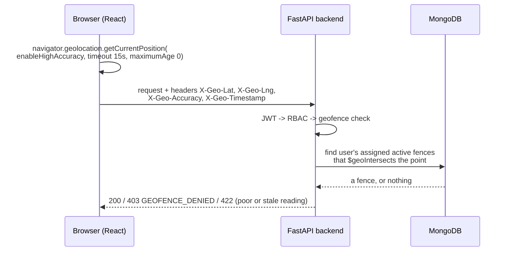
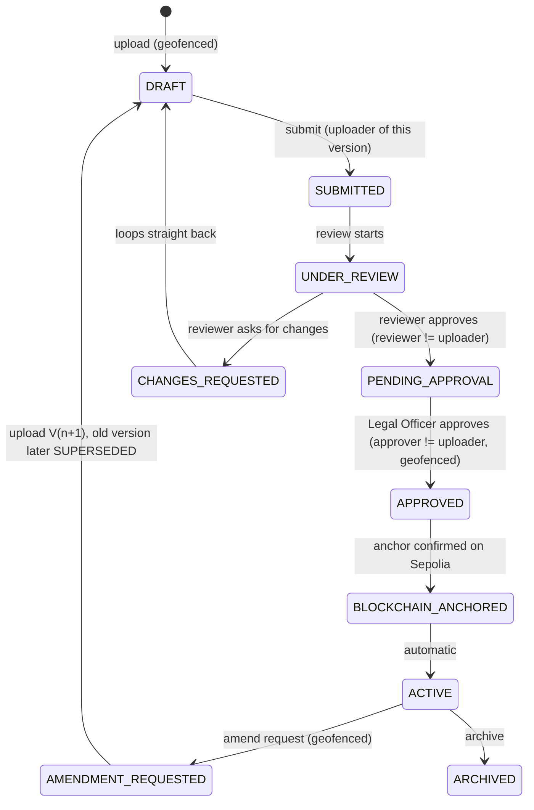

# GeoLegalVault, explained

*Written 2026-10-07 for a faculty presentation. Every statement is taken from the code or from `DECISIONS.md` as they stand at commit `e9f7870`. Where something is not in the code it says "not used". Where a claim is only partly true it says so. The dev database and the real `.env` values were not read or printed.*

**How to read the evidence tags.** `path::name` points at a file and function. `D-0xx` is an entry in `DECISIONS.md`. `SEC-xx / REL-xx / OPS-xx / CMP-xx` are findings in `PRODUCTION_READINESS.md`. "Guardrail #n" is a rule in `CLAUDE.md`.

---

## 1. What it is, and the problem it solves

GeoLegalVault is a prototype web application for an organisation (for example a records office or a law firm) that keeps sensitive legal documents. It does four things at once:

1. **Controls who can do what.** Five roles with different powers, and a "maker-checker" rule: the person who uploads a document can never be the person who approves it.
2. **Controls where they can do it from.** Uploading, downloading, approving and starting an amendment are only accepted if the user's reported location is inside an area an administrator assigned to them. This is a *policy* control, not a guarantee (section 3).
3. **Controls who can see what.** Every document has a secrecy level and every user has a clearance. A document above your clearance behaves as if it does not exist (section 4).
4. **Proves a file was not changed.** When a document is approved, its SHA-256 fingerprint is written to a public blockchain (Ethereum's Sepolia test network). Later, anyone allowed to verify can recompute the fingerprint from the stored file and compare it with the database and with the blockchain. A change to the file is *detected*. It is not *prevented*.

The word to use is **tamper-evident**, never "tamper-proof" (Guardrail #6).

---

## 2. Technology stack

### 2.1 What we use

| Technology | What it is | What it does in THIS project | Where |
|---|---|---|---|
| **Python 3.11+ / FastAPI 0.133.1** | A web framework | The whole backend: one program, organised in modules (auth, users, documents, versions, geofences, blockchain, verify, audit, reports) | `backend/app/main.py`, `backend/app/modules/*` |
| **MongoDB 7** via **Motor / PyMongo** | A document database; Motor is its async Python driver | Stores users, documents, versions, geofences, anchors, verification records, audit rows, login-throttle counters, refresh sessions. A geospatial (`2dsphere`) index lets it answer "is this point inside this polygon" | `core/db.py`, `docker-compose.yml` (`mongo`) |
| **RustFS** (dev, CI) / **Cloudflare R2** (production target) | S3-compatible private object storage. RustFS replaced MinIO because MinIO's images disappeared (D-034) | Holds the actual file bytes. Bucket is private; downloads happen only through a pre-signed link that expires in `STORAGE_PRESIGN_TTL_SEC` (default 60 s) | `services/storage.py`, `docker-compose.yml` (`storage`, `storage-init`) |
| **boto3** | AWS's S3 client library | Talks to RustFS/R2: put, get, head, delete, and signs the temporary download links | `services/storage.py` |
| **SHA-256** (Python `hashlib`) | A hash function: any file becomes a fixed 256-bit fingerprint; change one bit and the fingerprint changes completely | The integrity fingerprint, computed on the server from the exact uploaded bytes and again at verification | `services/hashing.py::sha256_bytes` |
| **Solidity 0.8.20** smart contract | A small program that lives on a blockchain | `DocumentAnchor`: stores, per (document id, version), a hash, an event type and a timestamp. Refuses a second record for the same (document, version). Only allow-listed "writer" addresses may write | `contracts/contracts/DocumentAnchor.sol` |
| **Hardhat 2.22.10** | A Solidity development toolkit | Compiles and tests the contract, runs a throw-away local chain for tests, and deploys to Sepolia | `contracts/hardhat.config.ts`, `contracts/scripts/deploy.ts`, `contracts/test/DocumentAnchor.test.ts` |
| **Ethereum Sepolia** | A public *test* blockchain (coins have no real value) | Where anchors are recorded. Chain id `11155111` | `core/config.py` (`CHAIN_ID`, `SEPOLIA_RPC_URL`) |
| **web3.py 7.6.1** | Python library for talking to Ethereum | Builds, signs and sends the `anchor()` transaction; reads `getAnchor()` back; checks receipts | `services/blockchain.py` |
| **RPC provider** | A company's server that relays our requests to the Ethereum network | The URL in `SEPOLIA_RPC_URL`. The code does not care which provider. `.env.example`, `config.py` defaults and `docs/DEPLOYMENT.md` suggest Alchemy. A pattern check of the local dev `.env` (counts only, nothing printed) found it is **not** an Alchemy or Infura URL and **does** match `publicnode` | `core/config.py`, `.env.example` |
| **JWT (PyJWT 2.15.1)** | A signed token proving "this request comes from user X" | 15-minute access token (kept in memory in the browser) plus a 7-day refresh token in an httpOnly cookie. Algorithm pinned to HS256, `alg: none` rejected, refresh tokens rotate and reuse revokes the whole session family | `core/security.py`, `modules/auth/service.py` |
| **Argon2id (argon2-cffi)** | A deliberately slow password-hashing function | Passwords are stored only as Argon2id hashes (library defaults, `PasswordHasher()`) | `core/security.py` |
| **python-magic** | Reads a file's real type from its first bytes | Upload check: the claimed content type must match what the bytes really are | `modules/documents/service.py::validate_upload` |
| **React 18 + TypeScript + Vite + Tailwind + TanStack Query + React Router** | The frontend stack | The user interface. It only *shows* what the server decides; it never decides access, location or integrity | `frontend/src/*`, `frontend/package.json` |
| **Browser Geolocation API** | The browser's own `navigator.geolocation` | Source of the location reading (section 3) | `frontend/src/hooks/useGeoLocation.ts` |
| **Docker Compose** | Starts several containers from one file | Local stack: `mongo`, `storage`, `storage-init`, a **placeholder** `hardhat-node` (does nothing), `backend`, and the opt-in `anchor-worker` | `docker-compose.yml` |
| **GitHub Actions** | Automated checks on every push | Three jobs, `backend`, `contracts`, `frontend` (section 8) | `.github/workflows/ci.yml` |
| **Sentry** (optional) | Error-tracking service | Only active if `SENTRY_DSN` is set | `core/sentry.py` |
| **Google Fonts** | Web fonts | The one third-party request the *browser* makes at page load (Inter and JetBrains Mono). Not a map, not location related | `frontend/index.html` |

### 2.2 Things people may assume we use but we do not

Checked by searching `backend/app`, `frontend/src`, `.env.example`, `docker-compose.yml`, `scripts/`, `contracts/` and `docs/DEPLOYMENT.md` (case-insensitive).

| Assumption | Used? | Evidence and what we use instead |
|---|---|---|
| **MetaMask or any browser wallet** | **Not used** | No wallet-connect UI exists in `frontend/src`. `services/blockchain.py` docstring: "there is no per-user MetaMask path and no user-triggered anchoring endpoint" (Guardrail #3). Users never sign anything. |
| **Who signs, then?** | One **backend service wallet** | The private key is the env var `SERVICE_WALLET_PRIVATE_KEY`, read in `services/blockchain.py::get_service_account()`. It lives in the gitignored `.env` locally and in the hosting platform's secret store in production (Guardrail #2). The same wallet deployed the contract, so it is the contract's `owner` and first allowed `writer`. The optional worker signs with the same wallet. |
| **Alchemy** | **Not required.** Only a suggestion | Appears only as the default placeholder URL in `.env.example` / `config.py`, in `docs/DEPLOYMENT.md` ("or another Sepolia RPC provider"), and as fake strings in tests. The dev `.env` does not use it (pattern check, see 2.1). |
| **Infura** | **Not used** | Only the word in a comment in `services/anchor_errors.py` (explaining why RPC URLs can hold secrets). |
| **IPFS** | **Not used** | Zero matches. File bytes go to R2/RustFS, never on-chain (Guardrail #1). |
| **IP-geolocation service** (ipinfo, MaxMind and similar) | **Not used** | Zero matches. The server does read the client IP (`request.client.host`) but only to write it in audit rows and for rate limiting. It never uses it to decide location. |
| **Wi-Fi scanning** | **Not used** | Zero matches. Whether the *browser* uses nearby Wi-Fi to estimate position is the browser's business (section 3.1). |
| **Third-party maps API** (Google Maps, Mapbox, Leaflet, OpenStreetMap) | **Not used** | Zero matches. D-027 explicitly says "no map library needed (text readout only)". Admins see the polygon's approximate centre as text (`GeofenceManagementPanel.tsx`). |
| **Hardware GPS attestation** | **Not used** | Explicitly out of scope (Guardrail #8). |
| **A message broker / microservices** | **Not used** | One FastAPI app plus one optional worker (Guardrail #10). |
| **Merkle trees, NLP, mainnet** | **Not used** | Out of scope (Guardrail #8). |

---

## 3. How location is obtained and checked

### 3.1 What the browser sends and how it gets it



- **How the browser gets it.** `frontend/src/hooks/useGeoLocation.ts::getCurrentLocation` calls `navigator.geolocation.getCurrentPosition` with `enableHighAccuracy: true`, `timeout: 15000`, `maximumAge: 0` (never a cached reading). It sends `lat`, `lng`, `accuracy` (the browser's own estimate in metres) and the reading's `timestamp`.
- **What the app controls and does not.** Standard browsers pick the source themselves: GPS on a phone, nearby Wi-Fi networks, mobile-cell towers, or the network address, whichever the device offers. The app can ask for "high accuracy" and can read the `accuracy` number. It **cannot tell which source was used** and does not try to.
- **Does the app read the IP address or Wi-Fi itself?** No. Not for location. Searching the code: there is no IP-geolocation lookup and no Wi-Fi access. The server reads `request.client.host` only to store it in audit rows (`services/geofence.py::check_location`, `modules/documents/router.py`) and in rate limiting.
- **Transport.** Headers `X-Geo-*` (`frontend/src/api/http.ts::geoHeaders`). The server also accepts the same four fields in a form or JSON body (`services/geofence.py::_extract_location_payload`).
- **The browser is only a messenger.** `LocationGate.tsx` and `useGeoLocation.ts` say in their comments that they never decide allow or deny.

### 3.2 What the backend validates

All of it in `backend/app/services/geofence.py`. The geofence dependency runs **after** login (JWT) and role check (RBAC), **before** the file checks and the action (Guardrail #5).

| Check | Rule | Result if it fails |
|---|---|---|
| Location present and well-formed | `LocationInput`: lat in [-90, 90], lng in [-180, 180], accuracy ≥ 0 | `422 INVALID_LOCATION` (missing fields count too: "fail closed") |
| Accuracy | `accuracy > GEO_ACCURACY_MAX_M` (default **100 m**) | `422 LOCATION_LOW_CONFIDENCE` |
| Freshness | reading older than `GEO_FRESHNESS_MAX_SEC` (default **60 s**) | `422 LOCATION_STALE` |
| Inside a fence | MongoDB `$geoIntersects` of the point against the user's assigned, **active** fences | `403 GEOFENCE_DENIED`, plus an audit row `GEOFENCE_DENIED` with the coordinates |
| User has no fence | the list is empty, so nothing can match | `403 GEOFENCE_DENIED` (an unassigned user can do nothing geofenced) |

**Partly true, said plainly:**
- The freshness check only rejects *old* timestamps (`age_sec > max`). A timestamp in the future is not rejected, so a captured set of headers whose timestamp was set far ahead would stay "fresh". This is finding SEC-12 in `PRODUCTION_READINESS.md`; I re-read `geofence.py` and `DECISIONS.md` and found no fix.
- `GEOFENCE_ALLOWED_BBOX` is **not** a check on the user's location. It is an optional box that every *vertex of a fence an administrator is creating or editing* must fall inside (`modules/geofences/bbox.py`, router `_enforce_allowed_region`, `422 GEOFENCE_OUTSIDE_REGION`). It guards against a mis-typed fence (D-027), and it is off by default.
- There is no minimum interval or replay protection beyond the 60 s window.

### 3.3 Which actions are geofenced

Read from `Depends(require_geofence(...))` in the routers:

| Geofenced (location required) | Not geofenced |
|---|---|
| Upload a document or a new version (`POST /documents`) | Login, logout, refresh |
| Download a document (`GET /documents/{id}/download`) | List / open a document, version history |
| Approve (`POST /documents/{id}/approve`) | Submit for review, Review (approve or request changes) |
| Request an amendment (`POST /documents/{id}/amend`) | Archive, Verify, clear an integrity flag (D-025: "administrative integrity action") |
| Administrator re-queue of a stuck anchor (`POST /blockchain/anchors/{id}/retry`) | User, geofence, audit and report administration |

Two documents say less than the code does. `CLAUDE.md` #5 and `PROJECT_ANALYSIS.md` name upload, approve and amend only; the code also geofences **download** and the **anchor re-queue**.

### 3.4 The geofence model

**Answering the question directly: "Can the uploader's location be only one fixed point?" No.** The permitted place is a **polygon** (an area with straight edges), not a point and not a radius.

- **Shape.** A GeoJSON `Polygon` in the field `region`, coordinates in **[longitude, latitude]** order, closed ring, at least 4 positions, at most 100 vertices per ring (`modules/geofences/schemas.py`, `models.py::MAX_POLYGON_VERTICES`). Inside or outside is decided by MongoDB's `$geoIntersects` on a `2dsphere` index.
- **`center` and `radius_m`: stored, not used for the decision.** The schema accepts an optional `center` point and `radius_m`. They are saved, but nothing in `check_location` reads them. `center` is only range-checked against the optional box. So this is **not** a "radius around a point" model.
- **Several fences per user: yes.** A user document has `assigned_geofence_ids: list`. The query asks for *any* active assigned fence that contains the point (`"_id": {"$in": object_ids}`), so being inside **one** is enough.
- **Different fences for different users: yes.** An Administrator (permission `users:manage`) edits a user's list with `PATCH /users/{id}` (UI: inline edit in the user table, D-001). Fences are created, edited and deactivated by the Administrator (`geofence:manage`; there is no hard delete, only `active: false`).
- **What is not possible.** A fence per document, per action, per time of day, or a rule like "inside fence A *and* B". The fence belongs to the user, and the same set applies to every geofenced action.

**Example (shape of the stored data, values from the seeded demo):**

```jsonc
// collection "geofences"
{ "_id": "…f1", "name": "HQ Campus (demo)", "active": true,
  "region": { "type": "Polygon",
              "coordinates": [[ [78.14,11.66], [78.16,11.66], [78.16,11.68],
                                [78.14,11.68], [78.14,11.66] ]] } }   // [lng, lat]

// collection "users"  (two different users, different fence lists)
{ "email": "authorized_staff@…", "role": "AUTHORIZED_STAFF",
  "assigned_geofence_ids": ["…f1"] }                  // one area
{ "email": "legal_officer@…",    "role": "LEGAL_OFFICER",
  "assigned_geofence_ids": ["…f1", "…f2"] }           // either area is accepted
```

Point `lat 11.67, lng 78.15` is inside `f1` (the seeded `HQ_INSIDE_POINT`). Point `lat 11.00, lng 77.00` (`HQ_OUTSIDE_POINT`, about 100 km away) is outside. In the demo seed (`scripts/seed.py --demo`) all five demo users get the same single fence.

### 3.5 Honest limits

| Threat | What we do | What we cannot prevent |
|---|---|---|
| **GPS spoofing** (browser DevTools "Sensors" override, fake-GPS phone apps, hand-built requests) | Server-side decision only; the browser's "allowed" is never trusted. Fail closed on poor accuracy or old readings. Every denial is audited. | A user who can make the browser (or a script) *say* "I am at the office" is believed. The server has no independent evidence of position. `THREAT_MODEL.md` row 14: residual risk **High (accepted)**. |
| **VPN** | Nothing specific. | A VPN changes the network address, which matters only where a device estimates location from it. It does not directly move a GPS reading. Combined with a spoofed coordinate it is irrelevant because the server never looks at the address. |
| **Emulators / virtual machines** | Nothing. | They can report any coordinate. |
| **Desktop browsers with coarse location** (Wi-Fi or network-address based) | The 100 m accuracy limit rejects readings the browser itself calls imprecise. | This is general browser behaviour, not something in this repo: such readings often report accuracy worse than 100 m, so honest desktop users can be refused with `LOCATION_LOW_CONFIDENCE`. Raising the limit weakens the check. |
| **Replay of captured headers** | 60 s freshness window. | Future-dated timestamps are accepted (SEC-12, above). |
| **A fence typed wrongly (lat and lng swapped)** | `D-027`: range checks plus optional `GEOFENCE_ALLOWED_BBOX` plus an advisory admin preview. | A swap where |real longitude| ≤ 90 (all of India, Europe, Africa, including the demo fence) is a valid point and is **accepted** unless the box is configured and the swapped point falls outside it. Even with a box, a swap that stays inside the box is missed. |

**Which text to quote.** Spoofing is covered by `THREAT_MODEL.md` (row 14 and "Honest limitations" 1) and `CLAUDE.md` #6. **D-027 is about something else**: the swapped-coordinate mistake when defining a fence. Do not cite D-027 for spoofing.

**One-line message for the audience:** geofencing here is a *policy-level* control. Blockchain anchoring, not geofencing, is what provides the tamper-evidence.

---

## 4. Lifecycle and roles

### 4.1 States

The real list (`DocumentStatus` / `VersionStatus` enums) has eleven values: `DRAFT, SUBMITTED, UNDER_REVIEW, PENDING_APPROVAL, CHANGES_REQUESTED, APPROVED, BLOCKCHAIN_ANCHORED, ACTIVE, AMENDMENT_REQUESTED, SUPERSEDED, ARCHIVED`. Plain-language mapping to the list you gave: "reviewed" = `UNDER_REVIEW` then `PENDING_APPROVAL`; "anchored" = `BLOCKCHAIN_ANCHORED`; "amended" = `AMENDMENT_REQUESTED`, then a new version starts again at `DRAFT`.



Notes from `documents/workflow.py`:
- **Review is one call.** `review()` moves `SUBMITTED -> UNDER_REVIEW` and straight on to `PENDING_APPROVAL` (or `CHANGES_REQUESTED -> DRAFT`), so a user rarely sees `UNDER_REVIEW`. `DEMO_SCRIPT.md` shows it; `DEMO_RUNBOOK.md` says say only what is on screen.
- **Approval triggers anchoring automatically** and never raises on a chain failure. The document stays `APPROVED` and is picked up later (section 7). No user has an "anchor" button (Guardrail #3).
- **Immutable versions.** An amendment never edits V(n). It creates V(n+1) with `prev_version_hash` = V(n)'s hash. V(n) is only ever marked `SUPERSEDED` (Guardrail #7).
- **Atomic transitions.** Every transition is a compare-and-swap (`_claim` / `documents_service.claim_status`, D-023): if two requests race, exactly one wins and the other gets `409 ILLEGAL_TRANSITION`.

### 4.2 Maker-checker

`core/rbac.py::enforce_maker_checker` raises `403 MAKER_CHECKER_VIOLATION` when the actor equals the uploader of the current version. It runs in `review()` and `approve()`. The UI also hides the buttons (D-008), but the server enforces it. The reason is plain separation of duties: nobody marks their own work as checked, so one dishonest or mistaken person cannot push a document to "official" alone. In addition, the role map gives **no role both review and approve rights** (Reviewing Officer has `review:perform`, Legal Officer has `approve:perform`).

### 4.3 The five demo roles

From `ROLE_PERMISSIONS` in `core/rbac.py`. Clearance values are the **seed defaults** in `core/clearance.py::PROPOSED_ROLE_CLEARANCE`; the clearance that counts is whatever is stored on each user in the database, which I did not read.

| Role (demo account prefix) | Can | Cannot | Seed clearance |
|---|---|---|---|
| **Legal Officer** (`legal_officer@…`) | Upload, view, search, submit, amend, archive, **approve**, verify, see stuck-anchor list | Review; manage users, fences or audit; approve what they uploaded | RESTRICTED |
| **Authorized Staff** (`authorized_staff@…`) | Upload, view, search, submit, amend, verify | Review, approve, archive; any admin function | CONFIDENTIAL |
| **Reviewing Officer** (`reviewing_officer@…`) | View, search, **review** (approve or request changes), verify | Upload, submit, approve, amend, archive; review what they uploaded (they cannot upload anyway) | RESTRICTED |
| **Auditor** (`auditor@…`) | View, search, verify, **read the audit log**, see stuck-anchor list. Read-only everywhere | Change any document or user; geofence admin | RESTRICTED |
| **Administrator** (`administrator@…`) | Manage users (role, fences, clearance), manage geofences, view audit, archive, clear an integrity flag, view and **re-queue** stuck anchors, view/verify documents | Upload, submit, review, approve, amend (separation of duties, `rbac.py` comment); read a document above their own clearance | INTERNAL |

Facts worth stating: the **demo has exactly one Legal Officer**, so if that person uploads a document, nobody else can approve it. Run the main demo with Authorized Staff as the uploader. Passwords: the demo password is printed by `scripts/seed.py --demo` and written in `docs/DEMO_SCRIPT.md`; it is not in `README.md` despite the usual convention. None is reproduced here.

### 4.4 Clearance (SEC-02, D-051, D-052, Guardrail #13)

- Five ordered levels: `PUBLIC < INTERNAL < CONFIDENTIAL < RESTRICTED < TOP_SECRET` (`core/clearance.py::LEVELS`). Each **document** gets one at upload and it is **fixed** (`CLASSIFICATION_IMMUTABLE`). Each **user** has one. You may upload only at or below your own.
- A user sees a document only if their clearance reaches its level. Anything unknown is treated as the lowest level (deny by default).
- **A hidden document is a 404, not a 403.** `documents/access.py::load_visible_document` returns the same "not found" as for an id that does not exist, so a low-clearance user cannot even learn it is there. Lists, search, counts and reports filter in the database query (`visible_classifications`), so a hidden document is never fetched then dropped. A refused attempt on an existing document is audited as `ACCESS_DENIED`.
- Only an Administrator changes clearance, audited old to new, and nobody changes their own (`403 SELF_CLEARANCE_CHANGE`).
- **No automatic content access for anyone.** The Administrator needs clearance like everyone else. The Auditor sees every audit row but its `meta` is blanked when the target is above their clearance.
- **Limits (Guardrail #13):** this is application-level access control, **not encryption**: someone with database or storage access sees everything. It is not a per-client or per-matter "ethical wall" (still open under SEC-02). The stuck-anchor list and audit rows deliberately still show that a hidden document exists (id, status), with its title replaced by a placeholder.

---

## 5. Hashing and the blockchain, step by step

### 5.1 Worked example

Take a tiny file whose content is the text `Hello GeoLegalVault`.

| Step | What happens | Where in the code |
|---|---|---|
| 1 | Authorized Staff uploads it from inside the fence. Server checks login, role, location, size (≤ `MAX_UPLOAD_MB`, default 10), content type vs real bytes. | `documents/router.py::upload_document`, `services/geofence.py`, `documents/service.py::validate_upload` |
| 2 | **Server computes SHA-256** of the exact bytes: `d5ef85932cbc2f9416a606bdc58a786de009548b53e3261e5442c6c2b01eb039`. Change one letter (`...VaulT`) and it becomes `3f874f595bcec53a2058aeccb95b79f6e0cf54f75fccca9dc13c8ecf67467ddc`. (Both values were produced with `sha256sum` during this review.) | `services/hashing.py::sha256_bytes` |
| 3 | Bytes go to private storage under a **server-made, content-addressed key**: `docs/{document_id}/v1-{sha256}`. The user's filename is never used (this blocks path tricks), and two different files can never share a key, so a later upload cannot overwrite an earlier object. | `services/storage.py::build_version_key` |
| 4 | Metadata goes to MongoDB: a `documents` row (title, type, classification, status, owner) and a `document_versions` row (`version_no`, `sha256`, `prev_version_hash`, `storage_key`, `size_bytes`, `mime`, `status`, `uploaded_by`, `anchored`). | `versions/service.py::insert_version` |
| 5 | Submit, review, approve (section 4). On approve, the document status is atomically claimed, then anchoring starts. | `workflow.py::approve` |
| 6 | The backend **service wallet** builds and signs a transaction calling `anchor(documentId, version, hashBytes32, eventType)` on the contract. `documentId` is the Mongo id as text, `version` is 1, `hash` is the 32 raw bytes of the SHA-256, `eventType` is `1` (APPROVED). Sends are serialised with a lock to avoid two using the same transaction counter. | `services/blockchain.py::anchor_hash`, `modules/blockchain/service.py` |
| 7 | The contract checks the sender is an allowed writer and that this (document, version) was never anchored, then stores `{hash, version, eventType, timestamp}` and emits `AnchorCreated`. The transaction is mined into a block. | `DocumentAnchor.sol::anchor` |
| 8 | Once the transaction has `ANCHOR_CONFIRMATIONS` (default 1) confirmation, the anchor row becomes `CONFIRMED`, the version `BLOCKCHAIN_ANCHORED`, then `ACTIVE`. | `workflow.py::promote_confirmed_anchor`, `complete_promotion` |

### 5.2 What is stored where

| Place | What | Never |
|---|---|---|
| **Object storage** (R2 / RustFS) | The file bytes | Is never public; never streamed through the API |
| **MongoDB** | Titles, tags, classification, statuses, version rows with the hash, anchor rows (tx hash, block, status), users (password hash), audit rows, verification results | No file bytes |
| **Blockchain** (Sepolia) | Only `documentId`, `version`, `hash`, `eventType`, `timestamp` | **No** file content, filename or personal data (Guardrail #1). The contract has no such field. |

```
 file bytes ──► SHA-256 ──► hash ─┬─► MongoDB (version row)
      │                           └─► Sepolia contract  (documentId, version, hash, event, time)
      └────────────────────────────► private object storage (docs/{id}/v1-{hash})
```

### 5.3 What anchoring proves, and what it does not

- **It proves:** this exact fingerprint was submitted for this (document id, version) by our service wallet no later than that block's time. Therefore a file that no longer hashes to it has changed since.
- **It does not prove:** that the content is true, that the uploader was honest, who wrote it, or that the people named in it are real (`THREAT_MODEL.md`, limitation 5). It does not stop anyone changing a file or the database; it makes the change *detectable*.
- **Only the approved file bytes are covered.** Statuses, approval history, ownership, clearance, and the audit log itself can be edited by someone with database access without the chain noticing (CMP-04).
- **Single signer.** One backend key signs every anchor. Anchoring integrity depends on that key staying secret (threat-model limitation 3, BC-02).

### 5.4 Testnet versus mainnet, and gas

Sepolia is a free practice network that works like Ethereum but whose coins have no value, so a prototype can anchor without spending money; it can also be reset, which is why every anchor's transaction hash is also stored in our own database. Gas is the fee paid per transaction in the chain's coin; here a faucet gives the service wallet free test coin, and `PRODUCTION_READINESS.md` (BC-03) measured about 0.0000742 test-ETH per anchor. On the real network (mainnet) the same transaction would cost real money, and mainnet is out of scope (Guardrail #8).

---

## 6. Verification: the 3-way check

`modules/verify/service.py::verify_version` compares three independent values:

```
 A. recomputed  = SHA-256 of the file bytes read from storage right now
 B. stored      = sha256 in the MongoDB version row
 C. on-chain    = hash read live from the contract (getAnchor)

 VERIFIED  only if  A == B  and  A == C   (constant-time compare, hmac.compare_digest)
```

Because the chain value is outside our database, editing the database *and* the file together still disagrees with C.

### 6.1 The six outcomes

| Outcome | Meaning | Flag on document | Colour in UI |
|---|---|---|---|
| **VERIFIED** | All three agree | none | green |
| **MISMATCH** | The chain has an anchor and A, B, C do not all agree; or the file differs from the recorded hash while the chain cannot be read (a swapped file is provable without the chain) | `integrity_flag = TAMPERED`, audit `VERIFY_FAIL` | red |
| **NOT_ANCHORED** | The chain has no anchor **and** nothing in the database claims the version was ever anchored (for example a draft) | none | grey |
| **CHAIN_UNREACHABLE** | The chain could not be read (RPC down, timeout, not configured, bad reply). **No verdict** | none (audited `VERIFY_CHAIN_UNREACHABLE`) | amber |
| **ANCHOR_MISSING** | The database says the version *was* anchored, the chain definitively says no anchor (or no contract at that address, e.g. a testnet reset), and the file still matches its recorded hash | `UNCONFIRMED`, audited | red |
| **FILE_MISSING** | The storage service answered "no such object" for a version that points at it | `UNCONFIRMED`, audited | red |

Anything else on the storage side (an outage) gives HTTP `503 STORAGE_UNAVAILABLE`, an audit row, and no verdict.

### 6.2 Why "chain unreachable" is never reported as "tampered" (REL-04, D-049)

Before D-049, any error reading the chain was silently turned into "no anchor", so a healthy document verified as a soft grey "NOT ANCHORED" during an outage, and a tampered one could hide behind the same result. Two opposite mistakes are both false statements: calling an outage "tampered" accuses a document of something unproven, and calling it "not anchored" lets real tampering look harmless. So an unreadable chain is its own result, "could not check", with no flag. For the same reason a testnet reset or lost object is `UNCONFIRMED` ("could not be confirmed"), not `TAMPERED`, which would overstate (Guardrail #6). The on-chain read is also bounded by `CHAIN_READ_TIMEOUT_SEC` (default 10 s, no retries); previously a stuck node could hold a request for about 150 s.

**Known remaining gap (D-049 limits):** an attacker who edits the stored hash, the version number, *and* every database field that says "anchored", and also deletes the confirmed anchor row, can still get a grey `NOT_ANCHORED`. Closing that needs an event-log reconciliation job or a chain-derived lookup key; both are deferred.

---

## 7. Reliability and security measures, in plain language

| Measure | In plain words | Where |
|---|---|---|
| **Atomic state transitions** | Each status change is "change it only if it is still what I expect". If two people click at once, one succeeds and one gets a 409, so no double-anchoring or contradictory history. | `workflow.py::_claim`, `documents/service.py::claim_status` (D-023) |
| **Content-addressed storage keys + concurrent amendment guard** | A duplicate or retried upload cannot overwrite earlier bytes, which previously could produce a falsely "tampered" version (REL-03). | `storage.py::build_version_key`, D-022..D-024, D-029, D-048 |
| **Anchor never blocks approval** | If the chain is down, the document stays `APPROVED`, the user gets a normal answer, and a retry happens later. | `workflow.py::approve` |
| **Anchor retry with backoff (REL-01)** | One optional background worker re-sends failed anchors: waits start at 30 s and double up to 15 min, up to 8 tries (2 for a contract revert, a longer schedule for "out of funds"). Before sending it asks the chain whether the anchor already exists, so it never double-spends; the contract's `already anchored` revert is the real duplicate guard. A lease lets two workers avoid wasted work. Documents stuck longer than 7 days wait for an administrator to re-queue them. | `workers/anchor_confirmer.py`, `modules/blockchain/retry.py`, D-037..D-044, `config.py` `ANCHOR_*` |
| **The worker is opt-in** | `docker compose --profile worker up -d anchor-worker`. Nothing forces it to be deployed; without it a failed anchor waits for an administrator, the Dashboard shows an alert and `/health` reports `anchor_worker: stale`. | `docker-compose.yml`, `CLAUDE.md` #10 "Known limits" |
| **Re-queue is a request, not a signature** | An Administrator can ask for a stuck anchor to be retried; the API never contacts the chain and accepts only a reason, never a hash or address. | `blockchain/router.py::requeue_anchor`, D-041 |
| **Upload size limit before login** | The request size is enforced while the body streams, before it is read, so an unauthenticated caller cannot make the server swallow a huge file. Upload cap = `MAX_UPLOAD_MB` plus 1 MiB framing; other requests `MAX_JSON_BODY_KB` (1024). The multipart body is parsed only after login, role and location checks. | `core/body_limit.py`, `documents/router.py::upload_document`, D-028, D-033 |
| **Login rate limiting** | 5 failed attempts per email per 60 s, stored in MongoDB so it is shared by instances. There is also a global per-IP limiter (120 requests/min) that is in-memory per process and trusts the first `X-Forwarded-For` value (SEC-10, open). | `modules/auth/service.py`, `core/rate_limit.py` |
| **Passwords, tokens, roles** | Argon2id; 15-min access token; refresh rotation with reuse detection; the user's role and active flag are re-read from the database on every request so a demotion applies immediately. | `core/security.py`, `core/rbac.py`, `core/deps.py` |
| **Audit log** | Every significant action (login, upload, submit, review, approve, anchor ok/fail, verify result, denials, user and geofence changes) writes a row. The code has **one write function (insert) and no update or delete function or route**. This is "append-only by convention". It is an ordinary MongoDB collection under the application's own credentials: someone with database access can rewrite it, and there is no hash chain (CMP-01, finding proposed, with its tests, in commit `7e154a1`; not built). | `modules/audit/service.py`, `audit/router.py` |
| **Sanitised error codes** | An RPC URL can contain an API key, and the raw exception text can carry it. Anchor failures are stored and returned as fixed codes (for example `RPC_UNREACHABLE`, `INSUFFICIENT_FUNDS`, `REVERTED`, `STORED_OBJECT_MISSING`); the full text goes only to server logs with URL secrets masked. Verification `reason` values are likewise fixed codes. | `services/anchor_errors.py`, D-020, D-049 |
| **Startup refuses placeholders** | Outside development the app will not start if the JWT secret, database URI, storage keys, RPC URL, wallet key or contract address is still a placeholder. It does not check secret *strength* (SEC-09, open). | `core/config.py` |
| **Dependency scanning in CI** | `pip-audit -r requirements.txt --no-deps` (a known-vulnerability gate that fails the build) and `npm audit --omit=dev --audit-level=high`. | `.github/workflows/ci.yml` |
| **Other** | Private bucket and 60-s pre-signed downloads; claimed type must match real bytes; security headers (`X-Content-Type-Options`, `X-Frame-Options`, `Referrer-Policy`, `Cache-Control: no-store`, HSTS outside dev); Pydantic validation at every boundary; typed Mongo filters (no string-built queries). | `services/storage.py`, `core/security_headers.py` |

---

## 8. Testing and quality

| Area | Number | How I got it | Fresh or recorded |
|---|---|---|---|
| **Backend tests** | **346** | `pytest --collect-only` on `backend/` (no database touched; nothing was run against the dev DB or Docker) | **Fresh count of tests that exist.** |
| Backend last full run | 346 passed, 0 failed, **94.27 %** coverage (gate: 60 %), on Windows with CI's five variables only | `DECISIONS.md` D-052 verification | **Recorded, not fresh.** I did not re-run the suite: it needs Mongo, storage and a local Hardhat node and takes 6 to 8 minutes, so it cannot be run without touching Docker. |
| **Frontend tests** | **127 tests in 21 files, all passed** (about 104 s) | `npx vitest run` in `frontend/` (the tests use mocked API calls and need no database) | **Fresh.** Matches D-052. |
| **Contract tests** | 10 test cases in one file | Counted `it(` in `contracts/test/DocumentAnchor.test.ts` | Static count, **not run** here. CI runs it. |
| Test files in backend | 37 | file count under `backend/tests` | Fresh |

Test styles: unit (hashing, geofence maths, clearance, security primitives), API (authorisation matrix of role by endpoint, geofence, audit, anchor error exposure), integration against a **real** MongoDB, a real S3-compatible store and a **real local Hardhat chain** (no mocking of the three core services), including a Hardhat node killed and restarted mid-anchor and two workers racing as two OS processes.

**CI jobs** (`.github/workflows/ci.yml`, runs on every push and pull request, `ubuntu-24.04`):

| Job | Steps |
|---|---|
| `backend` | install Python and Node, compile contracts, start Mongo and RustFS with Docker, `ruff` lint, **`pip-audit`**, `pytest` (coverage gate 60 %) |
| `contracts` | `npx hardhat test` |
| `frontend` | `npm audit` (production, high), `eslint`, `vitest`, `vite build` |

**What the CI failure on pymongo means.** I read the latest run with `gh run view` (read-only). Run `37458277076`, on `main` for commit `e9f7870` ("CLAUDE.md: add guardrail #13…"), failed in the `backend` job at the step **"Dependency audit"**. `pip-audit` reported **4 known vulnerabilities in `pymongo 4.9.2`**: `CVE-2026-88029` (fixed in 4.18.1) and `CVE-2026-96747`, `-96748`, `-96749` (fixed in 4.18.2). The `contracts` and `frontend` jobs passed; the `pytest` step was **skipped** in that run because the audit gate failed first, so that run says nothing about whether the tests pass. In plain terms: a security advisory was published for a library we depend on, and our own rule (fail the build on a known vulnerability) tripped. It is not a bug introduced by the latest commit. Why it is not a one-line fix: `pymongo` is not in `requirements.txt`; it is pulled in by `motor==3.6.0`, which requires `pymongo>=4.9,<4.10`, so reaching 4.18.x means upgrading or replacing Motor. The app also imports `pymongo` directly (`ReturnDocument`, `DuplicateKeyError`). I did not read the advisories and cannot say whether they are exploitable in this configuration.

---

## 9. Honest status

**Complete and tested** (see sections above): authentication and role-based access with a role by endpoint test matrix; server-side geofencing; upload pipeline; immutable versioning; the lifecycle state machine with atomic transitions; anchoring on a real contract with retry, a deployable worker and an administrator re-queue; the 3-way verification with six outcomes; clearance-based document access; audit logging; the full React UI; CI with vulnerability gates.

**Known pending, presented as future work** (all in `PRODUCTION_READINESS.md` unless noted):

| Item | State |
|---|---|
| **pymongo advisories / Motor upgrade** | Open. CI is red on `main` because of it (section 8). |
| **SEC-03** account lock-out abuse | Open. The 5-per-minute counter is keyed by email only, so anyone can keep a named account (including the administrator) locked out. No fix in `DECISIONS.md`. |
| **SEC-01** password change or reset, and MFA | Open. No endpoint changes a password; the Settings form is a dead end. The administrator sets every password. |
| **OPS-01** backup and restore | Open. Backup covers MongoDB only, with no restore script and no object-storage backup. Because versions are immutable, a lost file cannot be rebuilt (only its hash survives on-chain). |
| **CMP-01** audit hash chain | Proposed with tests, not built. The audit log can be edited by someone with database access. |
| **SEC-04** malware scanning | Not implemented. Validation is size plus type-versus-bytes only. |
| **Per-matter access ("ethical wall")** | Not built. Clearance is one ordered level per user (SEC-02 remainder). |
| **Accessibility** | Open (FE-02): most inputs are placeholder-only, no skip link, no automated accessibility test. |
| **Performance** | Not measured under load (OPS-03, threat-model limitation 6). Everything is prototype-scale. |
| SEC-12 future-dated location timestamps | Open (section 3.2). |
| Also open | No notifications (FUN-01); no audit export (FUN-03); no retention or deletion (CMP-02); the in-process 120/min limiter; the real Sepolia run, the worker container and a cross-host race are listed as "not exercised" in `CLAUDE.md` #10. |

`PRODUCTION_READINESS.md` (dated 2026-10-01) is partly stale: SEC-02, REL-01, REL-03, REL-04, SEC-07 and several others have been fixed or partly fixed since (D-020 to D-052). Always read the "Update" notes in it together with `DECISIONS.md`.

---

## 10. Live demo script (about 10 minutes)

Use `DEMO_RUNBOOK.md` for set-up and recovery (it covers the port clash with another project, a preflight for the chain settings, and a rehearsal checklist). **Passwords: use the shared demo password (see 4.3); none is written here.** Use three browser windows, one per role, and log in fresh just before starting (access tokens last 15 minutes).

**Do not follow `docs/DEMO_SCRIPT.md`'s role order.** It has the Legal Officer upload and also approve, which the server forbids (`MAKER_CHECKER_VIOLATION`). Use this order instead.

| Min | Window / role | Action | Say (and point at) |
|---|---|---|---|
| 0:00 | Staff | Log in as **Authorized Staff**. Open Geofence Status. | "The browser reports a location claim. The server decides inside or outside." Show the coordinates (DevTools Sensors set to the demo point: lat 11.67, lng 78.15). |
| 1:00 | Staff | **Negative case 1: outside the fence.** Set Sensors to lat 11.00, lng 77.00 and try an upload. | Expect `GEOFENCE_DENIED`. "Denied by the server, and recorded." Then set it back inside. (Say: "Anyone who can fake this input is believed. That is why this is a policy control.") |
| 2:00 | Staff | Upload a small text or PDF file, classification **CONFIDENTIAL** or lower. | Show status `DRAFT` and the SHA-256. "File in private storage under a server-made key. Only the fingerprint goes to the blockchain, never the file or its name." Click **Submit**. |
| 3:00 | Reviewer | Log in as **Reviewing Officer**. Open the document, **Review → Approve review**. | "The checker confirms the content. Not the blockchain step." |
| 3:45 | Legal | Log in as **Legal Officer**. Open it, **Approve**. | "There is no anchor button. Approval triggers it, and the backend's own wallet signs, never the user." Wait for `ACTIVE`. |
| 4:45 | Legal | Version history, **View on-chain**. Open Etherscan **only if running on real Sepolia** (the link is hard-coded to Sepolia). | "Public, independent of our database. It holds a hash, not the file." |
| 5:30 | Legal | **Negative case 2: uploader cannot approve.** On a *second*, throw-away document uploaded by the Legal Officer and reviewed by the reviewer, show that Approve is missing for the uploader. | "The server also refuses it with `MAKER_CHECKER_VIOLATION`." (The unit test is `tests/api/test_rbac.py`.) |
| 6:15 | Admin | **Negative case 3: low clearance.** Log in as **Administrator** (seed clearance INTERNAL). Open the repository, then the first document's link directly. | "It is not in the list, and opening it says 'not found', the same as a document that never existed. Not 'forbidden'." Re-check the stored clearances in rehearsal, since the seed values are defaults. |
| 7:15 | Terminal | **Negative case 4: tamper.** Run `python demo/tamper.py "<exact title>"` on **this demo document only** (it changes one byte in storage, as someone with storage access could; the file is untracked in git). | "This bypasses the application on purpose." |
| 8:00 | Auditor or Legal | Document → **Verify** | Expect red **MISMATCH**; three hashes shown, recomputed differs. Say: "It does not prevent the change. It makes it evident." |
| 9:00 | Auditor | **Audit log** | Show `GEOFENCE_DENIED`, `APPROVE`, `ANCHOR_OK`, `VERIFY_FAIL`. Close with the limits: location is spoofable, one wallet signs, test network only, audit log not yet hash-chained. |

Positive cases covered: in-fence upload, review, approve, anchor, on-chain read. Negative: outside fence, uploader cannot approve, hidden document, tampered file.

**Documents NOT to demo.** Five old development documents have **no stored file** (their objects are missing, created 2026-08-29 with old-style keys; recorded in `DECISIONS.md`, REL-01 outcome, checked on 2026-10-05, the database may have changed since): **"Approval Demo", "Manual Verify NDA", "Test Contract", "Lifecycle Test", "Anchor Demo"**. Verifying them gives `FILE_MISSING` or a failure, not a clean result. "Approval Demo" (stuck in `APPROVED`, 36 days old at that check) will also show in the Dashboard stuck-anchor alert. Always demo from one fresh upload.

**Actions not to try live:**
- `python scripts/seed.py --seed-documents` (sends many real blockchain transactions and spends test coin).
- `docker compose --profile worker up` (starts the signer, may re-send old stuck anchors).
- `docker compose down -v`, `docker volume prune`, `docker system prune` (deletes users, fences and anchored documents).
- `git clean` (would delete the untracked `demo/tamper.py`).
- Running `tamper.py` on any document you still need: it flags the document `TAMPERED` and only an administrator can clear that, after the bytes are restored (D-025).
- The administrator "re-queue" on the old stuck documents; the Etherscan click on a local chain.
- Anything needing internet that you have not rehearsed (Sepolia can be slow or rate-limited).

---

## 11. Likely faculty questions, with honest short answers

1. **Why a blockchain instead of just a database?** A database can be edited by whoever administers it, and you would have to trust them. A hash on a public chain is outside our control, so editing our database and file together still disagrees with it. We use the chain only for one fact (a fingerprint existed at a time), not as a database.
2. **Why a testnet?** It is free, public and works like the real network, which is enough to show the design. It can be reset, so we also keep every transaction hash locally. Mainnet is out of scope and would cost real money.
3. **Can the location be spoofed?** Yes. Browser GPS can be overridden with developer tools, fake-GPS apps or scripts, and the server has no hardware proof. The server never trusts a client "allowed" flag and rejects poor or old readings, but a determined user can claim any position. It is a policy control, and we say so (`THREAT_MODEL.md` row 14, accepted risk).
4. **Why SHA-256?** It is a standard, well-studied hash with no known practical collision attack. It changes completely if one bit changes, and its 32-byte output fits exactly in the contract's `bytes32` (`services/hashing.py` docstring).
5. **What if the blockchain is down?** Approval still succeeds; the document waits in `APPROVED` and a worker (if deployed) retries with backoff, otherwise an administrator is alerted. Verification during an outage says **CHAIN_UNREACHABLE** ("could not check"), never "tampered" (D-049).
6. **What if someone edits the database directly?** If they change a file or its stored hash, the next verification disagrees with the chain and shows MISMATCH. If they change status, ownership, clearance or audit rows, the chain does not notice (CMP-04). The audit log has no hash chain yet (CMP-01).
7. **Who pays gas and who holds the key?** The organisation, through one backend service wallet. The private key is an environment variable on the server (never in git or the browser). Users never hold wallets. On Sepolia the funding is free faucet coin.
8. **Can the admin read every document?** No. The Administrator has no automatic content access: they need clearance like anyone else and have no upload or approve rights. They can set clearances (not their own). An admin with database or storage access could still read everything outside the app; clearance is not encryption.
9. **How does it scale?** Not proven. It is a single FastAPI app plus one optional worker, prototype-sized, never load-tested (OPS-03). Known scale limits: the global rate limiter is per process, storage calls are synchronous (REL-05), and the anchor nonce lock is per process. Anchoring is one small transaction per approval.
10. **What is the biggest limitation?** That the location and the signer are both trust points: location is claimed by the client, and one server key signs every anchor. A second one: what the chain protects is the file bytes only.
11. **What would you do next?** Password change and MFA (SEC-01), the Motor/pymongo upgrade, backup and restore including file storage (OPS-01), a hash-chained audit log (CMP-01), per-matter access, then malware scanning.
12. **Why is the uploader not allowed to approve?** Separation of duties: one person alone cannot create and legitimise a document. The server enforces it (`enforce_maker_checker`), not just the UI.
13. **Why does a hidden document return "not found" instead of "forbidden"?** "Forbidden" would reveal that the document exists. Same status and body for both cases (Guardrail #13).
14. **What exactly goes on the blockchain?** Document id (a database id, not a name), version number, the 32-byte hash, an event code, and the block time. No file, no filename, no personal data (Guardrail #1).
15. **Why not let users sign with MetaMask?** It would force records staff to manage wallets and gas and multiply ways anchoring can go wrong. The trade-off is custody: one key signs everything (Guardrail #3, threat-model limitation 3).
16. **What if the signing key leaks?** An attacker could pre-anchor future (document, version) pairs, making them un-anchorable, and drain the wallet. There is no on-chain key rotation or pause, and no recovery tooling yet (BC-02).
17. **Does anchoring prove the document is genuine?** No. It proves that a fingerprint existed by a time and that a file with a different fingerprint is a different file. It says nothing about truth or authorship.
18. **What if the stored file is lost?** Verification returns FILE_MISSING (flagged "could not confirm", not "tampered"). Versions are immutable so it cannot be regenerated; only the hash survives on-chain. This is why backup of file storage (OPS-01) matters.
19. **Is the data encrypted?** Traffic is encrypted by the hosting platform (TLS). Encryption at rest is a property of Cloudflare R2; local RustFS does not do it (`THREAT_MODEL.md`). The application does not encrypt files itself. `docs/DEMO_SCRIPT.md` says "encrypted at rest" without that qualifier.
20. **How do you know the tests mean anything?** The integration tests run against real MongoDB, real object storage and a real local blockchain node, and failure scenarios (node killed mid-anchor, two workers racing) are tested. Coverage is 94 %. Still, there is no end-to-end browser test, no load test, and a real Sepolia run is listed as not exercised.
21. **Why a polygon rather than a radius?** A polygon fits real building footprints and is what the database's geospatial index answers natively. `radius_m` exists in the schema but is not used for the decision.
22. **Can one user work from several sites?** Yes: assign several fences to the user; being inside any one active fence is enough.
23. **What stops two people approving at the same moment?** An atomic compare-and-swap on the document's status: exactly one wins (D-023).
24. **What is the CI failure about?** A newly published security advisory on `pymongo` (pulled in by Motor) tripped the dependency-audit gate on 2026-10-06. It is a known open item, not a regression (section 8).

### The three hardest, and how to answer

1. **"If location can be faked, why have a geofence at all?"** Answer: it is a policy and audit control, not a security boundary. It stops honest mistakes and casual misuse, creates an audited record of where actions were attempted, and forces a deliberate act to bypass it. The tamper-evidence comes from the blockchain, not the geofence. Real assurance would need device attestation, which is out of scope.
2. **"One key signs everything. How is that decentralised or trustworthy?"** It is not decentralised for *who may anchor*; it is for *what was anchored*. The chain gives an immutable, independently readable record; the single wallet means a leaked key could add false anchors for unused (document, version) pairs but cannot alter existing ones, and verification still needs the real file bytes to hash to the anchored value. Mitigations (key rotation, multi-signature, a pause switch) are future work.
3. **"What stops a database administrator from rewriting history?"** For file contents: nothing prevents it, but verification detects it. For everything else (statuses, approvers, clearance, audit rows): nothing prevents it and nothing currently detects it, and the audit log has no hash chain yet. Say this plainly and name CMP-01 and CMP-04.

---

## 12. Glossary

| Term | Meaning |
|---|---|
| **Anchor / anchoring** | Writing a document version's fingerprint into the blockchain contract so it can be checked later |
| **API** | The set of web addresses the frontend calls to ask the backend to do things |
| **Argon2id** | A slow password-hashing method that makes guessing passwords expensive |
| **Atomic** | Happens completely or not at all, with no half-done state visible to others |
| **Audit log** | The record of who did what, when and with which result |
| **bbox / bounding box** | A rectangle (`minLng,minLat,maxLng,maxLat`) used to sanity-check fence coordinates |
| **Block / transaction** | A transaction is one instruction sent to the blockchain; a block is a batch of them added to the chain |
| **Blockchain** | A shared record kept by many computers where past entries cannot practically be changed |
| **Clearance / classification** | A user's allowed secrecy level / a document's secrecy level (PUBLIC to TOP_SECRET) |
| **Compare-and-swap** | "Change this only if it is still what I read", used to avoid two requests clashing |
| **Content-addressed key** | A storage name that includes the file's fingerprint, so different content never shares a name |
| **Contract (smart contract)** | A small program stored on a blockchain; here `DocumentAnchor.sol` |
| **Docker / Docker Compose** | Tools that run software in isolated containers, and start several together from one file |
| **Faucet** | A website that hands out free test coin |
| **FastAPI** | The Python web framework used for the backend |
| **Gas** | The fee paid in the chain's coin for a transaction |
| **Geofence** | A defined area on the map; here a polygon |
| **Geolocation API** | The browser feature that reports the device's position |
| **GeoJSON** | A standard text format for map shapes; coordinates are `[longitude, latitude]` |
| **GPS spoofing** | Making a device or browser report a position it is not at |
| **Hardhat** | A toolkit to build, test and deploy Solidity contracts |
| **Hash / SHA-256** | A one-way function turning any data into a fixed 256-bit fingerprint |
| **Immutable** | Cannot be changed after creation |
| **Integrity flag** | A mark on a document (`TAMPERED` or `UNCONFIRMED`) set by verification |
| **JWT** | A signed token a browser presents to prove its login |
| **Maker-checker** | The person who prepares something cannot be the person who approves it |
| **Mermaid** | A text format that draws diagrams |
| **MongoDB / Motor / PyMongo** | The database, and its async and standard Python drivers |
| **Mainnet / testnet** | The real Ethereum network with valuable coin / a practice network with worthless coin |
| **Nonce** | A counter attached to each transaction from a wallet; two transactions must not reuse one |
| **Object storage (R2, RustFS, S3)** | A service that stores files by name in "buckets" |
| **Pre-signed URL** | A temporary download link that works for a short time and needs no login |
| **pip-audit** | A tool that checks Python libraries against lists of known vulnerabilities |
| **Polygon** | A closed shape with straight edges |
| **RBAC** | Role-based access control: what you may do depends on your role |
| **Refresh token** | A longer-lived credential that obtains a new short-lived access token |
| **Rate limiting** | Refusing requests from a client that sends too many too fast |
| **RPC provider** | A company's server that relays requests to the blockchain network |
| **Sepolia** | The Ethereum test network used here |
| **Service wallet** | The single backend-held blockchain account that signs every anchor |
| **Solidity** | The programming language for Ethereum contracts |
| **STRIDE / threat model** | A structured list of what could go wrong and what mitigates it |
| **Tamper-evident** | Changes can be detected (but not necessarily prevented) |
| **TTL** | "Time to live": how long something stays valid |
| **web3.py** | The Python library used to talk to Ethereum |
| **Worker** | The one optional background process that confirms and retries anchors |
| **`2dsphere` index** | A MongoDB index that makes "is this point inside this shape" queries fast |
