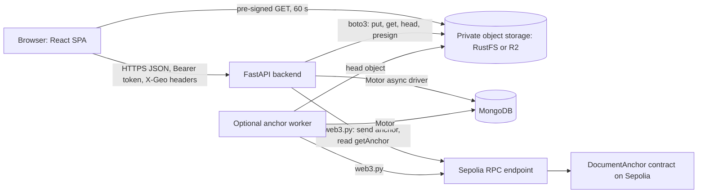
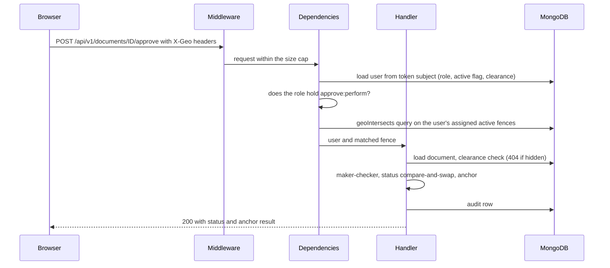
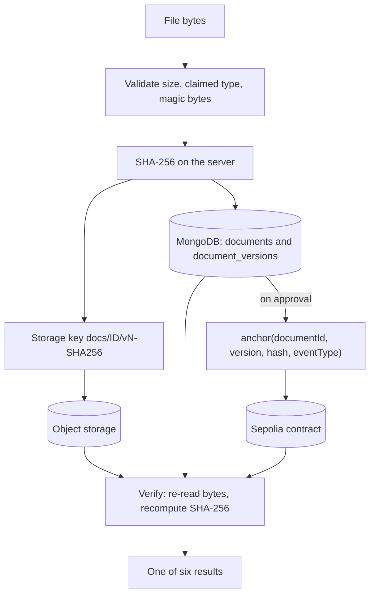
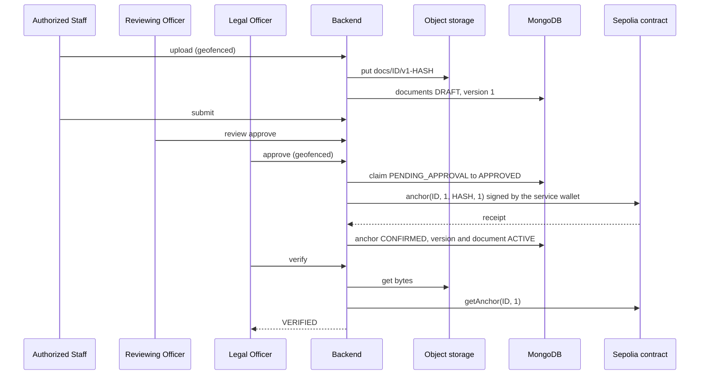
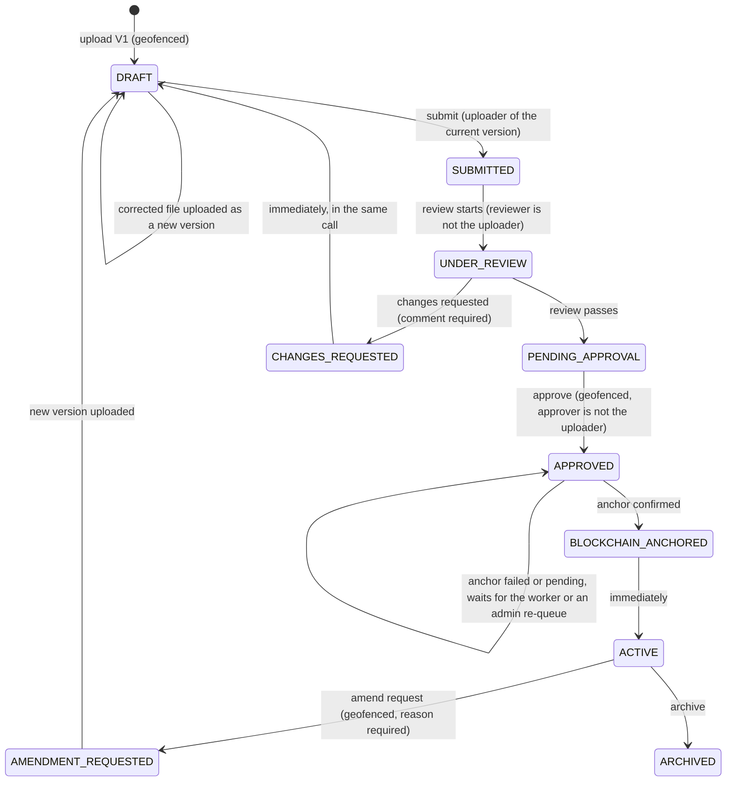

# GeoLegalVault: complete reference and interview guide

This is a single reference for the GeoLegalVault prototype as it exists on the `main` branch (v1). It explains the problem, the design, every technology choice, how the code works, how it is tested, and what it does not do. It is written so that someone with no prior context can understand the whole project and answer examiner questions about it.

Every claim points at the file it comes from. Paths are relative to the repository root.

---

## 0. How to read this document

### 0.1 Evidence markers

| Marker | Meaning |
|---|---|
| `path/to/file` | The claim comes from that tracked file. For behaviour, the source code is the authority. |
| **[docs differ: file]** | The code and the named document disagree. This document follows the code. All such places are collected in Appendix A. |
| **(not verified)** | The claim could not be confirmed from the repository or by running anything. Collected in Appendix B. |
| **(standard rationale, not recorded)** | A "why" that the project never wrote down. It is the usual engineering reason, not a recorded decision. |
| `D-0xx` | A numbered entry in `DECISIONS.md` (the project's decision log). |
| `SEC-xx`, `REL-xx`, `OPS-xx`, `CMP-xx`, `FUN-xx`, `FE-xx`, `BC-xx` | Findings in `PRODUCTION_READINESS.md` (a production-readiness audit dated 2026-10-01, with later "Update" notes). |
| "Guardrail #n" | Rule number n in `CLAUDE.md`, the project's list of rules that must never be broken. |
| "Plan Part n" | Part n of `docs/GeoLegalVault_Project_Plan.md`, the original design plan. |
| "run on 2026-11-10" or "run on 2026-11-11" | A number produced by running the project's code or tests while this document was written (the work spanned both days). |

Numbers without a "run on" date are quoted from the file named next to them.

### 0.2 The whole project in ten lines

1. GeoLegalVault is a prototype web application for an organisation that keeps sensitive legal documents (`README.md`, `docs/SRS.md`).
2. It runs each document through a review-and-approval workflow with five roles, and the person who uploads a version can never approve it (maker-checker, `backend/app/core/rbac.py`).
3. Uploading, downloading, approving, starting an amendment and re-queuing a stuck anchor are accepted only if the user's browser reports a position inside an area (a "geofence") an administrator assigned to them (`backend/app/services/geofence.py`).
4. Each document has a secrecy level and each user a clearance; a document above your clearance behaves exactly like one that does not exist (`backend/app/modules/documents/access.py`).
5. Files go to private S3-compatible object storage; metadata, versions and the audit log go to MongoDB (`backend/app/services/storage.py`, `backend/app/core/db.py`).
6. On approval, the server computes nothing new: it takes the SHA-256 digest recorded at upload and writes it, with the document id and version number, to a small smart contract on the Ethereum Sepolia test network, signed by one backend-held wallet (`backend/app/services/blockchain.py`, `contracts/contracts/DocumentAnchor.sol`).
7. "Verify" re-reads the stored file, recomputes SHA-256, and compares it with the database copy and with the value on the chain; any change to the file is detected (`backend/app/modules/verify/service.py`).
8. The system is **tamper-evident** (it detects changes), not tamper-proof (it does not prevent them), and geofencing is a **policy** control, because a browser's reported position can be faked (`CLAUDE.md` Guardrail #6, `docs/THREAT_MODEL.md`).
9. It is one FastAPI backend, one React frontend, MongoDB, object storage, one Solidity contract, and one optional background worker that retries anchoring (`docker-compose.yml`, `CLAUDE.md` Guardrail #10).
10. It is tested against real MongoDB, real object storage and a real local blockchain node, with CI on GitHub Actions (`.github/workflows/ci.yml`, `docs/TEST_PLAN.md`); section 14 has the counts from a fresh run.

### 0.3 What this document covers and does not cover

It covers only what is implemented and committed on the `main` branch (v1).

---

## 1. The problem

### 1.1 Plain statement

An organisation that keeps legal documents (contracts, NDAs, board resolutions) needs to answer one question convincingly, sometimes years later: **"Is this file exactly the version that was officially approved?"** It also wants some control over **where** sensitive work is done, for example only from the office (Plan Part 1 items 4-5).

### 1.2 Who has it

The plan names legal departments, compliance teams, records offices and contract-management units (Plan Part 1 item 9). The demo models a records or contracts office with five job roles (`docs/SRS.md` section 3).

### 1.3 What it costs when it goes wrong

Plan Part 1 item 5: legal and compliance disputes turn on document integrity ("is this the version that was signed?"). If the only proof is "our database says so", the proof is weak, because the party making the claim also controls the database. A database administrator could change a record and nobody outside could tell.

### 1.4 Existing attempts and why they fall short

From Plan Part 1 items 6-7:

| Existing approach | Example products named in the plan | Gap |
|---|---|---|
| Document management systems (DMS) | SharePoint/M365, Google Workspace, DocuWare, OpenKM, Alfresco, iManage | Integrity is self-asserted: the vendor's database is the source of truth. No proof an outsider can check without trusting the vendor. No location-based authorisation of operations. |
| Blockchain "notary" or hash-timestamping tools | (named only as a category) | They timestamp a hash, but have no lifecycle, roles, versioning or access control around it. |

The plan's honest position is that hash anchoring on a blockchain is **not novel**, and neither are role-based document management or geofencing. The contribution is the **combination**: geofenced document operations plus per-version on-chain anchoring plus immutable version history, in one working system with an honestly stated threat model (Plan Part 27, `docs/RESEARCH.md` "Framing").

---

## 2. The solution in one page

### 2.1 The idea

Keep the file private and off-chain. Put only a 32-byte digest (a hash) of each approved version on a public blockchain, where no one in the organisation can later change it. To check a file, recompute its digest and compare it with that public record. Around this, build a normal document workflow with roles, approvals, versions, an audit log, and a location check on sensitive actions (Plan Part 0.3, Part 1 item 3).

### 2.2 What it does

| Capability | Where |
|---|---|
| Login with short-lived access tokens and rotating refresh cookies | `backend/app/modules/auth/` |
| Five roles, deny-by-default permissions, maker-checker | `backend/app/core/rbac.py` |
| Server-side geofence check on upload, download, approve, amend request and anchor re-queue | `backend/app/services/geofence.py`, routers |
| Clearance-based document visibility, hidden documents return 404 | `backend/app/core/clearance.py`, `backend/app/modules/documents/access.py` |
| Upload with size, type and magic-byte checks, SHA-256, private storage | `backend/app/modules/documents/service.py`, `backend/app/services/storage.py` |
| Immutable versions with a link to the previous version's hash | `backend/app/modules/versions/` |
| Workflow: draft, submit, review, approve, anchor, activate, amend, archive | `backend/app/modules/documents/workflow.py` |
| Automatic anchoring on approval, signed by one service wallet | `backend/app/services/blockchain.py`, `backend/app/modules/blockchain/service.py` |
| Three-way verification with six possible results | `backend/app/modules/verify/service.py` |
| Append-only (by convention) audit log, readable by Auditor and Administrator | `backend/app/modules/audit/` |
| Optional worker that confirms and retries anchors | `backend/app/workers/anchor_confirmer.py` |
| React UI for every role | `frontend/src/` |

### 2.3 What it deliberately does not do

From `CLAUDE.md` Guardrail #8, `docs/SRS.md` section 2 and Plan Part 1 item 12:

- No document bytes, filenames or personal data on the chain (Guardrail #1).
- No per-user wallets or "connect wallet" button; users never sign anything (Guardrail #3).
- No Merkle trees, no NLP, no microservices or message brokers, no mainnet, no contract upgrade proxy, no hardware GPS attestation, no multi-tenant billing (Guardrail #8).
- No claim of "tamper-proof", "military-grade", "unhackable" or "guaranteed location" anywhere (Guardrail #6).
- No e-signatures, OCR, real-time collaborative editing or native mobile apps (`docs/SRS.md` section 2).
- No email notifications (FR-21 in `docs/SRS.md`), and in fact no in-app notifications either (FUN-01, open).
- No malware scanning (`docs/THREAT_MODEL.md` row 7, limitation 2b).

---

## 3. Users and roles

### 3.1 The five roles

Roles are fixed in `backend/app/modules/users/models.py` (`Role`). Permissions are strings, and each role maps to a set of them in `backend/app/core/rbac.py` (`ROLE_PERMISSIONS`). Anything not in the set is refused with `403 FORBIDDEN` (deny-by-default). The frontend has a copy of the same map in `frontend/src/lib/permissions.ts`, used only to hide buttons; the server decides.

| Permission | Administrator | Legal Officer | Reviewing Officer | Authorized Staff | Auditor |
|---|:-:|:-:|:-:|:-:|:-:|
| `document:upload` | | yes | | yes | |
| `document:view` | yes | yes | yes | yes | yes |
| `document:search` | yes | yes | yes | yes | yes |
| `document:submit` | | yes | | yes | |
| `document:amend` | | yes | | yes | |
| `document:archive` | yes | yes | | | |
| `review:perform` | | | yes | | |
| `approve:perform` | | yes | | | |
| `verify:perform` | yes | yes | yes | yes | yes |
| `users:manage` | yes | | | | |
| `geofence:manage` | yes | | | | |
| `audit:view` | yes | | | | yes |
| `integrity:clear` | yes | | | | |
| `anchor:view` | yes | yes | | | yes |
| `anchor:retry` | yes | | | | |

Source: `backend/app/core/rbac.py`.

### 3.2 What each role does, in words

- **Legal Officer.** Uploads, submits, requests amendments, archives, approves (which triggers anchoring), verifies, sees the stuck-anchor list. Cannot review, and cannot approve a version they uploaded.
- **Authorized Staff.** Uploads, submits, amends, verifies. Cannot review, approve or archive.
- **Reviewing Officer.** Reviews submitted documents (pass to approval, or send back with a required comment), verifies. Cannot upload or approve.
- **Auditor.** Reads documents within their clearance, verifies, reads the full audit log and reports, sees the stuck-anchor list. Changes nothing.
- **Administrator.** Manages users (role, assigned geofences, clearance, active flag), manages geofences, reads audit and reports, archives, clears an integrity flag after re-verification, sees and re-queues stuck anchors. **Cannot upload, submit, review, approve or amend.** The comment in `rbac.py` gives the reason: separation of duties, so a super-admin cannot silently approve documents.

### 3.3 Rules that cut across roles

| Rule | How it is enforced | Source |
|---|---|---|
| Maker-checker: the uploader of the version being processed cannot review or approve it | `enforce_maker_checker` raises `403 MAKER_CHECKER_VIOLATION`; called in `review()` and `approve()` | `backend/app/core/rbac.py`, `backend/app/modules/documents/workflow.py` |
| No role holds both `review:perform` and `approve:perform` | Role map | `backend/app/core/rbac.py` |
| Only the uploader of the current version may submit it | `submit()` compares `version.uploaded_by` with the caller (D-016) | `workflow.py` |
| Role and active flag are read from the database on every request, not from the token | `get_current_user` loads the user; `require()` checks the loaded role | `backend/app/core/deps.py`, `rbac.py` |
| An administrator cannot demote or deactivate themselves (`409 SELF_LOCKOUT`) or change their own clearance (`403 SELF_CLEARANCE_CHANGE`) | `update_user` | `backend/app/modules/users/service.py` (D-002, D-051) |
| No self-registration; only an Administrator creates users | `POST /users` needs `users:manage` | `backend/app/modules/users/router.py` |
| Users are never hard-deleted, only deactivated | No delete route exists | `backend/app/modules/users/router.py` |

### 3.4 Clearance (who sees which document)

Five ordered levels: `PUBLIC < INTERNAL < CONFIDENTIAL < RESTRICTED < TOP_SECRET` (`backend/app/core/clearance.py`, `LEVELS`). Each document gets one at upload and it never changes. Each user has one. A user sees a document only if their clearance is at or above the document's level. A missing or unknown value on either side counts as the lowest level, so an unknown document classification is hidden from everyone (deny-by-default). New users start at `PUBLIC` (`backend/app/modules/users/schemas.py`). The seed and migration scripts use these starting values, which are never consulted at request time (`PROPOSED_ROLE_CLEARANCE` in `clearance.py`):

| Role | Seed clearance |
|---|---|
| Administrator | INTERNAL |
| Authorized Staff | CONFIDENTIAL |
| Legal Officer | RESTRICTED |
| Reviewing Officer | RESTRICTED |
| Auditor | RESTRICTED |

Nobody gets `TOP_SECRET` by default. The Administrator has no automatic access to document content (Guardrail #13).

### 3.5 Demo accounts

`scripts/seed.py --demo` creates one user per role and one "HQ Campus (demo)" geofence, and assigns that fence to all five (`scripts/seed.py`). The accounts share one demo password, stored as the `DEMO_PASSWORD` constant in `scripts/seed.py`; it is not repeated here. The account names follow the pattern `<role>` at a demo domain (`README.md`). The seed prints an inside test point `lat 11.67, lng 78.15` and an outside point `lat 11.00, lng 77.00` (`scripts/seed.py`, `HQ_INSIDE_POINT`, `HQ_OUTSIDE_POINT`).

The demo has exactly one Legal Officer, so a document that the Legal Officer uploads can never be approved by anyone. Demos therefore have Authorized Staff upload, the Reviewing Officer review, and the Legal Officer approve (`docs/DEMO_SCRIPT.md`, D-053).

---

## 4. Architecture

### 4.1 Components

| Component | What it is | Local port (dev) | Production target | Source |
|---|---|---|---|---|
| Frontend | React single-page app built by Vite | 5173 | Vercel | `frontend/vite.config.ts`, `docs/DEPLOYMENT.md` |
| Backend API | One FastAPI application (a "modular monolith": one deployable program split into modules) | 8000 | Render (Docker) | `backend/app/main.py`, `backend/Dockerfile` |
| MongoDB 7 | Document database for metadata, versions, users, geofences, anchors, verification records, audit log | 27017 | MongoDB Atlas M0 | `docker-compose.yml` (`mongo`) |
| Object storage | S3-compatible private bucket for file bytes. RustFS locally and in CI, Cloudflare R2 in production | 9000 (S3 API), 9001 (console) | Cloudflare R2 | `docker-compose.yml` (`storage`), `backend/app/services/storage.py` |
| `storage-init` | One-shot container that creates the dev bucket with the AWS CLI | none | not used | `docker-compose.yml` |
| `hardhat-node` | **A placeholder container** that only sleeps, kept so `/health` has something to probe at 8545. It is not a blockchain. | 8545 | not used | `docker-compose.yml` |
| Smart contract | `DocumentAnchor`, one Solidity contract | none | Ethereum Sepolia | `contracts/contracts/DocumentAnchor.sol` |
| RPC provider | A server that relays JSON-RPC calls to the Ethereum network; any Sepolia endpoint works | none | set in `SEPOLIA_RPC_URL` | `.env.example` |
| Anchor worker (optional) | Same Docker image as the backend, different command; confirms and retries anchors | none | Render background worker | `backend/app/workers/anchor_confirmer.py`, `docker-compose.yml` (`anchor-worker`, profile `worker`) |

There is no message broker, no queue server and no second backend service (Guardrail #10). The worker keeps its queue state on the document row itself (`documents.anchor_retry`) and its liveness in one MongoDB document (`worker_heartbeats`).

### 4.2 Component diagram



The browser never talks to the blockchain and never holds a wallet. It downloads files directly from storage using a pre-signed link that the API generated; the API never streams file bytes (Guardrail #4).

### 4.3 Layers inside the backend

| Folder | Role |
|---|---|
| `backend/app/main.py` | Builds the app, adds middleware, mounts the nine routers under `/api/v1`, defines `GET /api/v1/health` |
| `backend/app/core/` | Cross-cutting concerns: settings (`config.py`), database (`db.py`), current-user dependency (`deps.py`), permissions (`rbac.py`), clearance (`clearance.py`), passwords and tokens (`security.py`), error envelope (`errors.py`), body-size limit, rate limit, security headers, request logging, Sentry, health probes |
| `backend/app/modules/<name>/` | One package per feature: `auth`, `users`, `geofences`, `documents`, `versions`, `blockchain`, `verify`, `audit`, `reports`. Each has `router.py` (HTTP), `service.py` (logic), `schemas.py` (Pydantic request and response models), `models.py` (collection names and enums) |
| `backend/app/services/` | Thin shared wrappers: `hashing.py`, `storage.py`, `blockchain.py`, `geofence.py`, `anchor_errors.py`, and the contract ABI `document_anchor_abi.json` |
| `backend/app/workers/` | `anchor_confirmer.py` (the optional worker) and `heartbeat.py` |

### 4.4 The request pipeline

Guardrail #5 fixes the order for every sensitive endpoint: **TLS, then JWT, then RBAC, then geofence, then input and file validation, then the action, then the audit row.** TLS is terminated by the hosting platform. In the code:

1. **Middleware**, from outermost to innermost (Starlette runs the last-added middleware first; `backend/app/main.py`): CORS, security headers, global per-IP rate limit, body-size limit, JSON request logging.
2. **Dependencies** declared on the route, in order: `get_current_user` (JWT) inside `require(permission)` (RBAC), then `require_geofence(...)` (location) where the route has one.
3. **Handler**: validation (for example classification and file checks), the clearance check inside `access.load_visible_document`, the action, then `audit.record(...)`.



The multipart upload route declares no `File()` or `Form()` parameters, so FastAPI does not parse the body before the dependencies run; the handler calls `request.form()` only after JWT, RBAC and geofence have passed (`backend/app/modules/documents/router.py`, D-028). JSON routes are still parsed by FastAPI before their dependencies, bounded by `MAX_JSON_BODY_KB` (`CLAUDE.md` #5 "Known limits", D-031).

### 4.5 Data flow at a glance



### 4.6 Deployment shape

Production target (all free tiers, a "₹0" budget; Plan Part 23 and `docs/DEPLOYMENT.md`): Vercel for the frontend, Render for the backend Docker image and the optional worker, MongoDB Atlas M0, Cloudflare R2, and Sepolia through any RPC provider. Locally, `docker compose up` starts MongoDB, RustFS, the bucket init job, the placeholder `hardhat-node` and the backend; the frontend runs with `npm run dev`. The only differences between local and cloud are environment variables (`docs/SRS.md` section 5, Portability). A completed deployment to these platforms is not recorded in the repository **(not verified)**.

---

## 5. Tech stack, with the reason for every choice

Versions are the pinned ones in `backend/requirements.txt`, `frontend/package.json` and `contracts/package.json` on `main`. A "why" with a source is recorded; otherwise it is labelled.

### 5.1 Backend

| Technology (version) | What it is | Where used | Why chosen | Alternatives and trade-off |
|---|---|---|---|---|
| Python 3.11+ | Programming language | `backend/` (`pyproject.toml` `requires-python = ">=3.11"`; CI uses 3.11) | Plan Part 8: easy blockchain libraries, fast to write | Node.js (Plan Part 8 lists Node/Express) |
| FastAPI 0.133.1 | Async Python web framework with automatic OpenAPI docs | all routers, `backend/app/main.py` | Plan Part 8: "async, auto OpenAPI, easy blockchain libs, fast to write" | Node/Express, Django (Plan Part 8). Trade-off: FastAPI parses JSON bodies before dependencies run (D-028, D-031). Upgraded from 0.115.6 to clear Starlette advisories (D-030). |
| Starlette 1.3.1 | The ASGI toolkit under FastAPI | middleware, `request.form()` | Pinned so `pip-audit` sees it and a FastAPI bump cannot silently move it (D-030) | Staying on Starlette 0.x left advisories open (D-030) |
| Uvicorn 0.34.0 + Gunicorn 23.0.0 | ASGI server, and a process manager running Uvicorn workers | `backend/Dockerfile` (`WEB_CONCURRENCY` default 2) | Dockerfile comment: process-level concurrency, worker recycling, graceful reload | Bare Uvicorn (single process). Trade-off: per-process state (the global rate limiter, the nonce lock) is not shared across workers (SEC-10, REL-06). |
| Pydantic 2.10.4, pydantic-settings 2.7.0 | Data validation, typed settings from environment variables | every `schemas.py`, `core/config.py` | Plan Part 14: input validation at every boundary | Manual validation **(standard rationale, not recorded)** |
| Motor 3.7.1 | Async MongoDB driver | `core/db.py`, all services | **(standard rationale, not recorded)**: FastAPI is async, so a non-blocking driver avoids stalling the event loop | PyMongo alone is synchronous |
| PyMongo 4.18.3 | The driver Motor builds on; also imported directly for `ReturnDocument` and `DuplicateKeyError` | `documents/service.py`, `auth/service.py` | Pinned by the latest commit `9c8a8f4` ("Upgrade pymongo to >=4.18.3 to clear pip-audit advisories") | 4.9.x failed the CI vulnerability gate (`docs/PROJECT_EXPLAINED.md` section 8) |
| PyJWT 2.15.1 | JSON Web Token library | `core/security.py` | Plan Part 8 (stateless auth); upgraded from 2.10.1 for advisories (D-019) | Auth0 (Plan Part 8). Trade-off: HS256 with one shared secret means rotating it logs everyone out (SEC-09, open). |
| argon2-cffi 23.1.0 | Argon2id password hashing | `core/security.py` (`PasswordHasher()` defaults) | Plan Part 8: "strong password hash" | bcrypt or PBKDF2. Argon2id is memory-hard, which makes GPU guessing costly **(standard rationale, not recorded)**. |
| boto3 1.35.90 | AWS's S3 client library, works with any S3-compatible store | `services/storage.py` | **(standard rationale, not recorded)**: the usual S3 client; R2 and RustFS both speak the S3 API, so one code path serves dev and production | A vendor-specific client. Trade-off: boto3 is synchronous; storage calls inside request handlers block the event loop (REL-05, open). The worker wraps its HEAD call in `asyncio.to_thread`. |
| web3.py 7.6.1 | Python library for Ethereum JSON-RPC | `services/blockchain.py` | Plan Part 8: sign and send transactions, read the contract | ethers.js "if Node" (Plan Part 8) |
| python-magic 0.4.27 (python-magic-bin 0.4.14 on Windows) | Reads a file's real type from its leading bytes using libmagic | `documents/service.py` (`validate_upload`) | Plan Part 8: MIME and magic-byte checks | `filetype` library (Plan Part 8). Trade-off: libmagic versions disagree on edge cases (D-035). |
| python-multipart 0.0.32 | Multipart form parser used by `request.form()` | upload route | Upgraded from 0.0.20 for advisories (D-019) | none recorded |
| httpx 0.28.1 | HTTP client | `/health` probes (`core/health.py`), test client | **(standard rationale, not recorded)**: async client that also drives the in-process test client | requests (synchronous) |
| sentry-sdk 2.19.2 | Error-tracking client | `core/sentry.py` (no-op unless `SENTRY_DSN` is set; `traces_sample_rate=0.0`, `send_default_pii=False`) | Plan Part 8 and Part 32 | Self-hosted Grafana (Plan Part 8) |
| pytest 9.0.3, pytest-asyncio 1.3.0, pytest-cov 6.0.0 | Test runner, async tests, coverage | `backend/tests/`, `pyproject.toml` (gate `--cov-fail-under=60`) | Plan Part 20; upgraded for advisories (D-019) | none recorded |
| ruff 0.8.4 | Python linter | CI, `pyproject.toml` (rules `E,F,I,UP,B`, line length 100) | CI gate (D-018) | flake8 plus isort **(standard rationale, not recorded)** |
| pip-audit 2.10.1 | Checks Python dependencies against known vulnerabilities | CI step "Dependency audit" | D-030: a known vulnerability fails the build | Manual review |

### 5.2 Data and storage

| Technology | What it is | Where used | Why chosen | Alternatives and trade-off |
|---|---|---|---|---|
| MongoDB 7 | Document database with geospatial indexes | all collections (`core/db.py`) | Plan Part 10 and `docs/DB_DESIGN.md`: (1) native `2dsphere` index and `$geoIntersects` for point-in-polygon; (2) flexible schema for metadata that varies by document type; (3) nested audit and version detail reads naturally | PostgreSQL + PostGIS, which Plan Part 10 calls "a valid alternative". Trade-off: no multi-document transactions on the standalone instance used here, so consistency is enforced in the application with compare-and-swap updates and unique indexes (D-022, D-029). |
| MongoDB Atlas M0 | Free hosted MongoDB | production target | Plan Parts 9 and 23: free tier | Self-hosted. Whether M0 offers snapshots is disputed (OPS-01). |
| Cloudflare R2 | S3-compatible object storage | production target | Plan Part 0.2: AWS S3's free tier expires after 12 months and egress fees can surprise students; R2 has 10 GB free and no egress fees | AWS S3, Backblaze B2 (Plan Part 8) |
| RustFS 1.0.1 (pinned by tag and digest) | S3-compatible storage server | local dev and CI (`docker-compose.yml` `storage`) | D-034: MinIO's images were withdrawn; RustFS is Apache-2.0, single process, validates pre-signed signatures and expiry, same port, simple healthcheck | Mirroring MinIO (frozen image, AGPL redistribution), SeaweedFS (passed, kept as the fallback), Garage (AGPL, manual bootstrap), moto (accepts tampered and expired pre-signed URLs, so storage tests would prove nothing). Risk recorded in D-034: RustFS was very new. |
| amazon/aws-cli 2.27.0 | AWS command-line tool | `storage-init` creates the bucket | D-034: replaces MinIO's `mc` | none |

### 5.3 Blockchain

| Technology | What it is | Where used | Why chosen | Alternatives and trade-off |
|---|---|---|---|---|
| Ethereum Sepolia testnet (chain id 11155111) | A public Ethereum test network whose coins have no value | anchoring target (`CHAIN_ID`) | Plan Part 12: largest EVM tool ecosystem; stable, free, working faucets | Polygon Amoy testnet (Plan Part 12). Mainnet is out of scope (Guardrail #8). Trade-off: a testnet can be reset or retired (THREAT_MODEL limitation 4, BC-01). |
| Solidity 0.8.20 | Language for Ethereum contracts | `contracts/contracts/DocumentAnchor.sol` | Plan Part 8 | none |
| Hardhat 2.22.10 + hardhat-toolbox 5 | Compile, test and deploy contracts; runs a local chain | `contracts/` (optimizer on, 200 runs, `hardhat.config.ts`) | Plan Part 8 | Foundry (Plan Part 8) |
| One backend service wallet | A single private key held by the backend, used to sign every anchor | `services/blockchain.py` (`get_service_account`) | Plan Part 18 and Guardrail #3: users need no wallet or test coin; anchoring is a system event; simpler demos | Per-user MetaMask signing: more decentralised but impractical (wallet onboarding, gas per user). Trade-off: custodial signing; one key is a single point of trust (THREAT_MODEL limitation 3, BC-02). This is a known limit of v1. |
| dotenv 16.4.5 | Reads the repo-root `.env` inside Hardhat | `contracts/hardhat.config.ts` | Guardrail #2: one source of secrets, never a hard-coded key | none |

### 5.4 Frontend

| Technology (version) | What it is | Where used | Why chosen | Alternatives |
|---|---|---|---|---|
| React 18.3 + TypeScript 5.7 | UI library and typed JavaScript | `frontend/src/` | Plan Part 8: SPA, typed, fast development | Next.js ("overkill"), Vue (Plan Part 8) |
| Vite 6 | Dev server and bundler | `frontend/vite.config.ts` (port 5173) | Plan Part 8 | none recorded |
| Tailwind CSS 3.4 | Utility CSS framework | `frontend/tailwind.config.js`, `frontend/src/index.css` | Plan Part 8: clean UI quickly | none recorded |
| TanStack Query 5 | Server-state cache and fetching | pages and components (`useQuery`, `useMutation`) | Plan Part 16: "a data layer" | Hand-written fetch state **(standard rationale, not recorded)** |
| React Router 7 | Client-side routing | `frontend/src/App.tsx` | Plan Part 16 | none recorded |
| lucide-react | Icon set | components | not recorded | none |
| Browser Geolocation API | `navigator.geolocation.getCurrentPosition` | `frontend/src/hooks/useGeoLocation.ts` (`enableHighAccuracy: true`, `timeout: 15000`, `maximumAge: 0`) | Plan Part 11: the position source a web app has | Out of scope for v1 (Guardrail #8) |
| Vitest 4, Testing Library, jsdom | Unit and component tests in a simulated browser | `frontend/src/**/__tests__` | Plan Part 20 | Jest (Plan Part 8) |
| ESLint 9 + typescript-eslint | Linter | `frontend/eslint.config.js` | CI gate | none |
| Google Fonts | Web fonts loaded by the page | `frontend/index.html` | not recorded | Self-hosted fonts (SEC-16 notes there is no CSP) |

### 5.5 Tooling and operations

| Technology | Where | Why | Alternatives |
|---|---|---|---|
| Docker and Docker Compose | `docker-compose.yml`, `backend/Dockerfile` | Plan Part 8: reproducible dev environment | Podman (Plan Part 8) |
| GitHub Actions on `ubuntu-24.04` | `.github/workflows/ci.yml` | Plan Part 8 (free CI); runner pinned so a silent image change cannot alter libmagic or Docker (D-036) | GitLab CI; `ubuntu-latest` (rejected, D-036) |
| npm audit | CI frontend job (`--omit=dev --audit-level=high`) | D-030 | none |
| Vercel, Render | `docs/DEPLOYMENT.md` | Plan Parts 8 and 23: free tiers | Netlify, Railway, Fly.io (Plan Part 8) |

---

## 6. The full pipeline end to end, with a worked example

### 6.1 Worked-example inputs

The values below were computed on 2026-11-10 by calling the project's own functions (`app.services.hashing.sha256_bytes`, `app.services.storage.build_version_key`, `app.services.blockchain.sha256_hex_to_bytes32`, `app.core.clearance.visible_classifications`, `app.core.body_limit.body_limit_for`, `app.modules.blockchain.retry.next_after_failure`) from a clean checkout of `main` with no `.env`, so every setting is its code default. The input file is the tracked sample `demo_video/samples/DEMO_Lease_Agreement_v1.pdf`.

| Item | Value | How obtained |
|---|---|---|
| File size | 2,321 bytes | run on 2026-11-10 |
| Type detected by libmagic | `application/pdf` | `magic.from_buffer`, run on 2026-11-10 |
| SHA-256 of the file | `3110ca8ef7f2f4f4d5a0cbc80a135fd89b5073f70c6a4d721222b6d029c09295` | `sha256_bytes`, run on 2026-11-10 |
| SHA-256 after flipping one bit of the middle byte | `65a28700ab9f7dad9e8546d1437fa19c31bc4e69e9cab15519ca12156d2d2fb8` | run on 2026-11-10 |
| Document id | `6a1b2c3d4e5f60718293a4b5` | **illustrative**: a made-up 24-hex MongoDB ObjectId; a real upload gets a fresh one |
| Storage key for version 1 | `docs/6a1b2c3d4e5f60718293a4b5/v1-3110ca8e…c09295` (full hash in the key) | `build_version_key`, run on 2026-11-10 |
| On-chain hash argument | the same 32 bytes, as `bytes32` | `sha256_hex_to_bytes32` (length 32), run on 2026-11-10 |
| Contract mapping key `keccak256(abi.encodePacked(documentId, uint32 version))` | `f2256a4051dca6024635d57faf5ec6b8968b5cdd69dc5221a95bcc883b3e7831` | `Web3.solidity_keccak(["string","uint32"], [id, 1])`, run on 2026-11-10 |
| Classification chosen | `CONFIDENTIAL` | example |
| Levels an Authorized Staff user (seed clearance CONFIDENTIAL) can see | `PUBLIC, INTERNAL, CONFIDENTIAL` | `visible_classifications`, run on 2026-11-10 |
| Upload request size cap | 11,534,336 bytes (10 MiB + 1 MiB multipart allowance) | `body_limit_for("POST", "/api/v1/documents")`, run on 2026-11-10 |
| Cap for every other request body | 1,048,576 bytes (1024 KiB) | same, run on 2026-11-10 |
| Location used | `lat 11.67, lng 78.15, accuracy 10 m`, timestamp a few seconds old | the seed's inside point (`scripts/seed.py`) |

One bit changed, and the new digest bears no visible relationship to the old one. That is the "avalanche effect" the project relies on (`backend/app/services/hashing.py` docstring).

### 6.2 Step by step

**Step 0. Set-up (Administrator).** The Administrator creates a geofence polygon (GeoJSON, `[longitude, latitude]` order) and a user with role `AUTHORIZED_STAFF`, clearance `CONFIDENTIAL` and that fence in `assigned_geofence_ids` (`POST /geofences`, `POST /users`, `PATCH /users/{id}`). All three writes are audited (`GEOFENCE_CREATE`, `USER_CREATE`, `USER_UPDATE`).

**Step 1. Login.** `POST /api/v1/auth/login` with email and password. The server checks the per-email failure counter (5 failures in a 60 s window lock that email for the rest of the window), verifies the Argon2id hash, and returns an access token (JWT, HS256, 15 minutes, claims `sub`, `role`, `iat`, `exp`, `jti`, `type`) in the JSON body. A refresh token (7 days, with a `family` id) is set as a cookie: `HttpOnly`, `Secure`, `SameSite=Strict`, path `/api/v1/auth`. The frontend keeps the access token in memory only (`frontend/src/lib/authToken.ts`). Sources: `backend/app/modules/auth/service.py`, `router.py`, `backend/app/core/security.py`.

**Step 2. Location reading.** On the Upload page, `LocationGate` asks the browser for a fresh position (`maximumAge: 0`, high accuracy, 15 s timeout) and sends it as four headers: `X-Geo-Lat`, `X-Geo-Lng`, `X-Geo-Accuracy`, `X-Geo-Timestamp` (Unix seconds). The browser never decides inside or outside (`frontend/src/components/LocationGate.tsx`, `frontend/src/api/http.ts` `geoHeaders`).

**Step 3. Upload (`POST /api/v1/documents`, multipart).**

| Order | Check or action | Failure | Source |
|---|---|---|---|
| a | Body-size cap while streaming (11,534,336 bytes for this route) | `413 PAYLOAD_TOO_LARGE` | `core/body_limit.py` |
| b | JWT valid, user exists and is active | `401` / `403 Account is disabled` | `core/deps.py` |
| c | Role holds `document:upload` | `403 FORBIDDEN` | `core/rbac.py` |
| d | Location: well-formed, accuracy ≤ 100 m, age ≤ 60 s, point inside an assigned active fence | `422 INVALID_LOCATION`, `422 LOCATION_LOW_CONFIDENCE`, `422 LOCATION_STALE`, `403 GEOFENCE_DENIED` (audited with the coordinates) | `services/geofence.py` |
| e | Parse the multipart form only now | `422 VALIDATION_ERROR` if a field is missing | `documents/router.py` |
| f | Classification is exactly one of the five levels | `422 INVALID_CLASSIFICATION` | `documents/access.py` |
| g | Uploader's clearance reaches that level | `403 CLASSIFICATION_NOT_ALLOWED` | `documents/access.py` |
| h | File ≤ 10 MiB; claimed type on the allow-list (PDF, DOCX, plain text, PNG, JPEG); libmagic agrees with the claim | `413 FILE_TOO_LARGE`, `422 UNSUPPORTED_MEDIA_TYPE`, `422 MIME_MISMATCH` | `documents/service.py` `validate_upload` |
| i | SHA-256 of the bytes: `3110ca8e…c09295` | | `services/hashing.py` |
| j | Write the object under `docs/{id}/v1-{sha256}` | `503 STORAGE_UNAVAILABLE`, nothing written to MongoDB | `services/storage.py` |
| k | Insert the `documents` row (status `DRAFT`) and the V1 `document_versions` row (`prev_version_hash: null`); if the version insert fails, the document row and the object are removed | | `documents/service.py`, `versions/service.py` |
| l | Audit `UPLOAD` | | `documents/router.py` |

Response `201 {"document_id", "version_id", "sha256": "3110ca8e…", "status": "DRAFT"}`.

**Step 4. Submit (`POST /documents/{id}/submit`, Authorized Staff).** Only the uploader of the current version may submit (D-016). The status moves `DRAFT → SUBMITTED` by an atomic compare-and-swap; if a newer version appeared meanwhile, the claim is rolled back with `409` (D-032). The version is marked `SUBMITTED`, any old review comment is cleared, and `SUBMIT` is audited (`workflow.py` `submit`).

**Step 5. Review (`POST /documents/{id}/review`, Reviewing Officer).** Body `{"decision": "approve" | "changes_requested", "comment"}`. The reviewer must not be the uploader (`MAKER_CHECKER_VIOLATION`). One call moves `SUBMITTED → UNDER_REVIEW` and then either to `PENDING_APPROVAL` (audits `REVIEW_START`, `REVIEW_PASS`) or, with a required comment, through `CHANGES_REQUESTED` straight back to `DRAFT` (audits `CHANGES_REQ`, stores the comment on the document as `review_feedback`) (`workflow.py` `review`, D-009).

**Step 6. Approve and anchor (`POST /documents/{id}/approve`, Legal Officer, geofenced).**

1. Maker-checker against the current version's uploader.
2. Compare-and-swap `PENDING_APPROVAL → APPROVED` **before** anything touches the chain, so of several simultaneous approvals exactly one proceeds (D-023). Version marked `APPROVED`; `APPROVE` audited.
3. Up to `ANCHOR_MAX_ATTEMPTS` = 3 send attempts, 1 s apart. Each attempt calls `anchor_hash`: under a process-wide lock it reads the wallet's pending nonce, estimates gas and adds 20 %, builds the transaction with `chainId` 11155111, signs it with the service wallet, and sends it. For the example the call is `anchor("6a1b2c3d4e5f60718293a4b5", 1, 0x3110ca8e…c09295, 1)`, where `1` is `AnchorEventType.APPROVED`.
4. A sent transaction creates a `blockchain_anchors` row with status `PENDING` and `live: true`. A failed send creates a `FAILED` row whose `error` is a fixed code such as `RPC_UNREACHABLE`, never the raw exception text (D-020).
5. If all sends fail: `anchor_pending_alert: true`, `ANCHOR_FAIL` audited, and the document is put in the worker's queue (`anchor_retry`). The HTTP response is still `200` with the document in `APPROVED` (`workflow.py` `approve`).
6. If sent: poll for a receipt up to 5 times, 0.3 s apart, needing `ANCHOR_CONFIRMATIONS` = 1. A receipt with status 0 (reverted) marks the row `FAILED`/`REVERTED` and queues a retry. No receipt in time leaves the anchor `PENDING`; the worker confirms it later.
7. On a successful receipt, `promote_confirmed_anchor` first claims `PENDING → CONFIRMED` on the anchor row (only one caller can win), then: version `BLOCKCHAIN_ANCHORED` with `anchored: true` and `anchor_id`; document `BLOCKCHAIN_ANCHORED`; audit `ANCHOR_OK`; version `ACTIVE`; document `current_version_id` set and status `ACTIVE`; alert cleared; retry state removed; any previously active version marked `SUPERSEDED`; audit `ACTIVATE`.

On the chain, the contract checks that the sender is an allowed writer, computes the mapping key (for the example `f2256a40…3e7831`), refuses if that key already exists (`already anchored`), stores `{hash, version, eventType, ts = block.timestamp, exists = true}` and emits `AnchorCreated(documentId, version, hash, eventType, ts)` (`contracts/contracts/DocumentAnchor.sol`).

**Step 7. Download (`GET /documents/{id}/download`, any role with `document:view`, geofenced).** After the clearance check, the API returns a pre-signed S3 GET URL valid for `STORAGE_PRESIGN_TTL_SEC` = 60 s, signed against `STORAGE_PUBLIC_ENDPOINT` so the browser can reach it, and audits `ACCESS`. The browser fetches the bytes straight from storage (`documents/router.py`, `services/storage.py`).

**Step 8. Verify (`POST /verify/{version_id}`, any role with `verify:perform`, not geofenced).** Read the object, recompute SHA-256, compare with the stored hash in constant time (`hmac.compare_digest`), read `getAnchor(documentId, version)` from the chain with a 10 s bound, and decide one of six results (section 8.4). Every call writes a `verification_records` row and an audit row (`verify/service.py`).

- Untouched file: recomputed `3110ca8e…` = stored `3110ca8e…` = on-chain `3110ca8e…`, result `VERIFIED`, audit `VERIFY_PASS`.
- One bit changed in storage: recomputed `65a28700…` differs from stored and on-chain `3110ca8e…`, result `MISMATCH`, document flagged `integrity_flag: "TAMPERED"`, audit `VERIFY_FAIL`.
- Someone also rewrites the stored hash in MongoDB to `65a28700…`: recomputed equals stored, but the chain still says `3110ca8e…`, so the result is still `MISMATCH`. This is the reason the chain is there (`docs/RESEARCH.md`, "Database-level tamper").

**Step 9. Amend.** A Legal Officer or Authorized Staff calls `POST /documents/{id}/amend` with a reason (geofenced; `ACTIVE → AMENDMENT_REQUESTED`; audit `AMEND_REQ`). A new file is then uploaded to `POST /documents` with `amend_of={id}` and the same classification (a different one is `422 CLASSIFICATION_IMMUTABLE`). That creates V2 in `DRAFT` with `prev_version_hash` = V1's `3110ca8e…` and key `docs/{id}/v2-{sha256 of V2}`. V2 goes through submit, review and approve; when V2 becomes `ACTIVE`, V1 becomes `SUPERSEDED` but its row, object and anchor are untouched and it still verifies (`documents/service.py` `create_next_version`, `workflow.py` `complete_promotion`).

**Step 10. Archive (`POST /documents/{id}/archive`, Administrator or Legal Officer).** `ACTIVE → ARCHIVED`. The document disappears from the default list but every version, anchor and verification record stays, and it can be listed with `status=ARCHIVED` (`workflow.py` `archive`, `documents/service.py` `list_documents`).

### 6.3 The whole path as one picture



---

## 7. Data and storage

### 7.1 Where each kind of data lives, and why

| Place | What it holds | What it never holds | Why |
|---|---|---|---|
| Object storage (RustFS locally, R2 in production) | File bytes, one object per version, key `docs/{document_id}/v{n}-{sha256}` | Nothing else; never public | Guardrail #4: a private bucket reached only through short-lived pre-signed URLs, so one misconfiguration cannot leak everything, and the API never proxies large files |
| MongoDB | Users, sessions, login counters, geofences, documents, versions (with hashes), anchor records, verification records, audit log, worker heartbeat | File bytes | Plan Part 10: flexible schema plus native geospatial queries |
| Sepolia contract | Per `(documentId, version)`: hash, version, event type, block timestamp, an `exists` flag | File bytes, filenames, names, emails or any personal data | Guardrail #1: the chain is public and permanent, so anything confidential written there could never be removed |

The `documentId` written on chain is the MongoDB ObjectId as text (24 hex characters), not a title or name (`workflow.py` passes `str(document_id)`).

### 7.2 MongoDB collections

All indexes are created at startup by `ensure_indexes()` in `backend/app/core/db.py`; that function is the source of truth.

| Collection | Main fields | Indexes (from `core/db.py`) | Write rules |
|---|---|---|---|
| `users` | `email`, `password_hash` (Argon2id), `name`, `role`, `assigned_geofence_ids`, `clearance`, `is_active`, `created_at`, `last_login` | `email` unique | Created and updated only through `users/service.py`; never deleted |
| `refresh_sessions` | `jti`, `family`, `user_id`, `revoked`, `replaced_by`, `created_at`, `expires_at` | `jti` unique, `family` | One row per issued refresh token |
| `login_rate_limits` | `_id` = typed email, `count`, `expires_at` | TTL index on `expires_at` (removed after expiry) | Atomic upsert per failed login (`auth/service.py`) |
| `geofences` | `name`, `region` (GeoJSON Polygon), optional `center`, `radius_m`, `active`, `created_at` | `region` 2dsphere, `center` 2dsphere | No hard delete; deactivate with `active: false` |
| `documents` | `title`, `doc_type`, `classification`, `owner_id`, `status`, `current_version_id`, `tags`, `created_at`, `updated_at`, `retention_until` (always null), `anchor_pending_alert`, `integrity_flag`, `review_feedback`, `integrity_cleared`, `anchor_retry` | `status`, `owner_id`, `(status, doc_type)`, text index on `(title, tags)` | Only named setter functions in `documents/service.py` and `blockchain/retry.py`; classification never changes |
| `document_versions` | `document_id`, `version_no`, `sha256`, `prev_version_hash`, `storage_key`, `size_bytes`, `mime`, `status`, `uploaded_by`, `uploaded_at`, `anchored`, `anchor_id` | `(document_id, version_no)` unique, `sha256` | **Insert-only**, apart from the whitelisted `update_status` and `mark_confirmed_anchor` (Guardrail #7) |
| `blockchain_anchors` | `document_id`, `version_id`, `sha256`, `event_type`, `tx_hash` (absent on a failed send), `block_number`, `contract_address`, `network`, `status` (`PENDING`, `CONFIRMED`, `FAILED`), `live`, `adopted`, `error` (a fixed code), `created_at`, `confirmed_at` | `tx_hash` unique sparse; `version_id`; partial unique `(version_id, live)` where `live == true` | A log: one row per transaction sent or adopted |
| `verification_records` | `version_id`, `requested_by`, `recomputed_hash` (null for `FILE_MISSING`), `stored_hash`, `onchain_hash`, `result`, `reason`, `created_at` | `(version_id, created_at desc)` | One row per verification, no update or delete function |
| `audit_logs` | `actor_id` (user id, `"SYSTEM"`, or the typed email for a failed login), `action`, `target_type`, `target_id`, `result`, `ip`, `location` (only on geofence denials), `meta`, `created_at` | `(actor_id, created_at desc)`, `action`, `created_at desc`, `(target_id, created_at desc)`, `location` 2dsphere | One write function (`record`, an insert), no update or delete function or route |
| `worker_heartbeats` | one row `_id: "anchor_worker"`: `last_beat_at`, `last_ok_at`, `last_error_at`, `last_error_code`, `passes` | none | Written by the worker each loop |

### 7.3 Index decisions and their reasons

| Index | Reason | Source |
|---|---|---|
| `geofences.region` 2dsphere | Makes the point-in-polygon query `$geoIntersects` work on a sphere and fast | Plan Part 10 |
| `document_versions (document_id, version_no)` unique | The only mechanism that stops two versions with the same number for one document; it also decides races between concurrent amendment uploads | `docs/DB_DESIGN.md`, D-024, D-029 |
| `blockchain_anchors.tx_hash` unique **sparse** | A failed send has no transaction hash. The key is left out entirely, because a unique index still indexes an explicit `null` and a second failure would collide | `docs/DB_DESIGN.md`, `blockchain/service.py` |
| `blockchain_anchors (version_id, live)` partial unique where `live == true` | At most one live (`PENDING` or `CONFIRMED`) anchor per version; rows written before the field existed are outside the index, so no migration was needed | D-023 |
| `documents (title, tags)` text | Search box; MongoDB text search matches stemmed whole words only (FUN-05) | `core/db.py`, PRODUCTION_READINESS FUN-05 |
| `audit_logs created_at desc`, `(target_id, created_at desc)` | The audit page sorts newest first and filters by target; without these it scans the whole collection | D-055 |
| `login_rate_limits.expires_at` TTL | Old counters disappear by themselves; the login code still checks `expires_at` itself | `core/db.py` comment |

### 7.4 Storage keys

`build_version_key(document_id, version_no, sha256)` returns `docs/{document_id}/v{version_no}-{sha256}` (`backend/app/services/storage.py`). Three properties follow:

1. The user's filename is never part of the key, so names like `../../etc/passwd` cannot reach storage paths (Plan Part 14 threat 8).
2. Two different files can never share a key, so a late or duplicate upload can never overwrite bytes that an existing hash describes (D-022, D-024). Identical bytes give an identical key, so a retry overwrites with the same bytes.
3. Old rows written before D-024 keep their old `docs/{id}/v{n}` key, and nothing recomputes a key for an existing version, so they still download and verify (D-026).

The original filename is not stored anywhere, so downloads are not named after it (FUN-04).

### 7.5 What is on the chain

From `contracts/contracts/DocumentAnchor.sol`:

```text
struct Anchor { bytes32 hash; uint32 version; uint8 eventType; uint64 ts; bool exists; }
mapping(bytes32 => Anchor) private anchors;      // key = keccak256(abi.encodePacked(documentId, version))
mapping(address => bool) public writers;         // allowed senders
address public owner;                            // the deployer
event AnchorCreated(string documentId, uint32 version, bytes32 hash, uint8 eventType, uint64 ts);
```

`documentId` is a `string` argument to `anchor()` and appears in the event; it is not stored in the struct. The event's parameters are not `indexed`, which is why the worker cannot cheaply recover a lost transaction hash from logs (D-037).

### 7.6 Consistency without transactions

The project runs MongoDB as a single instance, which does not support multi-document transactions, so consistency is kept by design rather than by a transaction (D-022 alternative 4, D-029 alternative 4, `docs/DB_DESIGN.md`):

- every status change is a compare-and-swap on the document's `status` (`claim_status`);
- the unique `(document_id, version_no)` index decides which of two competing uploads wins;
- the V1 upload removes the document row and the object if the version insert fails;
- the anchor row is claimed `PENDING → CONFIRMED` before promotion, and the remaining promotion writes are idempotent so the worker can finish an interrupted one (D-037 defect 6).

### 7.7 Retention

Archiving hides a document from the default list and keeps everything. There is no deletion path of any kind, `retention_until` is always null and never read, and the sessions, verification and audit collections have no expiry (CMP-02, open).

---

## 8. Core algorithms and logic

### 8.1 SHA-256 hashing

- **What.** `sha256_bytes(data)` feeds the bytes to `hashlib.sha256` in 1 MiB slices of a `memoryview` and returns the lowercase hex digest (`backend/app/services/hashing.py`).
- **When.** On the exact bytes at upload, and again on the bytes read back from storage at every verification. Approval does not re-hash; it anchors the hash stored at upload (`workflow.py` passes `version["sha256"]`).
- **Why SHA-256.** Standard, fast, no known practical collisions, and its 32-byte output fits Solidity's `bytes32` exactly, so no second hashing step is needed (Plan Part 13, `hashing.py` docstring, `blockchain.py` `sha256_hex_to_bytes32`). MD5 and SHA-1 are broken (Plan Part 13).
- **Complexity.** Linear in file size. The file is held in memory in full (upload reads it with `file.read()`, verify with `get_object().read()`); the 10 MiB cap bounds this (REL-05 notes it).
- **Comparison.** Verification compares digests with `hmac.compare_digest`, a constant-time comparison (`verify/service.py`). Both sides are normalised to lowercase hex without `0x` first.
- **What it proves.** A file whose digest differs from the recorded one is a different file. It does not show where in the file the change is (Guardrail #8 excludes Merkle trees).

### 8.2 Geofence decision

Implemented in `backend/app/services/geofence.py` (`require_geofence`, `check_location`).

1. **Extract** `lat`, `lng`, `accuracy`, `timestamp` from the four `X-Geo-*` headers if all are present, otherwise from a form or JSON body. Missing data is `422 INVALID_LOCATION` (fail closed).
2. **Validate** with `LocationInput`: `lat` in [-90, 90], `lng` in [-180, 180], `accuracy ≥ 0`.
3. **Accuracy.** If `accuracy > GEO_ACCURACY_MAX_M` (default 100 m), `422 LOCATION_LOW_CONFIDENCE`.
4. **Freshness.** If `now − timestamp > GEO_FRESHNESS_MAX_SEC` (default 60 s), `422 LOCATION_STALE`.
5. **Point in polygon.** Query `geofences` for any document whose `_id` is in the user's `assigned_geofence_ids`, `active` is true, and `region` `$geoIntersects` the point `[lng, lat]`. Invalid ids are skipped. No match (including a user with no fences) is `403 GEOFENCE_DENIED`, and an audit row `GEOFENCE_DENIED` is written with the reported point and accuracy.

**Parameters and why.** Plan Part 11 gives both numbers as examples: an accuracy radius larger than about 100 m means the true point could be inside or outside the fence, so it fails closed; a reading older than about 60 s is refused to stop replay of an old "good" location. The values are settings and can be changed.

**Shape model.** Only the polygon is used for the decision. `center` and `radius_m` are accepted and stored but never read by `check_location` (`docs/PROJECT_EXPLAINED.md` section 3.4 confirms this from the code). A user can have several fences; being inside any one active fence is enough.

**Polygon validation** (`backend/app/modules/geofences/schemas.py`): at least one ring; each ring at least 4 positions, at most `MAX_POLYGON_VERTICES` = 100, closed (first position equals last), each position `[lng, lat]` with range checks. An optional `GEOFENCE_ALLOWED_BBOX` (`minLng,minLat,maxLng,maxLat`) makes every vertex and the `center` fall inside a box (`422 GEOFENCE_OUTSIDE_REGION`; `geofences/bbox.py`, D-027).

**Complexity.** One indexed MongoDB query per geofenced request.

**Known edge cases and failure modes (known limits of v1).**

- The position is reported by the client. Anyone who can make the browser or a script report a point inside the fence is accepted. The server has no independent evidence of where the device is (THREAT_MODEL row 14, residual risk "High (accepted)").
- Only old timestamps are rejected; a timestamp in the future is accepted, so a captured header set does not expire (SEC-12, open).
- Desktop browsers that estimate position from Wi-Fi or network address often report accuracy worse than 100 m and are refused (`docs/PROJECT_EXPLAINED.md` section 3.5; `scripts/test_geofence_upload.py` docstring mentions Chrome's override reporting about 150 m).
- A fence entered with latitude and longitude swapped is accepted whenever the real longitude is within ±90° (all of India, Europe and Africa, including the demo fence), unless a bounding box is configured and the swapped points fall outside it (Guardrail #9 "Known limits", D-027).
- The 200-versus-403 answer lets a user probe the shape of their own fences (PRODUCTION_READINESS Appendix B).

### 8.3 Clearance check

`can_see(user, classification)` returns true only if the classification is a known level and its rank is at or below the user's rank; an unknown user clearance counts as `PUBLIC` (`backend/app/core/clearance.py`). Lists, counts and reports filter in the query with `classification: {$in: visible_classifications(user)}`, so hidden documents are never fetched (`documents/service.py` `list_documents`, `reports/service.py`). Single-document routes use `access.load_visible_document`, which returns the same `404 Document not found` for "missing" and "hidden", and audits `ACCESS_DENIED` only when the document exists (`backend/app/modules/documents/access.py`). O(1) per check.

### 8.4 Verification decision

From `backend/app/modules/verify/service.py` and D-049. "Claims anchored" means the database says the version was anchored: `anchored` is true, or the version status is `BLOCKCHAIN_ANCHORED`, `ACTIVE` or `SUPERSEDED`, or a `CONFIRMED` anchor row exists. "Local OK" means recomputed equals stored.

| Chain answer | Claims anchored | Local OK | Result | Document flag | Audit action |
|---|---|---|---|---|---|
| anchor exists and all three hashes equal | any | yes | `VERIFIED` | none | `VERIFY_PASS` |
| anchor exists, some hash differs | any | any | `MISMATCH` | `TAMPERED` | `VERIFY_FAIL` |
| no anchor (or no contract code at the address) | no | any | `NOT_ANCHORED` | none | `VERIFY_NOT_ANCHORED` |
| no anchor (or no contract code) | yes | yes | `ANCHOR_MISSING` | `UNCONFIRMED` (only if no flag yet) | `VERIFY_ANCHOR_MISSING` |
| no anchor (or no contract code) | yes | no | `MISMATCH` | `TAMPERED` | `VERIFY_FAIL` |
| chain unreadable (timeout, unreachable, not configured, bad reply) | yes | no | `MISMATCH` | `TAMPERED` | `VERIFY_FAIL` |
| chain unreadable | otherwise | | `CHAIN_UNREACHABLE` (no verdict) | none | `VERIFY_CHAIN_UNREACHABLE` |
| storage says "no such object" | any | n/a | `FILE_MISSING` | `UNCONFIRMED` | `VERIFY_FILE_MISSING` |
| any other storage failure | any | n/a | HTTP `503 STORAGE_UNAVAILABLE` | none | `VERIFY_STORAGE_UNAVAILABLE` |

Design reasons (D-049): calling an outage "tampered" accuses a document of something unproven, and calling it "not anchored" lets real tampering look harmless, so an unreadable chain is its own result. A lost anchor or lost file is "could not be confirmed" (`UNCONFIRMED`), not `TAMPERED`, which would overstate (Guardrail #6). The chain read is bounded by `CHAIN_READ_TIMEOUT_SEC` (10 s, no retries); before D-049 a silent node could hold a verify request for about 152 s (30 s × 5 retries in web3's default). The reason field holds only fixed codes (`RPC_UNREACHABLE`, `CHAIN_TIMEOUT`, `NOT_CONFIGURED`, `CONTRACT_NOT_DEPLOYED`, `CHAIN_READ_FAILED`), never exception text.

Known remaining gap (D-049 limits): someone with database write access who changes the version number and also removes every "claims anchored" signal still gets a grey `NOT_ANCHORED`.

### 8.5 Atomic state transitions

Every transition reads the document, checks the expected status for a clear error message (`_require_status`), then claims it with `find_one_and_update({_id, status: expected}, {$set: {status: new}})`. If another request changed the status first, the claim returns nothing and the caller gets `409 ILLEGAL_TRANSITION` before writing anything else (`documents/service.py` `claim_status`, `workflow.py` `_claim`, D-023). MongoDB's single-document update is atomic, so this holds across processes and servers, unlike an in-process lock (D-022 table).

Measured before the fix (PRODUCTION_READINESS R9): four simultaneous approvals produced three `APPROVE` audit rows and seven anchor rows. After the fix, the concurrency tests in `backend/tests/integration/test_concurrency.py` assert exactly one winner (D-023 outcome).

### 8.6 Anchoring, retry and the worker

**Sending** (`backend/app/services/blockchain.py` `anchor_hash`): under an `asyncio.Lock` (one per process), get the wallet's nonce from the `pending` block, estimate gas, add 20 % headroom, build with `chainId`, sign, send raw. The lock prevents two sends from the same process reusing a nonce. It does not cover a second process (the worker) using the same wallet; a collision there is a send error that is retried (Guardrail #10 "Known limits", D-037).

**Error classification** (`backend/app/services/anchor_errors.py` `classify_anchor_error`): text containing `already anchored` → `ALREADY_ANCHORED`; `not authorized` → `NOT_AUTHORIZED`; `insufficient funds` → `INSUFFICIENT_FUNDS`; `revert` → `REVERTED`; a `BlockchainNotConfigured` exception → `NOT_CONFIGURED`; connection or timeout errors → `RPC_UNREACHABLE`; anything else → `ANCHOR_FAILED`. Only the code is stored and returned. The full text is logged after `redact_secrets` masks the RPC URL, URL paths and `/v2/<key>` segments (D-020). Reason: provider URLs often carry an API key, and the raw text used to be returned to every viewer (SEC-07).

**Retry policy** (`backend/app/modules/blockchain/retry.py` `next_after_failure`, D-038). Backoff after the n-th failure is `min(cap, base × 2^(n−1))` seconds. Values computed by calling the function on 2026-11-10 with default settings:

| Error code | Delays after failures 1..7 (s) | After the 8th failure |
|---|---|---|
| `RPC_UNREACHABLE`, `ANCHOR_FAILED`, `TX_DROPPED` | 30, 60, 120, 240, 480, 900, 900 | permanent `RETRIES_EXHAUSTED` |
| `INSUFFICIENT_FUNDS` | 600, 1200, 2400, 3600, 3600, 3600, 3600 | permanent `RETRIES_EXHAUSTED` |
| `REVERTED` | 30, then permanent at the 2nd failure (`ANCHOR_REVERT_MAX_ATTEMPTS` = 2) | |
| `NOT_AUTHORIZED`, `NOT_CONFIGURED`, `STORED_OBJECT_MISSING` | permanent at the 1st failure | |
| `ALREADY_ANCHORED` | 0 (the next attempt reads the chain to decide adopt or permanent), bounded at 8 | permanent `RETRIES_EXHAUSTED` |

**The worker pass** (`backend/app/workers/anchor_confirmer.py`), every `ANCHOR_WORKER_INTERVAL_SEC` = 15 s:

1. *Confirm pending anchors.* Promote those with a successful receipt; mark reverted ones `FAILED`; declare a `PENDING` one `TX_DROPPED` only if it is older than `ANCHOR_PENDING_TIMEOUT_SEC` (600 s), has no receipt, **and** the node no longer knows the transaction (D-038 addendum). An unreachable node is never read as "dropped".
2. *Reconcile stuck documents* (status `APPROVED`, latest version `APPROVED`). For each, take a lease by compare-and-swap (`ANCHOR_LEASE_SEC` = 900 s, deliberately longer than the 600 s pending timeout), then in this order: a `PENDING` anchor exists, leave it; a `CONFIRMED` one exists, finish the interrupted promotion; the chain already holds this pair with the same hash, record an "adopted" anchor and promote; the chain holds a different hash, permanent `ALREADY_ANCHORED`; the stored object is missing (a definite 404), permanent `STORED_OBJECT_MISSING`; only then send.
3. Documents stuck longer than `ANCHOR_AUTO_RETRY_MAX_AGE_DAYS` (7) are never auto-sent; they show as "needs admin retry" (D-040). Reason recorded: a first worker start against a database pointed at a public chain must not spend gas on months-old rows.
4. Each pass and each document is wrapped in error handling; errors are written to the heartbeat as codes and the loop continues.

Modes: loop (default), `--once`, `--dry-run` (reads only, prints the plan, sends nothing), `--healthcheck` (exit 0 or 1 from the heartbeat age).

**What prevents a duplicate anchor.** The contract's `already anchored` revert. The lease only avoids wasted work (a second transaction that would revert and burn gas), and the partial unique index and status checks only protect the database from duplicate rows (D-037, Guardrail #10 "Known limits").

### 8.7 Login throttling and the global rate limit

- **Login** (`backend/app/modules/auth/service.py`): a document per typed email holds `count` and `expires_at`. One atomic pipeline update increments the count inside an active 60 s window or starts a new window, so concurrent requests from several processes count correctly. At 5 failures within the window the next attempt gets `429` with `retry_after_sec`. Unknown email, wrong password and disabled account give the same body and the same count (D-056). The counter is keyed by email only, so anyone can keep a named account locked (SEC-03, open). The unknown-email path skips the password hash, so timing can differ (D-056, noted, not fixed).
- **Global** (`backend/app/core/rate_limit.py`): a per-IP sliding window of 120 requests per minute held in a Python dictionary in each process. `/health` is exempt. It trusts the first `X-Forwarded-For` value and the dictionary is unbounded (SEC-10, open). Disabled in the test suite (`tests/conftest.py`).

### 8.8 Request body limit

`BodyLimitMiddleware` (`backend/app/core/body_limit.py`): for `POST /api/v1/documents` the cap is `MAX_UPLOAD_MB` MiB + 1 MiB; for every other non-GET request `MAX_JSON_BODY_KB` KiB. A declared `Content-Length` over the cap gets `413 PAYLOAD_TOO_LARGE` before anything is read; a negative or non-numeric one gets `400 BAD_CONTENT_LENGTH`. Otherwise bytes are counted as they arrive; on crossing the cap the middleware sends the 413 itself, tells the app the client disconnected, and drops anything the app sends afterwards. The 413 deliberately does not carry `Connection: close`, because closing a socket with unread data makes the operating system reset the connection and the client cannot read the answer (D-033).

### 8.9 Refresh-token rotation and reuse detection

Each login creates a token "family". Each `POST /auth/refresh` checks the session row: unknown or revoked is `401`; if it already has `replaced_by`, the token was used before, which is treated as theft, and the whole family is revoked; otherwise a new session row is inserted, the old one gets `replaced_by`, and a new access token and refresh cookie are returned (`backend/app/modules/auth/service.py`, `models.py`). The role in the new access token comes from the user row. Known gap: the browser fires one refresh per concurrent `401` with no sharing, so several refreshes can race and trip reuse detection, logging the user out (SEC-05, open; `frontend/src/lib/authToken.ts` has no single-flight).

### 8.10 Upload races and replays

- Two different files racing for version n+1 get different keys (content-addressed), so neither overwrites the other; the unique index lets one insert win, the loser gets `409 VERSION_CONFLICT` and its object is deleted (D-024).
- The same user sending the same bytes twice (a double-click) gets the same version back with `201` and no second audit row (D-024).
- The version number is computed from the version the status check was made on, not re-read later, so a late duplicate collides on the index instead of becoming n+2 (D-029).
- A late identical retry that arrives after the first upload finished is recognised as a replay and answered `201` with the existing version, only if the document is `DRAFT`, its latest version is an amendment (number ≥ 2, has a previous hash), is `DRAFT`, was uploaded by the caller, and has the same SHA-256 (D-048).

### 8.11 Clearing an integrity flag

`POST /documents/{id}/integrity/clear` (Administrator, `integrity:clear`, reason 10 to 1000 characters). The document must carry `TAMPERED` or `UNCONFIRMED`. Every anchored version is re-verified through the real verification function; the flag is cleared only if every one returns exactly `VERIFIED`, and only if the document's `updated_at` has not changed since it was read (a compare-and-swap). Otherwise `409 INTEGRITY_STILL_FAILING` and an `INTEGRITY_CLEAR_REFUSED` audit row (`workflow.py` `clear_integrity_flag`, D-025, D-049). Reason: the flag does not record which version tripped it, so checking only one could hide a real mismatch elsewhere.

---

## 9. Workflow, states and lifecycle

### 9.1 The states

Documents and versions share one vocabulary of eleven values (`DocumentStatus` in `backend/app/modules/documents/models.py`, `VersionStatus` in `backend/app/modules/versions/models.py`): `DRAFT`, `SUBMITTED`, `UNDER_REVIEW`, `PENDING_APPROVAL`, `CHANGES_REQUESTED`, `APPROVED`, `BLOCKCHAIN_ANCHORED`, `ACTIVE`, `AMENDMENT_REQUESTED`, `SUPERSEDED`, `ARCHIVED`.

Two pointers matter (`workflow.py` module docstring):

- **The version being processed** is always the one with the highest `version_no` (`get_latest_version`).
- **`documents.current_version_id`** names the live, downloadable version. For a new document it is set to V1 at upload (`documents/service.py` `create_document_with_v1`). For an amendment it is moved to V(n+1) only at final activation, so the old version stays downloadable while the new one is in review.

### 9.2 State diagram (document status)



`review()` performs `SUBMITTED → UNDER_REVIEW → PENDING_APPROVAL` (or `→ CHANGES_REQUESTED → DRAFT`) in one request, so users rarely see `UNDER_REVIEW` or `CHANGES_REQUESTED` on screen (`workflow.py`). Archiving is accepted only from `ACTIVE` (`workflow.py` `archive` requires `ACTIVE`) `docs/API.md` and `docs/USER_GUIDE.md` said `ACTIVE/SUPERSEDED → ARCHIVED` until the 2026-11-11 docs fix (Appendix A row 4); Plan Part 5 still shows the original design. A document's status is never `SUPERSEDED`; that value is used for versions.

### 9.3 Transition table

| Transition | Who | Guards | Writes | Audit action | Source |
|---|---|---|---|---|---|
| upload → `DRAFT` (V1) | Legal Officer, Authorized Staff | JWT, `document:upload`, geofence, classification valid and within clearance, file valid | object, `documents`, `document_versions` | `UPLOAD` | `documents/router.py`, `service.py` |
| `DRAFT → SUBMITTED` | uploader of the current version | `document:submit`, status CAS, latest version unchanged | version `SUBMITTED`, review comment cleared | `SUBMIT` | `workflow.submit` |
| `SUBMITTED → UNDER_REVIEW → PENDING_APPROVAL` | Reviewing Officer | `review:perform`, maker-checker, CAS | version statuses | `REVIEW_START`, `REVIEW_PASS` | `workflow.review` |
| `SUBMITTED → UNDER_REVIEW → CHANGES_REQUESTED → DRAFT` | Reviewing Officer | as above, comment required (`422 VALIDATION_REQUIRED`) | `review_feedback` on the document | `REVIEW_START`, `CHANGES_REQ` (with the comment) | `workflow.review` |
| `DRAFT` (with review feedback) → new version in `DRAFT` | Legal Officer, Authorized Staff | `document:amend`, geofence, same classification | new version, prev hash link | `UPLOAD` | `documents/router.py` (D-015) |
| `PENDING_APPROVAL → APPROVED` | Legal Officer | `approve:perform`, geofence, maker-checker, CAS | version `APPROVED`, anchor rows | `APPROVE`, then `ANCHOR_FAIL` if every send fails | `workflow.approve` |
| `APPROVED → BLOCKCHAIN_ANCHORED → ACTIVE` | system (approve request or worker) | anchor row claimed `PENDING → CONFIRMED` | version anchored and `ACTIVE`, document `current_version_id`, previous active version `SUPERSEDED` | `ANCHOR_OK`, `ACTIVATE` (`ANCHOR_ADOPTED` if adopted from the chain) | `workflow.promote_confirmed_anchor`, `complete_promotion` |
| `ACTIVE → AMENDMENT_REQUESTED` | Legal Officer, Authorized Staff | `document:amend`, geofence, CAS | status | `AMEND_REQ` (with reason) | `workflow.request_amendment` |
| `AMENDMENT_REQUESTED → DRAFT` (V n+1) | Legal Officer, Authorized Staff | `document:amend`, geofence, same classification | new version | `UPLOAD` | `service.create_next_version` |
| `ACTIVE → ARCHIVED` | Administrator, Legal Officer | `document:archive`, CAS | status | `ARCHIVE` | `workflow.archive` |

Every refused transition is `409 ILLEGAL_TRANSITION`.

### 9.4 Flags that sit beside the status

| Flag | Set by | Cleared by | Blocks anything? |
|---|---|---|---|
| `integrity_flag = "TAMPERED"` | `MISMATCH` verification | Administrator `integrity/clear` after every anchored version re-verifies | No workflow action checks it (D-050) |
| `integrity_flag = "UNCONFIRMED"` | `ANCHOR_MISSING` or `FILE_MISSING`, only if no flag yet | same | No (D-050, pinned by a test) |
| `anchor_pending_alert` | failed or reverted anchor in `approve()` | promotion | No |
| `anchor_retry` | `approve()` failure, worker on first sight, admin re-queue | removed on promotion | Drives the worker and the Dashboard alert |

Attention states shown on the Dashboard banner (`backend/app/modules/blockchain/retry.py`): `RETRYING`, `AWAITING_CONFIRMATION`, `PERMANENT_FAILURE`, `NEEDS_ADMIN_RETRY`. An `APPROVED` document appears there if it is flagged, has retry state, or has been stuck for more than `ANCHOR_ATTENTION_GRACE_SEC` (120 s); at most 500 `APPROVED` documents are scanned per request (D-043, D-058).

---

## 10. APIs and interfaces

### 10.1 Conventions

- Base path `/api/v1`. Interactive docs are served by FastAPI at `/docs` and `/openapi.json` (public, SEC-17).
- Authentication: `Authorization: Bearer <access token>`; the refresh token is only in the cookie.
- Location for geofenced routes: headers `X-Geo-Lat`, `X-Geo-Lng`, `X-Geo-Accuracy`, `X-Geo-Timestamp` (or the same four fields in a form or JSON body).
- Errors: most modules return `{"error": {"code", "message"}}` (`backend/app/core/errors.py`). The `auth` and `users` routers, and plain `HTTPException`s such as "Document not found", return `{"detail": "..."}`. Request validation errors from FastAPI return `{"detail": [ ... ]}` with status 422.
- Pagination: `?page=&limit=` (limit 1 to 100), responses `{items, page, limit, total}`.

### 10.2 Every route

Generated on 2026-11-10 by listing `app.routes` from `backend/app/main.py`; permissions from each router.

| Method | Path | Permission | Geofenced | Purpose |
|---|---|---|---|---|
| POST | `/auth/login` | none | no | Email and password; returns access token, sets refresh cookie |
| POST | `/auth/refresh` | refresh cookie | no | Rotates the refresh token, returns a new access token |
| POST | `/auth/logout` | any signed-in user | no | Revokes the current refresh session (204) |
| GET | `/users/me` | any signed-in user | no | Own name, email, role, clearance (D-054) |
| POST | `/users` | `users:manage` | no | Create a user (201) |
| GET | `/users` | `users:manage` | no | List users |
| PATCH | `/users/{user_id}` | `users:manage` | no | Change name, role, geofences, active flag, clearance |
| POST | `/geofences` | `geofence:manage` | no | Create a fence (201) |
| GET | `/geofences` | `geofence:manage` | no | List fences |
| GET | `/geofences/{geofence_id}` | `geofence:manage` | no | One fence |
| PATCH | `/geofences/{geofence_id}` | `geofence:manage` | no | Edit name, region, center, radius, active |
| POST | `/documents` | `document:upload` (and `document:amend` when `amend_of` is set) | **yes** | Upload V1, or a new version with `amend_of` (201) |
| GET | `/documents` | `document:view` | no | List and search: `query`, `status`, `doc_type`, `owner`, `date_from`, `date_to` |
| GET | `/documents/{document_id}` | `document:view` | no | Document metadata |
| GET | `/documents/{document_id}/download` | `document:view` | **yes** | Pre-signed URL (60 s) |
| GET | `/documents/{document_id}/versions` | `document:view` | no | Version list |
| POST | `/documents/{document_id}/submit` | `document:submit` | no | `DRAFT → SUBMITTED` |
| POST | `/documents/{document_id}/review` | `review:perform` | no | Review decision |
| POST | `/documents/{document_id}/approve` | `approve:perform` | **yes** | Approve; triggers anchoring |
| POST | `/documents/{document_id}/amend` | `document:amend` | **yes** | `ACTIVE → AMENDMENT_REQUESTED` |
| POST | `/documents/{document_id}/archive` | `document:archive` | no | `ACTIVE → ARCHIVED` |
| POST | `/documents/{document_id}/integrity/clear` | `integrity:clear` | no | Re-verify and clear a flag |
| GET | `/blockchain/anchor/{version_id}` | `document:view` | no | Stored anchor row plus a live chain read, network label, explorer link only on Sepolia |
| GET | `/blockchain/anchors/attention` | `anchor:view` | no | Stuck documents |
| POST | `/blockchain/anchors/{document_id}/retry` | `anchor:retry` | **yes** | Re-queue for the worker; body `{reason}` only, extra fields refused |
| POST | `/verify/{version_id}` | `verify:perform` | no | Run the three-way check |
| GET | `/verify/{version_id}/history` | `verify:perform` or `audit:view` | no | Past verification records |
| GET | `/audit/actions` | `audit:view` | no | Distinct action names for the filter dropdown |
| GET | `/audit` | `audit:view` | no | Audit rows; filters `actor_id`, `actor` (name or email search), `action`, `result`, `target_type`, `target_id`, `document_id`, `date_from`, `date_to` |
| GET | `/reports/summary` | `audit:view` | no | Counts by status and type, anchoring counts and success rate, verification counts for 30 days, geofence denial count |
| GET | `/health` | none | no | `status`, `mongo`, `storage`, `chain`, `anchor_worker` |

There is deliberately no route that anchors on demand and no route that changes a document's classification (Guardrails #3 and #13). Until the 2026-11-11 docs fix the `docs/API.md` table did not list `/users/me`, `/audit/actions`, `/blockchain/anchors/attention` or the retry route (Appendix A row 6); the retry and attention routes are also described in `DECISIONS.md` D-041.

### 10.3 Example request and response shapes

```http
POST /api/v1/documents   (multipart/form-data)
headers: Authorization: Bearer <token>; X-Geo-Lat: 11.67; X-Geo-Lng: 78.15; X-Geo-Accuracy: 10; X-Geo-Timestamp: <unix seconds>
fields:  file=<pdf>; title=Lease agreement; doc_type=LEASE; classification=CONFIDENTIAL; tags=lease,demo

201 {"document_id": "...", "version_id": "...", "sha256": "3110ca8e...", "status": "DRAFT"}
```

```http
POST /api/v1/verify/{version_id}

200 {"result": "VERIFIED", "recomputed": "3110...", "stored": "3110...", "onchain": "3110...", "tx_hash": "0x...", "etherscan_url": "https://sepolia.etherscan.io/tx/0x...", "reason": null}
200 {"result": "CHAIN_UNREACHABLE", "recomputed": "3110...", "stored": "3110...", "onchain": null, "reason": "CHAIN_TIMEOUT", ...}
```

`MISMATCH` and the other non-`VERIFIED` results are HTTP 200: the check ran and produced a result (`docs/API.md`, D-049).

### 10.4 Error codes

| Code | HTTP | Meaning | Source |
|---|---|---|---|
| `FORBIDDEN` | 403 | Role lacks the permission | `core/rbac.py` |
| `MAKER_CHECKER_VIOLATION` | 403 | Reviewer or approver is the uploader | `core/rbac.py` |
| `GEOFENCE_DENIED` | 403 | Point outside every assigned active fence | `services/geofence.py` |
| `INVALID_LOCATION`, `LOCATION_LOW_CONFIDENCE`, `LOCATION_STALE` | 422 | Missing or malformed location, accuracy over the limit, reading too old | `services/geofence.py` |
| `PAYLOAD_TOO_LARGE` | 413 | Body over the route cap | `core/body_limit.py` |
| `BAD_CONTENT_LENGTH` | 400 | Invalid `Content-Length` | `core/body_limit.py` |
| `FILE_TOO_LARGE` | 413 | File over `MAX_UPLOAD_MB` | `documents/service.py` |
| `UNSUPPORTED_MEDIA_TYPE`, `MIME_MISMATCH` | 422 | Type not allowed, or content does not match the claimed type | `documents/service.py` |
| `VALIDATION_ERROR` | 422 | Missing multipart field | `documents/router.py` |
| `INVALID_CLASSIFICATION`, `CLASSIFICATION_IMMUTABLE` | 422 | Not one of the five levels; different level on an amendment | `documents/access.py` |
| `CLASSIFICATION_NOT_ALLOWED` | 403 | Upload above own clearance | `documents/access.py` |
| `STORAGE_UNAVAILABLE` | 503 | Storage write or read failed | `documents/service.py`, `verify/service.py` |
| `ILLEGAL_TRANSITION` | 409 | Wrong status, or lost a race | `workflow.py` |
| `VERSION_CONFLICT` | 409 | Another upload took this version number | `documents/service.py` |
| `VALIDATION_REQUIRED` | 422 | Comment missing on "changes requested" | `workflow.py` |
| `NOT_FLAGGED`, `INTEGRITY_STILL_FAILING` | 409 | Nothing to clear; re-verification did not all pass | `workflow.py` |
| `ANCHOR_NOT_RETRYABLE` | 409 | Re-queue refused (not `APPROVED`, anchor already pending or confirmed, or leased) | `blockchain/retry.py` |
| `GEOFENCE_OUTSIDE_REGION` | 422 | Fence vertex outside the configured box | `geofences/router.py` |
| `SELF_LOCKOUT` | 409 | Admin demoting or deactivating themselves | `users/service.py` |
| `SELF_CLEARANCE_CHANGE` | 403 | Changing one's own clearance | `users/service.py` |
| `RATE_LIMITED` | 429 | Global per-IP limit | `core/rate_limit.py` |
| `NOT_FOUND` | 404 | Verification of an unknown or hidden version | `verify/service.py` |
| plain `detail` | 401, 403, 404, 409, 429 | Auth failures, disabled account, hidden or missing document, duplicate email, login lockout | `auth/router.py`, `users/router.py`, `documents/access.py` |

### 10.5 Smart-contract interface

`contracts/contracts/DocumentAnchor.sol`:

| Function | Who may call | Behaviour |
|---|---|---|
| `constructor()` | deployer | `owner = msg.sender`, and the deployer is the first writer |
| `setWriter(address account, bool allowed)` | owner only (`"only owner"`) | Grant or revoke anchoring rights |
| `anchor(string documentId, uint32 version, bytes32 hash, uint8 eventType)` | writers only (`"not authorized"`) | Refuses a second anchor for the same pair (`"already anchored"`); stores the record; emits `AnchorCreated` |
| `getAnchor(string documentId, uint32 version)` | anyone (view) | Returns `(hash, eventType, ts, exists)`; all zero and `exists = false` if never anchored |

There is no `transferOwnership`, no pause, no delete, no update and no upgrade proxy (Guardrail #8, BC-02). The backend's copy of the ABI is `backend/app/services/document_anchor_abi.json`.

### 10.6 Worker command line

`python -m app.workers.anchor_confirmer` with no flag loops; `--once` runs one pass; `--dry-run` prints what it would do and writes or sends nothing; `--healthcheck` exits 0 if the heartbeat is fresh (`backend/app/workers/anchor_confirmer.py`).

---

## 11. Frontend

### 11.1 Structure

`frontend/src/` has `pages/` (one file per screen), `components/` (shared pieces and the four admin panels), `api/` (one client per backend module plus `http.ts`), `context/` (authentication state), `hooks/useGeoLocation.ts`, and `lib/` (permission mirror, error messages, status colours, verification wording, classification list, JWT decode, formatting). Routes are in `frontend/src/App.tsx`.

### 11.2 Screens

| Route | Page | Who sees it | What it does |
|---|---|---|---|
| `/login` | `Login.tsx` | everyone | Email and password; shows "attempt X of 5" and the lockout wait (D-056) |
| `/` | `Dashboard.tsx` | signed-in | Role badge, counts (archived excluded), queue links (`?status=SUBMITTED`, `?status=PENDING_APPROVAL`, `?status=DRAFT&owner=me`; D-005, D-006), recent documents, the stuck-anchor banner for `anchor:view` roles |
| `/documents` | `DocumentRepository.tsx` | signed-in | Search and filters kept in the URL |
| `/documents/upload` | `Upload.tsx` | `document:upload` | `LocationGate`, `FileDropzone`, title, type, a required classification select with nothing preselected (D-052) |
| `/documents/:id` | `DocumentDetails.tsx` | signed-in | Metadata, status, flags, review comment, actions: submit, review, approve, amend, archive, download, verify, clear integrity flag; Approve and Review are hidden for the uploader of the version in flight (D-008) |
| `/documents/:id/versions` | `VersionHistory.tsx` | signed-in | All versions with short hashes and links to verify and to the chain record |
| `/documents/:id/amend` | `AmendmentRequest.tsx` | `document:amend` | Request an amendment, then upload the new version (also the "upload corrected file" path, D-017) |
| `/verify/:versionId` | `Verification.tsx` | `verify:perform` | Runs verification; shows the result in words, icon and colour, the three hashes, and history (D-050) |
| `/versions/:versionId/blockchain` | `BlockchainVerification.tsx` | signed-in | Recorded and live on-chain hash side by side with Match or Mismatch; explorer link only for Sepolia (D-057) |
| `/geofence-status` | `GeofenceStatus.tsx` | signed-in | Shows the browser's current reading and accuracy |
| `/audit` | `AuditLogs.tsx` | `audit:view` | Filters in the URL (action dropdown, actor search, document title search, dates), redacted rows marked "details hidden" (D-010..D-012, D-052, D-055) |
| `/admin` | `AdminPanel.tsx` | any of `users:manage`, `geofence:manage`, `audit:view` | Tabs Users, Geofences, Reports, System Health, each shown only with its permission (D-013) |
| `/settings` | `Settings.tsx` | signed-in | A change-password form that validates input but cannot submit, because no backend endpoint exists (SEC-01, open) |
| `/forbidden`, `*` | `Forbidden.tsx`, `NotFound.tsx` | everyone | Refusal and unknown route |

The geofence admin form takes the polygon as `[lng, lat]` text, shows the approximate centre as `°N/°S °E/°W`, and requires an "I have checked this is the intended location" tick; this is advisory and UI-only (`frontend/src/components/admin/GeofenceManagementPanel.tsx`, `frontend/src/lib/geoPreview.ts`, D-027). There is no map widget (D-027).

### 11.3 State handling

- **Access token** in a module-level variable, never in `localStorage` or `sessionStorage` (`frontend/src/lib/authToken.ts`). On reload, `AuthContext` calls `/auth/refresh` with the cookie to restore the session; the user's name comes from `GET /users/me` (D-054).
- **Server data** through TanStack Query hooks; mutations invalidate the related queries.
- **401 handling** in `frontend/src/api/http.ts`: one silent refresh, then one retry; if that fails, the session is cleared. Concurrent 401s each refresh independently (SEC-05, open).
- **Errors** are normalised into one `ApiError {status, code, message}`; `frontend/src/lib/errorMessages.ts` maps known codes to fixed sentences. Unknown verification reasons or anchor errors are never echoed from the server (D-044, D-050).
- **The UI never decides security.** `frontend/src/lib/permissions.ts` mirrors the role map only to hide buttons; the server re-checks everything (Guardrail #5). The hidden-document and missing-document cases share one message, so the page cannot tell them apart either (D-052).

### 11.4 Frontend tests

Twenty-three test files under `frontend/src/**/__tests__` (pages, components, admin panels, `lib/`), run with Vitest and jsdom; the API is mocked in these tests. Counts are in section 14.

---

## 12. Security, privacy and trust

### 12.1 The trust model in one paragraph

The only guarantee the system offers is **tamper-evidence for the bytes of approved versions**: a version whose stored file no longer hashes to the value anchored on the public chain will be reported as `MISMATCH` the next time someone verifies it, even if the database was edited to match. Everything else (who did what, when, from where, document status, ownership, clearance, the audit log) is recorded in MongoDB and trusted as the server and its database say. Geofencing is a policy control built on a position the client reports. Both statements come from `docs/THREAT_MODEL.md` (opening paragraph, limitations 1 and 5) and PRODUCTION_READINESS CMP-04.

### 12.2 Assets

From `docs/THREAT_MODEL.md` "Assets": document bytes (private bucket, never on chain); document metadata and version lineage (MongoDB); SHA-256 anchors (contract and `blockchain_anchors`); user credentials (Argon2id hashes); the service-wallet private key (environment only); the audit log; access and refresh tokens (memory and an httpOnly cookie).

### 12.3 Threats, controls and residual risk

Built from the threat table in `docs/THREAT_MODEL.md`, checked against the code and against the open findings in `PRODUCTION_READINESS.md`.

| # | Threat | Control in the code | What remains |
|---|---|---|---|
| 1 | Password guessing | Argon2id (`core/security.py`); 5 failures per email per 60 s (`auth/service.py`); one generic message and an identical attempt count for unknown email, wrong password and disabled account (D-056) | The per-email counter lets anyone lock out a named account (SEC-03, open). Minimum password length 8, no other policy, no password change or reset, no MFA (SEC-01, open). |
| 2 | Token theft through script injection | Access token in memory only, 15 minutes; refresh token in an `HttpOnly; Secure; SameSite=Strict` cookie scoped to `/api/v1/auth` (`auth/router.py`) | No Content-Security-Policy for the frontend host (SEC-16). The `SameSite=Strict` cookie may not work when the frontend and API are on different sites (SEC-06, not browser-verified). |
| 3 | Forged token, algorithm confusion | Algorithm pinned to HS256 on encode and decode; `alg: none` rejected; token `type` checked (`core/security.py`) | Secret strength is not checked, no key rotation (SEC-09, open). |
| 4 | Privilege escalation | Deny-by-default role map; role and active flag re-read from the database on every request (`core/rbac.py`, `core/deps.py`) | none recorded |
| 5 | Guessing another document's id | One loader for every route with a document or version id; hidden equals missing (404); lists filter in the query; a test enumerates the routes (Guardrail #13) | Response timing or size differences between hidden and missing are not measured (Guardrail #13 "Known limits"). |
| 6 | Forgotten permission check on a new route | `require(permission)` on every protected route; role-by-endpoint matrix test (`tests/api/test_authz_matrix.py`) | none recorded |
| 7 | Malicious upload | Size cap, type allow-list, libmagic must agree with the claimed type | No malware scan (THREAT_MODEL limitation 2b). Content checks are shallow: an EICAR string or JavaScript as `text/plain`, a zip as `.docx`, a PDF with JavaScript were accepted in the audit (SEC-04, open). |
| 8 | Path tricks in storage keys | Server-generated, content-addressed keys | none recorded |
| 9 | Public bucket | Private bucket; only 60 s pre-signed GET URLs; API never streams bytes (Guardrail #4) | Pre-signed URLs set no `Content-Disposition`, so a browser may display a file inline (SEC-18); `docs/THREAT_MODEL.md` row 7 said otherwise until the 2026-11-11 docs fix (Appendix A row 12). |
| 10 | NoSQL injection | Typed filter dictionaries from validated input; audit filter strings length-capped and whitelisted (D-055) | none recorded |
| 11 | Request flooding | Global 120 requests per minute per IP; request body caps before reading | In-memory per process, trusts `X-Forwarded-For`, unbounded dictionary (SEC-10, open). Slow-body attacks are left to the deployment layer (D-031). |
| 12 | Replay of a location reading | 60 s freshness window | Future-dated timestamps are accepted, so a captured header set never expires (SEC-12, open); `docs/THREAT_MODEL.md` row 12 now says so (Appendix A row 13). |
| 13 | Service-wallet key stolen | Key only in environment or platform secret store; never logged; contract writer allow-list | A thief could anchor false hashes for (document, version) pairs not yet anchored, making them permanently un-anchorable, and could spend the wallet's balance. No ownership transfer or pause exists in the contract (BC-02). This single-wallet design is a known limit of v1. |
| 14 | Faked location | Server decides; never reads a client "allowed" flag; fails closed on poor accuracy or old readings; denials audited | **A client that reports a position inside the fence is believed.** Residual risk "High (accepted)" (THREAT_MODEL row 14). Client-reported location is a known limit of v1. |
| 15 | Client-supplied "inside" flag | No endpoint reads one (Guardrail #5) | none |
| 16 | Database edited by an insider | A changed file, or a changed file plus a changed stored hash, fails the next verification against the chain | Only file bytes are covered. Status, approvals, ownership, classification, clearance and audit rows can be rewritten without detection (CMP-04). The server-trusted workflow is a known limit of v1. |
| 17 | Cloud account compromise | Scoped storage token, separate database user (`docs/DEPLOYMENT.md`) | Outside the code. |
| 18 | Insider misuse | Maker-checker, separate review and approve roles, Auditor role, audit log | Collusion between two roles is not addressed **(standard rationale, not recorded)**. |
| 19 | Audit log altered | One insert function, no update or delete function or route | No hash chain or other integrity field; anyone with database access can change or delete history unseen (CMP-01, open; `audit/service.py`). "Append-only" holds by convention only. |
| 20 | Secrets in git | `.env` git-ignored; startup refuses placeholder secrets when `APP_ENV` is not `development`; anchor errors stored as fixed codes with secret parts of URLs masked in logs (Guardrail #2, D-020) | Placeholder check only, not strength (SEC-09). |

### 12.4 Cross-cutting controls in the code

- **Security headers** on every API response: `X-Content-Type-Options: nosniff`, `X-Frame-Options: DENY`, `Referrer-Policy: no-referrer`, `Permissions-Policy: geolocation=(), camera=(), microphone=()`, `Cache-Control: no-store`, and `Strict-Transport-Security` outside development (`backend/app/core/security_headers.py`).
- **CORS** allows only the origins in `CORS_ORIGINS`, with credentials (`backend/app/main.py`).
- **Sentry** is off unless configured, and never sends default personal data (`backend/app/core/sentry.py`).
- **Startup check**: outside `development`, the app refuses to start if `JWT_SECRET`, `MONGODB_URI`, `STORAGE_ACCESS_KEY`, `STORAGE_SECRET_KEY`, `SEPOLIA_RPC_URL`, `SERVICE_WALLET_PRIVATE_KEY` or `CONTRACT_ADDRESS` is a placeholder (`backend/app/core/config.py`).
- **Encryption.** In transit, TLS is the hosting platform's job. At rest, R2 encrypts objects; local RustFS does not; the application itself does not encrypt files (`docs/THREAT_MODEL.md` "Cross-cutting controls", `backend/app/services/storage.py` docstring). Clearance is access control, not encryption (Guardrail #13).

### 12.5 Privacy

- Nothing personal goes on chain; only an opaque document id, a version number, a hash, an event code and a block time (Guardrail #1).
- Stored personal data (CMP-03): user names and emails; the typed email of a failed login as the audit actor; client IP addresses in audit rows; the exact reported coordinates of every geofence denial; free-text review comments and amendment reasons. Auditors and Administrators can read them. There is no retention period, deletion path or privacy notice (CMP-02, CMP-03, open).
- A document's owner is shown to other users by name only, never by email (D-054).

### 12.6 Known limits of v1 (stated plainly)

These are known limits of v1, recorded in the tracked documents. They are out of scope for v1, and this document does not describe how a later version would address them.

1. **Server-trusted workflow.** The chain proves only that a given hash was submitted for a given (document, version) by the service wallet no later than a given block. It does not prove who approved, when, or that the workflow was followed; those facts live in MongoDB, which an operator with database access can change without detection (THREAT_MODEL limitation 5, CMP-01, CMP-04).
2. **Single service wallet.** One backend key signs every anchor and also owns the contract. The integrity of future anchoring depends on that key staying secret; the API and the worker share it (THREAT_MODEL limitation 3, BC-02, Guardrail #10 "Known limits").
3. **Client-reported location.** The geofence decision is made on coordinates, accuracy and a timestamp that the browser or any HTTP client supplies. Spoofing is not detected; the expected spoofing-detection rate is "about 0 %" (`docs/RESEARCH.md` metrics table, THREAT_MODEL row 14).
4. **Testnet.** Sepolia can be reset or retired; a reset would make anchored versions verify as `ANCHOR_MISSING` (THREAT_MODEL limitation 4, BC-01, D-049).
5. **No malware scanning** and shallow content validation (SEC-04).
6. **Not encryption.** Anyone with database, storage or service-key access can read every document (Guardrail #13).

---

## 13. How to run it

### 13.1 Prerequisites

Docker with Compose, Node.js 20 or newer with npm, Python 3.11 or newer (`README.md`). CI uses Python 3.11 and Node 20 on Ubuntu 24.04 (`.github/workflows/ci.yml`). On Linux, `python-magic` needs the system `libmagic1` (CI installs it); on Windows `python-magic-bin` bundles it (`backend/requirements.txt`).

### 13.2 Environment variables (names only)

Copy `.env.example` to `.env` and `frontend/.env.example` to `frontend/.env` (`README.md`). In `APP_ENV=development` placeholders are accepted. Never commit `.env` (Guardrail #2).

| Group | Variables (defaults in `.env.example` and `backend/app/core/config.py`) |
|---|---|
| App and auth | `APP_ENV`, `JWT_SECRET`, `JWT_ACCESS_TTL_MIN` (15), `JWT_REFRESH_TTL_DAYS` (7) |
| Database | `MONGODB_URI`, `MONGODB_DB` |
| Storage | `STORAGE_ENDPOINT`, `STORAGE_PUBLIC_ENDPOINT`, `STORAGE_REGION`, `STORAGE_BUCKET`, `STORAGE_ACCESS_KEY`, `STORAGE_SECRET_KEY`, `STORAGE_PRESIGN_TTL_SEC` (60), `MAX_UPLOAD_MB` (10), `MAX_JSON_BODY_KB` (1024) |
| Chain | `SEPOLIA_RPC_URL`, `SERVICE_WALLET_PRIVATE_KEY`, `CONTRACT_ADDRESS`, `CHAIN_ID` (11155111), `ANCHOR_CONFIRMATIONS` (1), `CHAIN_RPC_URL` (used only by `/health`), `CHAIN_READ_TIMEOUT_SEC` (10, code default), `ANCHOR_MAX_ATTEMPTS` (3), `ANCHOR_RETRY_BACKOFF_SEC` (1.0), `ANCHOR_CONFIRM_POLL_ATTEMPTS` (5), `ANCHOR_CONFIRM_POLL_INTERVAL_SEC` (0.3) |
| Worker | `ANCHOR_RETRY_BASE_SEC` (30), `ANCHOR_RETRY_CAP_SEC` (900), `ANCHOR_RETRY_MAX_ATTEMPTS` (8), `ANCHOR_REVERT_MAX_ATTEMPTS` (2), `ANCHOR_FUNDS_RETRY_BASE_SEC` (600), `ANCHOR_FUNDS_RETRY_CAP_SEC` (3600), `ANCHOR_PENDING_TIMEOUT_SEC` (600), `ANCHOR_LEASE_SEC` (900), `ANCHOR_AUTO_RETRY_MAX_AGE_DAYS` (7), `ANCHOR_WORKER_INTERVAL_SEC` (15), `ANCHOR_WORKER_STALE_SEC` (120), `ANCHOR_ATTENTION_GRACE_SEC` (120) |
| Geofence | `GEO_ACCURACY_MAX_M` (100), `GEO_FRESHNESS_MAX_SEC` (60), `GEOFENCE_ALLOWED_BBOX` (empty) |
| Other | `SENTRY_DSN`, `CORS_ORIGINS`, `RATE_LIMIT_PER_MIN` (120), `RATE_LIMIT_ENABLED` (true; the test suite turns it off) |
| Frontend | `VITE_API_BASE_URL` |

The settings loader reads the repository-root `.env` by absolute path, so it is found wherever the process starts (`backend/app/core/config.py`).

### 13.3 Start the stack locally

```bash
cp .env.example .env
cp frontend/.env.example frontend/.env
docker compose up -d            # mongo, storage, storage-init, hardhat-node (placeholder), backend
curl http://localhost:8000/api/v1/health
cd frontend && npm install && npm run dev      # http://localhost:5173
```

Backend without Docker (`README.md`, `docs/DEVELOPER_GUIDE.md`):

```bash
cd backend
python -m venv .venv
.venv/Scripts/activate           # Windows; source .venv/bin/activate elsewhere
pip install -r requirements.txt
uvicorn app.main:app --reload
```

Seed data (`scripts/seed.py`, `docs/DEVELOPER_GUIDE.md`):

```bash
python scripts/seed.py --demo              # five demo users, one per role, and the HQ geofence
python scripts/seed.py --seed-documents    # synthetic corpus; sends real anchor transactions if chain settings are real
```

Contracts (`docs/DEPLOYMENT.md`, `contracts/package.json`):

```bash
cd contracts
npm ci
npx hardhat compile
npx hardhat test
npx hardhat run scripts/deploy.ts --network sepolia    # needs a funded wallet and RPC URL in the root .env
```

The optional worker (`docker-compose.yml`, `docs/DEPLOYMENT.md` section 4a). It signs and sends real transactions, so review the dry run first:

```bash
cd backend && python -m app.workers.anchor_confirmer --dry-run     # reads only, prints the plan
docker compose --profile worker up -d anchor-worker
```

Without real chain settings, approvals still succeed but documents stay `APPROVED` (`docs/DEVELOPER_GUIDE.md`).

### 13.4 Ports

| Port | Service |
|---|---|
| 5173 | Vite dev server (frontend). CORS allows only this origin by default, so another port breaks login (`DEMO_RUNBOOK.md` step 9) |
| 8000 | Backend API |
| 27017 | MongoDB |
| 9000, 9001 | RustFS S3 API and console |
| 8545 | Placeholder `hardhat-node` container; a real local chain only when started with `npx hardhat node` |

### 13.5 Accounts

Five demo accounts, one per role, created by `scripts/seed.py --demo`, sharing the `DEMO_PASSWORD` constant in that file. Seed clearances are in section 3.4. Any other account is created by an Administrator in the Admin Panel.

### 13.6 Troubleshooting (real issues recorded in the repository or met while writing this document)

| Symptom | Cause | Fix | Source |
|---|---|---|---|
| `docker compose up` fails pulling `minio/minio` or `minio/mc` | MinIO's images were withdrawn from Docker Hub and quay.io | Use the current compose file (RustFS + `amazon/aws-cli`) | D-034 |
| "port is already allocated" on 8000, 27017, 9000 or 9001 | Another project's containers hold the ports | Stop the other containers (do not delete their volumes) | `DEMO_RUNBOOK.md` Part 4 row 1 |
| Login works but every page shows a network or CORS error | Vite moved off port 5173, or the backend is down | Free 5173 and restart `npm run dev`; check `/health` | `DEMO_RUNBOOK.md` Part 4 row 2 |
| "Invalid email or password" for demo users | Demo users not seeded in this database | `python scripts/seed.py --demo` | `DEMO_RUNBOOK.md` Part 4 row 3 |
| `403 GEOFENCE_DENIED` while "inside" | No assigned fence, wrong tab for the browser location override, or permission blocked | Assign a fence; set the location override on the right tab; allow location | `DEMO_RUNBOOK.md` row 7, D-004 |
| `422 LOCATION_LOW_CONFIDENCE` with a browser override | Chrome's override reports about 150 m accuracy, over the 100 m limit | Send headers with a controlled accuracy (`scripts/test_geofence_upload.py`) | `scripts/test_geofence_upload.py` docstring |
| `422 LOCATION_STALE` | Reading older than the freshness limit because a page sat idle | Refresh the location before the action | `demo_video2/TROUBLESHOOTING.md` |
| Document stays `APPROVED`, never `ACTIVE` | Anchor failed: no funds, RPC down, placeholder chain settings; no worker running | Check chain settings and wallet balance (`scripts/faucet_check.py`); start the worker or ask an admin to re-queue | `DEMO_RUNBOOK.md` row 6, `docs/DEVELOPER_GUIDE.md` |
| `/health` shows `chain: degraded` while anchoring works | The probe checks `CHAIN_RPC_URL` (the local placeholder), not `SEPOLIA_RPC_URL` | Expected; judge the chain by a real approval | `demo_video2/TROUBLESHOOTING.md`, `backend/app/main.py` |
| `/health` shows `anchor_worker: stale` | The optional worker is not running | Expected unless the worker profile is started | `docs/DEPLOYMENT.md` 4a |
| No Approve button for the Legal Officer | The Legal Officer uploaded that version, or the document is not `PENDING_APPROVAL` | Have Authorized Staff upload and the Reviewing Officer review first | `DEMO_RUNBOOK.md` row 9, D-008 |
| A document "does not exist" for one user but does for another | Clearance: a document above your clearance is a 404 by design | Upload at a lower level or raise the user's clearance (another admin) | `DEMO_RUNBOOK.md` row 10, Guardrail #13 |
| Three pre-signed URL tests fail when the test storage runs on another port | `STORAGE_PUBLIC_ENDPOINT` defaults to `http://localhost:9000`, not to `STORAGE_ENDPOINT` | Set `STORAGE_PUBLIC_ENDPOINT` to the same storage | D-052 outcome |
| `MIME_MISMATCH` on CI only, for a 10 MiB file of one repeated byte | libmagic versions classify such data differently | Use real text as test filler | D-035 |
| Hardhat-node test fixture times out | CPU contention while the local node starts | `HARDHAT_START_TIMEOUT_SEC` override; avoid running heavy jobs at the same time | D-021 |
| Oversize upload: browser shows a connection reset instead of "file too large" | Earlier `Connection: close` on the 413 | Fixed by D-033 | D-033 |
| Throwaway RustFS container exits with "Volume not found" when started from Git Bash on Windows | Git Bash rewrites the `/data` argument into a Windows path | Prefix the command with `MSYS_NO_PATHCONV=1` | met on 2026-11-10 while preparing section 14 |
| Vitest "Failed to start forks worker" or a Hardhat test timing out at 40 s | The machine was busy starting Docker, installing packages and compiling at the same time | Re-run when the machine is idle | met on 2026-11-10 (section 14) |
| A test passes locally but fails in CI with `NOT_CONFIGURED` | The test leaned on the developer's `.env` chain settings | Tests must set every setting they need | D-047 |
| Seven worker, migration and two-process tests fail with `assert '...' == 'geolegalvault_test'` | `MONGODB_DB` was set to another name; these tests refuse to start a subprocess against any database but the test one | Leave `MONGODB_DB` unset (the suite defaults to `geolegalvault_test`) or set it to exactly that | met on 2026-11-11 (section 14.2) |

---

## 14. Testing and CI

### 14.1 Test layers

| Layer | Tool | Files | What they cover | Source |
|---|---|---|---|---|
| Backend unit | pytest | 7 files in `backend/tests/unit/` | hashing, geofence maths, the geofence dependency, JWT and password primitives, clearance rules, anchor error classification, retry policy | `docs/TEST_PLAN.md` |
| Backend API | pytest + httpx against the real ASGI app | 15 files in `backend/tests/api/` | auth, users, RBAC and the role-by-endpoint matrix, geofence admin and swap detection, audit, reports, hardening (rate limit, headers), security cases (IDOR, NoSQL-shaped input), anchor attention and error exposure, readable names | `docs/TEST_PLAN.md` |
| Backend integration | pytest against real MongoDB, real S3-compatible storage and a real local Hardhat node | 16 files in `backend/tests/integration/` (plus two helper modules) | upload, workflow, anchoring, anchor reliability (node killed and restarted, two workers racing in-process and as two OS processes), worker operations, verification and its six outcomes, archival, body limits (ASGI and real sockets), chain-read bounds, classification access and the route-enumeration guard, the UI leak surface, concurrency, integrity clearing, the classification migration | `docs/TEST_PLAN.md`, D-042, D-049, D-051 |
| Contract | Hardhat + Mocha + Chai | `contracts/test/DocumentAnchor.test.ts`, 9 `it(...)` cases | anchor and read back, event, never-anchored read, re-anchor revert, second version allowed, non-writer refused, grant and revoke writer, owner-only `setWriter` | the test file |
| Frontend | Vitest + Testing Library + jsdom | 23 files under `frontend/src/**/__tests__` | pages, components, admin panels, `lib/` helpers; API calls mocked | the test files |

Deliberately **not mocked**: MongoDB, object storage and, in the integration tests, the blockchain. The backend suite starts a real `npx hardhat node`, deploys the contract and anchors against it (`backend/tests/integration/test_anchor.py` `local_chain`). The reason recorded: the riskiest parts (three-way comparison, anchor, confirm and promote) are exactly what a mock would over-simplify (`docs/TEST_PLAN.md` "Strategy"). D-034 rejected a mock S3 server because it accepted tampered and expired pre-signed URLs.

Tests that guard guardrails directly:

- `backend/tests/api/test_authz_matrix.py`: every role against every endpoint (Guardrail #5, #11).
- `backend/tests/integration/test_classification_access.py::test_every_route_with_a_document_or_version_id_has_an_access_probe`: fails the build if a new route with a document or version id is not covered by the clearance check (Guardrail #13).
- `backend/tests/api/test_geofence_swap_detection.py`: pins both the swaps that are caught and those that are not (Guardrail #9).
- `backend/tests/api/test_anchor_attention.py`: patches `get_service_account` to fail if the API ever tries to sign (Guardrail #3).
- `backend/tests/api/test_anchor_error_exposure.py` and the reliability tests: no API key reaches a row, a log line or a response (Guardrail #2, D-020).

Several safety mechanisms were checked by **mutation**: the code was deliberately broken, the matching test was shown to fail, and the file was restored (D-023 outcome, D-043, D-045, D-048, D-050).

### 14.2 Fresh results (this document)

Environment for the backend run: a clean `git worktree` of `main` at commit `9c8a8f4` with **no `.env`** (as in CI), a throwaway Python 3.11 virtual environment installed from `backend/requirements.txt` (FastAPI 0.133.1, Motor 3.7.1, PyMongo 4.18.3), a throwaway MongoDB 7 container and a throwaway RustFS 1.0.1 container on spare ports, database `geolegalvault_test` (the suite's own test database name, created only inside the throwaway MongoDB container; the developer's database is `geolegalvault` and was never connected to), bucket `glvdoc-test`, contracts compiled with `npx hardhat compile` in the worktree, Windows 11, Node 20.20.2. The developer's database and containers were not touched (checked with `docker ps -a` before and after: every existing container kept its state and id).

| Check | Command | Result | When |
|---|---|---|---|
| Backend tests | `python -m pytest -q -p no:cacheprovider` | **370 passed, 0 failed, 0 errors**, exit 0, 8 min 20 s | run on 2026-11-11 |
| Backend coverage | pytest-cov (gate 60 %) | **94.07 %** line coverage (gate reached) | same run |
| Backend lint | `python -m ruff check app tests` | "All checks passed!", exit 0 | run on 2026-11-10 |
| Dependency audit | `python -m pip_audit -r requirements.txt --no-deps` | "No known vulnerabilities found", exit 0 | run on 2026-11-10 |
| Contract tests | `npx hardhat test` | **9 passing**, exit 0 | run on 2026-11-11 |
| Frontend tests | `npx vitest run` | Three runs on an idle machine, 146 tests in 23 files each time: run 1 **140 passed, 6 failed** (exit 1; names not captured); run 2 **146 passed** (exit 0); run 3 **144 passed, 2 failed** (exit 1): `GeofenceManagementPanel.test.tsx` "pre-fills the edit form ... and saves via PATCH" and `UserManagementPanel.test.tsx` "saves name, role and geofences through PATCH". The failures move between tests, so they are timing-sensitive tests, not a stable defect (see section 17.2) | run on 2026-11-11 |
| Frontend lint | `npx eslint .` | exit 0 | run on 2026-11-10 |
| Frontend type check | `npx tsc -b` | exit 0 | run on 2026-11-10 |

**Comparison with the last recorded numbers.** Backend: 370 tests, the same as the last known 370; coverage 94.07 % is **0.50 percentage points lower** than the last known 94.57 %. The cause was not investigated; this run used Python 3.11 and a checkout without `.env`, as CI does. Against the figures in tracked files: 346 tests and 94.27 % (D-052, `docs/TEST_PLAN.md`), so +24 tests and −0.20 points. Frontend: 146 tests against 127 recorded in `docs/TEST_PLAN.md` (+19). Contracts: 9 cases against the 10 recorded (a counting difference, Appendix A row 1).

**Runs that failed for environmental reasons, reported as they happened.** On 2026-11-10 a first attempt ran the frontend and contract suites at the same moment as Docker Desktop was starting, a Python package install and an `npm ci`. Vitest could not start its worker processes ("Failed to start forks worker", no tests ran, exit 1), and one of nine contract tests ("anchors a hash and getAnchor reads it back") hit Mocha's 40 s timeout on the cold start while the other eight passed. Both suites were re-run on an idle machine; the table above shows the re-runs.

A first full backend run used the database name `glvdoc_test`. It finished on 2026-11-11 with 363 passed, 3 failed and 4 errors (92.80 % coverage). All seven were safety guards, not product failures: `test_classification_migration.py`, `test_anchor_reliability.py::test_two_worker_processes_race_for_the_same_document` and two tests in `test_anchor_worker_ops.py` start a subprocess or a script and first assert `MONGODB_DB == "geolegalvault_test"`, so that a child process can never reach the dev database. The suite was then re-run with that name, still inside the throwaway container; that run is the one in the table.

### 14.3 What CI runs

`.github/workflows/ci.yml`, on every pull request and every push to `main`, three jobs on `ubuntu-24.04`:

| Job | Steps |
|---|---|
| `backend` | Python 3.11 and Node 20; `apt-get install libmagic1`; `pip install -r requirements.txt`; `npm ci` and `npx hardhat compile` in `contracts/` (needed by the Hardhat fixture); `docker compose up -d mongo storage storage-init` and wait until healthy and the bucket job exits 0; `ruff check app tests`; `pip_audit -r requirements.txt --no-deps`; `pytest` (coverage gate 60 % via `pyproject.toml`) |
| `contracts` | `npm ci`; `npx hardhat test` |
| `frontend` | `npm ci`; `npm audit --omit=dev --audit-level=high`; `npm run lint`; `npm run test`; `npm run build` |

CI never starts the anchor worker (the compose profile is opt-in, D-040). Whether CI is green for commit `9c8a8f4` was not checked for this document **(not verified)**; nothing was pushed.

### 14.4 Not covered by tests

From `docs/TEST_PLAN.md` "Not covered" and `CLAUDE.md` #10 "Known limits": load and performance testing; end-to-end browser automation (the golden path is exercised by hand per `docs/DEMO_SCRIPT.md`); a real Sepolia run inside the test suite; the worker's own container; a race between two hosts (the multi-process race runs on one machine); screen-reader and device testing (FE-02, FE-03); malware scanning (not implemented). The frontend tests mock the API, so the real backend's answers to the UI pages are checked separately by `backend/tests/integration/test_ui_leak_surface.py` (D-052).

### 14.5 Test-count history (recorded, not re-run)

| Date | Backend | Frontend | Source |
|---|---|---|---|
| Phase 11 | 114 tests, 92 % | 3 files | `CLAUDE.md` #11 citing commit `34bec7e` |
| 2026-10-01 | 133 tests, 93.5 % (one fixture error) | 53 tests | PRODUCTION_READINESS Appendix C |
| 2026-10-01 (after D-018..D-021) | 150, 93.58 % | 53 | D-018..D-021 outcome |
| 2026-10-04 | 204, 93.79 % | 62 | D-027..D-031 outcome |
| 2026-10-04 (REL-01 backend) | 268, 93.76 % | | D-043 outcome |
| 2026-10-05 (REL-04) | 293, 93.90 % | 109 | D-050 outcome |
| 2026-10-06 (SEC-02) | 346, 94.27 % | 127 | D-052 outcome, `docs/TEST_PLAN.md` |
| before this document | 370, 94.57 % | | given by the project owner when requesting this document **(not verified from a tracked file)** |
| 2026-11-11 | 370, 94.07 % | 146 (one of three runs fully green) | this document, section 14.2 |

---

## 15. Evaluation and results

### 15.1 What exists and what does not

There is **no evaluation dataset, no metrics file and no model or experiment results file** in the tracked repository on `main`. The project has no machine-learning component. `docs/RESEARCH.md` describes a planned evaluation (research question, method, metrics, baselines, expected results), and the evidence that exists is the automated test suite plus a small number of measurements recorded in `DECISIONS.md`, `PRODUCTION_READINESS.md` and the demo notes. This section reports exactly that and does not invent results.

### 15.2 The planned evaluation (from `docs/RESEARCH.md`)

- **Research question:** what are the practical benefits, costs and security limits of combining geospatial authorisation with per-version blockchain anchoring in a document lifecycle, and where does browser-based geofencing fail as a security control?
- **Method:** build the system; run controlled experiments (byte tamper; database tamper; inside versus outside a fence; a spoofed browser location); measure latencies; analyse the threat model.
- **Metrics and baselines:**

| Metric | Planned measurement | Expected per `docs/RESEARCH.md` | Evidence actually in the repository |
|---|---|---|---|
| Integrity-detection accuracy | Fraction of controlled byte changes that give `MISMATCH` | 100 %: any change gives a different SHA-256 | Automated tests in `backend/tests/integration/test_verify.py` and `test_verify_outcomes.py` assert `MISMATCH` for a changed object and for a changed object plus a rewritten stored hash. These are test cases, not a measured rate over a dataset. |
| Verify latency | Client and server timers | under 3 s target | Not measured. Recorded only: before D-049 a silent RPC node held a verify for about 152 s; after D-049 the chain read is bounded at 10 s (`CHAIN_READ_TIMEOUT_SEC`). |
| Anchor latency | Submission to confirmation | seconds to about 2 minutes on Sepolia | Not measured systematically. |
| Anchor cost | Gas per anchor | small: one storage write and one event | Two recorded observations on Sepolia: about 0.0000742 test ETH per anchor (PRODUCTION_READINESS BC-03, R19); and a total balance change of about 6.4e-10 test ETH for two anchors in the second recorded demo (`demo_video2/FEATURES_DEMONSTRATED.md`, blocks 11966398 and 11966608). The two differ by orders of magnitude because the gas price on the test network differed; neither is a controlled measurement. |
| Geofence decision correctness | Inside, outside, edge, low accuracy, stale | deterministic | Unit and API tests (`backend/tests/unit/test_geofence.py`, `test_require_geofence.py`, `tests/api/test_geofences.py`). |
| Spoofing-detection rate | Fraction of spoofed locations caught | about 0 %, by design | No experiment recorded. The code has no spoof detection, so the rate is 0 % by construction (known limit of v1). |

- **Baselines named:** database-only integrity (a hash kept only in MongoDB) versus chain-anchored; access control with and without geofencing. The database-tamper test is exactly the first comparison: a database-only scheme is defeated by someone who can edit the database, the chain-anchored scheme still reports `MISMATCH` (`docs/RESEARCH.md` "Baselines"). No numeric comparison exists.

### 15.3 Measurements recorded during development

| Measurement | Value | Source |
|---|---|---|
| Concurrent approvals before the compare-and-swap fix | 4 parallel approvals gave 3 `APPROVE` audit rows and 7 anchor rows | PRODUCTION_READINESS REL-02 (R9) |
| Concurrent amendment uploads before content-addressed keys | `[500, 201]`, stored bytes no longer matched the recorded hash | REL-03 (R10) |
| Storage outage before any fix (synchronous boto3) | upload 29.1 s, verify 24.5 s, an unrelated list call 53.6 s | REL-05 (R14), still open |
| Unauthenticated 200 MB upload before D-028 | read in full (4.1 s) before the 401 | SEC-14 (R15) |
| Chain read, refused connection vs silent node (web3 defaults) | 2.1 s vs about 152 s | D-049 |
| Real Sepolia round trip | anchored and confirmed, on-chain read matched | PRODUCTION_READINESS §5 (R19, block 11819001) |
| Hardhat fixture start in isolation | 5.2 to 5.9 s | D-021 |
| Tests failing before the REL-01 fix, with only the new tests present | 43 failed, 1 error, 1 passed | D-043 outcome |
| Tests failing before the SEC-02 fix | 28 of 30 failed | D-051 outcome |

### 15.4 Limits of the evaluation

- No dataset and no statistics: every "accuracy" statement is a property of SHA-256 plus passing test cases, not a measured rate.
- No load or latency testing; SRS performance numbers are targets (`docs/TEST_PLAN.md`, `docs/SRS.md` section 5).
- No spoofing experiment is recorded, and none is needed to know the outcome: the server accepts any well-formed reading inside a fence.
- Gas figures come from two incidental observations on a test network.
- The tests run on one machine; cross-host behaviour is not exercised (Guardrail #10 "Known limits").

---

## 16. Design decisions

### 16.1 Foundational decisions (from the plan and the guardrails)

| Decision | Reason recorded | Alternatives rejected | Trade-off accepted | Source |
|---|---|---|---|---|
| Keep documents off-chain; anchor only `{documentId, version, hash, eventType, timestamp}` | On-chain storage is expensive, public and permanent; leaked personal data could never be removed | Storing files or metadata on chain | The chain proves only a hash; the file must be kept elsewhere | Plan Part 0.1, Guardrail #1 |
| Anchor only on approval, automatically | Keeps gas bounded and the on-chain meaning clean; prevents "anchor spam" | A user-triggered anchor button | Drafts and rejected versions are never anchored | Plan Part 2 FR-14, Part 3, Guardrail #3 |
| One backend service wallet signs | Users need no wallets or test coin; anchoring is a system event; demos are simpler | Per-user MetaMask signing | Custodial: one key is trusted (known limit of v1) | Plan Part 18, Guardrail #3 |
| SHA-256 of the whole file | Standard, fast, fits `bytes32`; any change is detected | MD5 and SHA-1 (broken); Merkle trees (out of scope) | Detects that a file changed, not where | Plan Part 13 |
| Version chain: each version stores the previous version's hash | Cheap tamper-evident lineage, clearly simpler than a Merkle structure | Merkle or hierarchical hashing (reserved for a separate project) | Lineage is a linear chain only | Plan Part 13 |
| Versions are insert-only | The anchor only proves something if the version's hash can never change | Editable versions | Corrections must be new versions | Plan Part 5, Guardrail #7 |
| MongoDB | Native 2dsphere geospatial queries; flexible metadata | PostgreSQL + PostGIS ("valid alternative") | No multi-document transactions on a standalone instance | Plan Part 10 |
| Cloudflare R2 in production | No egress fees, 10 GB free; S3 free tier expires after 12 months | AWS S3, Backblaze B2 | Vendor-specific behaviour (for example conditional PUT) unverified (D-022) | Plan Part 0.2 |
| Ethereum Sepolia | Largest EVM tooling ecosystem, free, stable testnet | Polygon Amoy; mainnet (out of scope) | A testnet can be reset or retired | Plan Part 12, Guardrail #8 |
| Modular monolith plus one optional worker | Right size for the project; simpler deployment | Microservices, message brokers | Per-process state does not scale across processes (SEC-10, REL-06) | Plan Part 0.2, Guardrail #10 |
| Geofencing described as policy, never a guarantee | Browser location is spoofable | Claiming location security | The geofence stops honest mistakes and casual misuse, not a determined user | Plan Part 0.2 and 11, Guardrail #6 |
| Server-side geofence only, never a client flag | A client flag makes the control meaningless | Client-side decision | Every geofenced request needs a fresh reading | Guardrail #5 |
| Order TLS, JWT, RBAC, geofence, validation, action, audit | Checking location before role would leak location information to unauthorised callers | Other orders | JSON bodies are still parsed before dependencies (D-031) | Guardrail #5 |
| Administrator has no upload, review or approve rights | Separation of duties: a super-admin must not silently approve documents | Merging admin with approver ("call out the trade-off") | An administrator cannot help with document work | Plan Part 3 footnote 1, `rbac.py` comment |
| Maker-checker on review and approve | One person alone cannot create and legitimise a document | Trusting the role alone | With one Legal Officer, anything that officer uploads cannot be approved | Plan Part 3 "Hard rules" |
| Pre-signed download URLs of 60 s, no byte proxy | A public bucket or a proxying API turns one mistake into a mass leak | Proxying through the API, public bucket | A leaked link works for up to 60 s without login | Guardrail #4, THREAT_MODEL row 9 |
| Access token in memory, refresh in an httpOnly cookie | Limits theft through injected scripts | `localStorage` | A page reload needs a refresh call | Plan Part 16, THREAT_MODEL row 2 |
| Honest wording ("tamper-evident", "prototype") | Overclaiming would mislead and be criticised | "Tamper-proof", "military-grade" | none | Guardrail #6, Plan Part 37 |
| Archive hides but keeps everything | Retention and auditability | Deletion | No deletion path exists (CMP-02) | Plan Part 2 FR-24, `docs/SRS.md` FR-24 |
| Test against real Mongo, storage and a real local chain | The riskiest parts are exactly what a mock would simplify | Mocks | Slower tests that need Docker and Node | `docs/TEST_PLAN.md` "Strategy" |

### 16.2 Recorded decisions in `DECISIONS.md`

Each row: the decision, the recorded reason, the alternatives the entry rejected, and the trade-off it states.

| ID | Decision | Reason | Alternatives rejected | Trade-off or limit stated |
|---|---|---|---|---|
| D-001 | Edit users inline in the existing table | No new UI patterns | A new page or modal | No password reset or email change (new scope) |
| D-002 | An admin cannot demote or deactivate themselves (`409 SELF_LOCKOUT`) | With one admin it would lock everyone out; a UI-only guard is not a boundary | UI-only guard | Name and geofence self-edits still allowed |
| D-003 | Audit every user update (`USER_UPDATE`), field names plus role, active and geofence values, never names or passwords | Role and geofences feed RBAC and geofence decisions | No audit | none |
| D-004 | Show "No geofence" warnings and a clearer `GEOFENCE_DENIED` message instead of changing enforcement | Enforcement was right; users could not see why they failed | Auto-assigning a default fence; relaxing the check; validating fence ids server-side | Unknown fence ids fail closed silently |
| D-005 | Queues are the repository with URL filters | Reuse the table, pagination and empty states; bookmarkable | A separate review-queue page or endpoint | none |
| D-006 | `owner=me` resolved in the browser | Never put a user id in a shareable URL; display filter only | A backend alias | none |
| D-007 | Queue counts mean "in this state", not "actionable by me" | No API filter for "not uploaded by me" | Adding one (new scope) | An officer's queue can include their own uploads |
| D-008 | Hide Approve and Review for the uploader of the version in flight | Avoid a dead-end button; server still enforces | A "can I approve?" endpoint | Buttons stay hidden while versions load (fail closed) |
| D-009 | Store the "changes requested" comment on the document | Versions are insert-only; submitters cannot read the audit log | Storing on the version; on chain | Anyone who can view the document sees the comment |
| D-010 | Audit filters for actor, target and dates, in the URL | Backend already supported them | none | none |
| D-011 | Dates are local calendar days; "to" covers the whole day | A bare date as "to" would silently drop that day's rows | Time-of-day picker, presets | none |
| D-012 | Actor and target are raw ids, click-to-filter | Auditors cannot list users | An endpoint exposing users to a read-only role | Ids instead of names (later D-054) |
| D-013 | `/admin` and its tabs are permission-aware per tab | Auditors already had `audit:view` for Reports | A separate reports page; loosening the backend | none |
| D-014 | Inline geofence edit (name and region); audit `GEOFENCE_UPDATE` | Reuse D-001 pattern; edits had no audit | A modal; editing center and radius | Raw polygons are not stored in audit meta |
| D-015 | Allow a corrected-file upload on a `DRAFT` that has review feedback | Changes-requested documents had no way to take a new file | Allowing any `DRAFT`; a new endpoint | A fresh, never-submitted V1 cannot be replaced |
| D-016 | `submit()` checks the current version's uploader, not the document owner | An amendment can be uploaded by someone other than the owner | Changing `owner_id` | none |
| D-017 | UI "Upload corrected file" on the amendment page | Reuse | A new page | none |
| D-018 | Fix three long lines instead of loosening the linter | CI lint is a hard gate | `noqa`, longer lines | none |
| D-019 | Upgrade PyJWT, python-multipart, pytest, pytest-asyncio | 34 known vulnerabilities found | Ignoring | pytest-asyncio major bump risk |
| D-020 | Store and return fixed anchor error codes; log redacted detail | RPC URLs can carry API keys; raw text reached every viewer | Logging the full unredacted text | Old rows are sanitised on read, not rewritten |
| D-021 | Harden the Hardhat test fixture (timeout override, reused client, one retry) | A slow start under load, not a product bug | Just raising the timeout (hides contention) | none |
| D-022 | Fix races with compare-and-swap on status, a partial unique anchor index, and content-addressed keys | Smallest change, holds across processes, no new infrastructure | In-process locks; a `rev` counter; transactions (need a replica set); reserve-then-write; conditional PUT; idempotency keys | A lost race may leave an orphan object (deleted best-effort) |
| D-023 | Every transition claims its status first; anchor rows get a `live` flag | Exactly one winner per transition; no double promotion | none beyond D-022 | Legacy anchor rows sit outside the new index |
| D-024 | Content-addressed keys; identical retries are idempotent; others get `409 VERSION_CONFLICT` | An upload must never overwrite stored bytes | Key by version number only | Versions corrupted by the old race stay corrupted |
| D-025 | Admin-only `integrity/clear` re-verifies every anchored version first | Cannot be used to hide a real mismatch | Clearing by hand | Corrupted legacy versions can never be cleared |
| D-026 | Old-format storage keys keep working, pinned by a test | No code derives keys for existing versions | Migrating keys (would touch immutable rows) | none |
| D-027 | Optional bounding box plus an advisory admin preview for swapped coordinates | Range checks catch a swap only when the real longitude exceeds ±90° | Centroid check; winding-order heuristic; wording only | Off by default; misses swaps inside the box; preview is UI-only |
| D-028 | Body-size middleware before reading; upload body parsed only after auth | Unauthenticated callers could make the server read huge bodies | Middleware only; relying on a reverse proxy; streaming to storage | JSON bodies still parsed before auth; slowloris left to deployment |
| D-029 | The next version number comes from the validated document row | A fresh re-read let a double-click create two versions | Claim-first; a counter field; transactions | none |
| D-030 | FastAPI 0.133.1 with Starlette pinned at 1.3.1 | Smallest set clearing all seven Starlette advisories | Staying on 0.x; newest FastAPI | A major Starlette jump tested only by the suite |
| D-031 | Accept three residual limits of D-028 | Owner decision | none | JSON parsed before deps; aborted request logged as 400; slow-body not handled in app |
| D-032 | `submit()` re-checks the latest version after its claim and rolls back if it changed | Close the window found in D-029 | Folding the version id into the claim; transactions | A narrower window remains |
| D-033 | Remove `Connection: close` from the 413 | Clients could not read the rejection (connection reset) | Draining the body; background draining | A trickling client can hold a connection open |
| D-034 | RustFS replaces MinIO for dev and CI | MinIO images withdrawn; Apache-2.0; validates pre-signed URLs | Mirroring MinIO; SeaweedFS; Garage; moto | RustFS is young |
| D-035 | Fix a test's filler data, not the MIME check | Repeated-byte data has no stable type | Loosening validation | Only CI proves it |
| D-036 | Pin CI runners to `ubuntu-24.04` | `ubuntu-latest` would change silently | Keep latest; 22.04 | Must be bumped by hand |
| D-037 | Retry failed anchors inside the one worker with a chain-first reconcile | Documents could stay `APPROVED` forever | A cron job; manual retry only; longer retries inside the request | The contract, not the worker, prevents duplicates |
| D-038 | Retry table by error class; lease 900 s longer than pending timeout 600 s; `TX_DROPPED` only if the node forgot the tx | Bounded, safe retries | Declaring dropped on age alone | about 45 minutes of trying for transient errors |
| D-039 | Check the stored object exists before sending | An anchor for a lost file is permanent and wasted | Not checking | One HEAD per attempt |
| D-040 | Worker loop, heartbeat, `/health` flag, opt-in compose profile, 7-day auto-retry cutoff, `--dry-run` | Must not spend gas on months-old rows; optional worker must not make dev look degraded | Making the worker mandatory | Nothing forces it to be deployed |
| D-041 | `GET /blockchain/anchors/attention` and an admin-only, geofenced, audited re-queue that never contacts the chain | Recovery without a user-triggered anchor | Changing Guardrail #3 | Re-queue does nothing if no worker runs |
| D-042 | Tests first, each with its own hard timeout; real node killed and restarted; two processes racing | Prove behaviour under failure | Adding `pytest-timeout` | Cross-host race not exercised |
| D-043 | Implementation details: coverage exclusion for the worker removed; `ANCHOR_NOT_RETRYABLE`; permanent decided at enqueue; at most 500 scanned | as recorded | none | none |
| D-044 | Dashboard banner for stuck anchors; retry button for admins; known codes mapped to sentences, unknown values never echoed | Visible, leak-free alert | Per-document banner; notifications | Banner covered by jsdom tests only |
| D-045 | A latency test compares against a baseline measured in the same run | A fixed 5 s bound encoded machine speed | Looser bound; retry; raising the timeout | Short blocks under the margin are not detected |
| D-046 | Fix a backoff test that raced the clock | It asserted "nothing happens within 50 ms" | none | Superseded in part by D-048 |
| D-047 | Stub the chain read in a test that leaned on the developer's `.env` | CI had no chain settings | Dummy settings; real node | none |
| D-048 | A late identical amendment retry replays with 201 | D-024 promised idempotency; the status gate broke it | Accepting 201 or 409 in the test; a larger refactor | No re-check of current ownership on replay |
| D-049 | Verification separates `CHAIN_UNREACHABLE`, `ANCHOR_MISSING`, `FILE_MISSING`; flag `UNCONFIRMED`; bounded chain read | Outages were reported as "not anchored"; reads could hang 150 s | Minimal timeout only; reusing `TAMPERED`; event-log reconciliation (deferred) | An attacker who clears every "anchored" signal still gets `NOT_ANCHORED` |
| D-050 | UI wording for the new results and flag; fixed text, never server text | No overclaims; no leaks | none | Accessibility not tested with a screen reader |
| D-051 | Classification levels and user clearance, enforced in one loader, hidden is 404 | Any role could read any document | Free text; per-role ceilings; per-document lists (not ruled out); geofence as access control | Not encryption; not a matter or ethical-wall model |
| D-052 | UI for clearance: required select, no preselection, one message for hidden and missing, "details hidden" marker | The server decides; the page must not reveal more | Putting clearance in the JWT; `/auth/me` | The upload select cannot warn before the server refuses |
| D-053 | Correct stale docs (counts, demo role order, encryption wording) | Docs contradicted the code | none | none |
| D-054 | Readable names resolved on the server at read time; owner shown by name only | Auditors could not resolve ids; privacy of emails | Frontend lookup; snapshotting names in audit rows | A deleted user shows "Unknown user" |
| D-055 | Real audit filters, validated and indexed; scroll-to-top fix | Auditors could not find values | A "hide noisy actions" toggle | none |
| D-056 | "Attempt X of 5" on login, counted the same for every failure | Usability without enabling user enumeration | A response header | Timing can still differ for unknown emails |
| D-057 | Side-by-side hash comparison on the anchor page; explorer link only on Sepolia | The link was wrong on a local chain | none | Display-only comparison |
| D-058 | Dashboard banner and counts: findings, no logic change; Reports states the archived count | Explain a 33 versus 48 difference (archived excluded) | none | 500-document scan limit noted |

Gaps in numbering: none; D-001 to D-058 are all present in `DECISIONS.md`.

---

## 17. Limitations and future work

### 17.1 Limits by design (known limits of v1, out of scope for v1)

| Limit | What it means in practice | Source |
|---|---|---|
| Server-trusted workflow | Who approved, when, the status history, ownership, clearance and the audit log are stored in MongoDB and trusted as stored. Someone with database write access can change them and nothing detects it. Only the bytes of anchored versions are tamper-evident. | THREAT_MODEL limitation 5, CMP-01, CMP-04 |
| Single service wallet | One backend key signs every anchor and owns the contract; the API and the worker share it. A leaked key could anchor false hashes for pairs not yet anchored and spend the wallet; existing anchors cannot be changed. | THREAT_MODEL limitation 3, BC-02, Guardrail #10 "Known limits" |
| Client-reported location | The geofence decision uses coordinates, accuracy and a timestamp supplied by the client. A user who reports a position inside the fence is accepted. | THREAT_MODEL row 14 and limitation 1, `docs/RESEARCH.md` |
| Testnet | Sepolia can be reset or retired; a reset would make anchored versions verify as `ANCHOR_MISSING`. | THREAT_MODEL limitation 4, BC-01, D-049 |
| Whole-document integrity only | A mismatch says the file changed, not where. Merkle trees and NLP are out of scope. | Guardrail #8, Plan Part 13 |
| Not encryption, not an ethical wall | Clearance is one ordered level per user; it cannot say "A but not B" at the same level, and database or storage access bypasses it. | Guardrail #13 "Known limits", SEC-02 |
| Scope cuts | No e-signatures, OCR, collaborative editing, mobile apps, mainnet, multi-tenancy. | `docs/SRS.md` section 2, Guardrail #8 |

This document does not describe how a later version would address the first three; they are stated here only as limits of v1.

### 17.2 Technical limits found in the code (open)

| Item | Detail | Source |
|---|---|---|
| Synchronous storage calls in request handlers | boto3 is blocking; a storage outage stalls other requests on the same worker; whole files are held in memory | REL-05 |
| Per-process state | The global rate limiter and the anchor nonce lock live in each process; with two Gunicorn workers they are not shared | SEC-10, REL-06 |
| Login lockout abuse | The failure counter is keyed by email only | SEC-03 |
| Refresh race in the browser | Concurrent 401s each refresh, which can trip reuse detection and log the user out | SEC-05 |
| Future-dated location timestamps accepted | Only old readings are refused | SEC-12 |
| Malformed geofence edits | `PATCH /geofences/{id}` with `"region": null` writes null and breaks later reads; bow-tie and NaN polygons gave 500 in the audit | SEC-13; confirmed in `backend/app/modules/geofences/service.py` (`update_geofence` applies every field present, including null) |
| Shallow upload validation, no malware scan | see section 12 | SEC-04 |
| `/health` chain probe | Probes `CHAIN_RPC_URL` (by default the placeholder at 8545), not the Sepolia RPC used for anchoring, so `chain` does not reflect anchoring readiness | `backend/app/main.py`, `demo_video2/TROUBLESHOOTING.md` |
| Remaining verification gap | Someone who edits the version number and removes every "anchored" signal in the database gets `NOT_ANCHORED` | D-049 limits, REL-04 |
| Anchor success rate in reports counts attempts | Each failed in-request attempt is its own `FAILED` row, so one failed approval counts up to three failures | `backend/app/modules/reports/service.py`, `workflow.py` (`ANCHOR_MAX_ATTEMPTS` rows per approval) |
| Search | MongoDB text search over title and tags, stemmed whole words only | FUN-05 |
| Timing-sensitive frontend tests | Three runs on 2026-11-11 gave 6, 0 and 2 failures out of 146, in different tests (admin edit-and-save tests among them), each failing after 1 to 2 s; D-044 records the same kind of problem fixed in the Dashboard test by longer waits | section 14.2, D-044 |

### 17.3 Operational limits (open)

| Item | Source |
|---|---|
| Backup covers MongoDB only, needs a host `mongodump`, no restore script, no object-storage backup; versions are immutable so a lost file cannot be rebuilt | OPS-01 |
| Logging: 5xx can escape the request log; structured `extra` fields are dropped; `/health` says `ok` with the chain down; no metrics or alerts; no wallet-balance alert | OPS-02, BC-03 |
| No staging, no infrastructure-as-code, the container runs as root | OPS-04 |
| The worker is optional and nothing enforces that it is deployed | Guardrail #10 "Known limits" |
| No notifications, no audit export, no retention or deletion, no personal-data inventory | FUN-01, FUN-03, CMP-02, CMP-03 |
| Public `/docs`, `/openapi.json` and an unauthenticated `/health` | SEC-17 |
| Accessibility mostly untested; tables not responsive on small screens | FE-02, FE-03 |

### 17.4 Future work recorded in the tracked documents

Only items already written in `PRODUCTION_READINESS.md`, `docs/PROJECT_EXPLAINED.md` section 9 and `docs/TEST_PLAN.md`, at the level of detail they give:

- Password change and reset, and multi-factor sign-in (SEC-01).
- Backup and restore including object storage, with a restore drill (OPS-01).
- Audit-log tamper-resistance: proposed in PRODUCTION_READINESS CMP-01, not built.
- Per-matter (ethical-wall) access on top of clearance (SEC-02 remainder).
- Malware scanning and structural file validation (SEC-04).
- Non-blocking storage calls with explicit timeouts (REL-05).
- Observability: request ids on errors, structured logs, a readiness check, alerts (OPS-02).
- In-app notifications and audit export (FUN-01, FUN-03).
- Accessibility work and responsive tables (FE-02, FE-03).
- End-to-end browser tests and light load tests (`docs/TEST_PLAN.md` "Not covered").
- Fixes for SEC-03, SEC-05, SEC-10, SEC-12 and SEC-13 as listed in PRODUCTION_READINESS §6 "Phase 0".

### 17.5 What I would do differently (lessons from issues recorded in this repository)

1. **Design the state machine for concurrency from the first commit.** Check-then-write transitions let a double-click produce duplicate approvals and anchors, and let a retried upload overwrite stored bytes; both were found by an audit and fixed later with compare-and-swap and content-addressed keys (REL-02, REL-03, D-022..D-024).
2. **Treat "could not check" as its own outcome from the start.** Verification first reported a chain outage as "not anchored" (REL-04, D-049).
3. **Make failure recovery part of the deployable stack.** The worker existed in code but was not in the Dockerfile, compose file or deployment guide until REL-01 (D-037..D-044).
4. **Never let a test depend on the developer's `.env`.** One test passed locally only because it reached the public network (D-047).
5. **Test over real sockets as well as in-process.** A 413 that the ASGI tests accepted was unreadable by real clients (D-033).
6. **Avoid absolute timing assertions.** Fixed time limits failed on a loaded machine (D-045, D-046).
7. **Pin infrastructure images and CI runners.** Withdrawn MinIO images broke CI (D-034); runners were pinned afterwards (D-036).
8. **Keep documentation in the same change as code.** Many documents drifted from the code (D-053 and Appendix A here).

---

## 18. Interview and viva preparation

Answers are written to be said aloud. Each is accurate to the code on `main`; where something is a limit, the answer says so.

### 18.1 The problem

**Q1. What problem does GeoLegalVault solve, in one sentence?**
It lets an organisation prove later that a stored legal document is byte-for-byte the version that was approved, and it restricts where sensitive document actions may be performed, as a policy.

**Q2. Why is "our database says so" not good enough?**
Because whoever controls the database can change it, and the party claiming integrity is the same party that controls the records. An outside check needs a record the organisation cannot rewrite (Plan Part 1 item 5).

**Q3. Who are the intended users?**
Legal departments, compliance teams, records offices and contract-management units; the demo models five roles: Administrator, Legal Officer, Reviewing Officer, Authorized Staff and Auditor (Plan Part 1, `docs/SRS.md`).

**Q4. What do existing document systems lack?**
Their integrity is self-asserted, nobody outside can verify it without trusting the vendor, and they do not gate operations by location. Notary-style hash tools timestamp a hash but have no workflow, roles or versioning (Plan Part 1 item 7).

**Q5. Is anchoring hashes on a blockchain novel?**
No, and the project says so. The contribution is the combination: geofenced lifecycle operations, per-version anchoring and immutable version lineage in one working system with an honest threat model (Plan Part 27).

**Q6. What does "tamper-evident" mean here, and why not "tamper-proof"?**
A change to an approved file is detected at the next verification. Nothing prevents someone with storage access from changing it. "Tamper-proof" would be false, and Guardrail #6 bans it.

**Q7. What is the single strongest feature?**
Out-of-band tamper detection: verification recomputes the hash from the stored bytes and compares it with the database and with the hash on a public chain, so editing the file and the database together is still caught (Plan Part 37 item 10, `verify/service.py`).

**Q8. What is the weakest part?**
The location check relies on a position the client reports, so it can be spoofed. It is a known limit of v1 and is described as a policy control, not a security guarantee.

### 18.2 Design choices and alternatives

**Q9. Why put only a hash on the chain and not the file?**
The chain is public and permanent; a confidential file or personal data written there could never be removed, and storage on chain is expensive. A 32-byte digest is enough to prove identity (Plan Part 0.1, Guardrail #1).

**Q10. What exactly goes on chain?**
The document id (a MongoDB ObjectId as text), the version number, the 32-byte SHA-256, an event code (1 for approved) and the block timestamp. No title, filename, name or content (`DocumentAnchor.sol`, Guardrail #1).

**Q11. Why SHA-256 rather than MD5 or SHA-1?**
MD5 and SHA-1 have practical collision attacks; SHA-256 has none known, is fast, standard, and its 32-byte output fits Solidity's `bytes32` directly (Plan Part 13, `hashing.py`).

**Q12. Why not Merkle trees?**
They would let you locate a change inside a document, but that was deliberately reserved for a separate project and is out of scope (Guardrail #8, Plan Part 13). Whole-document hashing plus a linear version chain is enough for "did this version change?".

**Q13. Why MongoDB and not PostgreSQL?**
Two recorded reasons: native geospatial indexing (`2dsphere` with `$geoIntersects`) for the point-in-polygon check, and a flexible schema for metadata that varies by document type. The plan itself calls PostgreSQL with PostGIS a valid alternative (Plan Part 10).

**Q14. What did choosing MongoDB cost you?**
No multi-document transactions on a standalone instance, so consistency is enforced by compare-and-swap updates and unique indexes rather than a transaction (D-022, D-029).

**Q15. Why FastAPI?**
Async, automatic OpenAPI documentation, Python's blockchain and storage libraries, and quick to write (Plan Part 8). Alternatives listed were Node/Express and Django.

**Q16. Why React with Vite, TypeScript and Tailwind?**
A typed single-page app with a fast dev loop and quick styling; Next.js was considered overkill and Vue was the other option (Plan Part 8).

**Q17. Why Cloudflare R2 in production?**
It is S3-compatible, has a free tier and no egress fees; AWS S3's free tier expires after a year and egress can surprise a student budget (Plan Part 0.2).

**Q18. Why RustFS locally instead of MinIO?**
MinIO's container images were withdrawn, which broke CI. RustFS is Apache-2.0, a single process, and it really validates pre-signed URL signatures and expiry. A mock S3 server was rejected because it accepted tampered and expired URLs, which would make the storage tests meaningless (D-034).

**Q19. Why Ethereum Sepolia?**
The largest EVM tool ecosystem, free test coin and a stable testnet. Polygon Amoy was the alternative; mainnet is out of scope (Plan Part 12, Guardrail #8).

**Q20. Why one backend service wallet instead of MetaMask?**
Anchoring is a system event, users should not need wallets or test coin, and demos stay simple. The trade-off is custody: one key is trusted. That is a known limit of v1 (Plan Part 18, Guardrail #3).

**Q21. Why can no user trigger anchoring?**
So the chain only ever records approved versions, with a clean meaning, and nobody can spam anchors. The only user action is an Administrator's re-queue request, which never contacts the chain and cannot name a hash (Guardrail #3, D-041).

**Q22. Why a modular monolith?**
One deployable app is the right size for the team and the scale; microservices or a broker would add operations work with no benefit here (Guardrail #10, Plan Part 0.2).

**Q23. Why is the worker optional?**
The happy path (approve and confirm inside the request) works without it; it exists to recover anchors that failed or were dropped. Making it optional keeps local development simple. The cost is that nothing forces it to be deployed (D-040, Guardrail #10).

**Q24. Why can't the Administrator approve documents?**
Separation of duties: a super-admin who could also approve could push documents through alone (`rbac.py` comment, Plan Part 3).

**Q25. Why maker-checker?**
So one person cannot both create and legitimise a document; the server compares the uploader of the version being processed with the reviewer or approver (`enforce_maker_checker`).

**Q26. Why does a hidden document return 404 and not 403?**
A 403 would confirm the document exists. The same 404 body is returned for a missing and a hidden document, and the refused attempt is audited only if the document exists (Guardrail #13, `access.py`).

**Q27. Why a clearance level per user rather than per role?**
A role ceiling cannot express that one Legal Officer works on a top-secret matter and another does not. Per-document access lists were considered and not ruled out, but were a larger change (D-051).

**Q28. Why pre-signed URLs instead of streaming files through the API?**
The bucket stays private, the API never proxies large files, and each link expires in 60 s (Guardrail #4).

**Q29. Why keep the access token in memory?**
A token in `localStorage` is readable by any injected script; memory plus an httpOnly refresh cookie limits that (Plan Part 16, THREAT_MODEL row 2).

**Q30. Why content-addressed storage keys?**
With the hash in the key, two different files can never share a key, so a late or duplicate upload cannot overwrite bytes that an existing hash describes. This fixed a race where retried uploads corrupted versions (D-022, D-024).

**Q31. Why pin CI to `ubuntu-24.04`?**
A silent change of `ubuntu-latest` could change libmagic and Docker behaviour with no commit to blame; libmagic differences had already broken a test (D-035, D-036).

### 18.3 Algorithms and logic

**Q32. Walk me through verification.**
Read the stored object; recompute SHA-256; compare with the stored hash in constant time; read `getAnchor` from the chain with a 10 s bound; then decide one of six results. All three equal gives `VERIFIED`; a chain anchor with a different hash gives `MISMATCH` and flags `TAMPERED` (`verify/service.py`).

**Q33. What are the six results?**
`VERIFIED`, `MISMATCH`, `NOT_ANCHORED`, `ANCHOR_MISSING`, `FILE_MISSING` and `CHAIN_UNREACHABLE`; a storage outage is a `503` with no verdict (D-049).

**Q34. Why separate `CHAIN_UNREACHABLE` from `NOT_ANCHORED`?**
Before D-049 any chain error looked like "not anchored", so a healthy document showed a soft grey result during an outage and a tampered one could hide behind it. "Could not check" is now its own result, audited and never a verdict (D-049).

**Q35. Why is `ANCHOR_MISSING` flagged `UNCONFIRMED` rather than `TAMPERED`?**
A testnet reset or a lost anchor means integrity could not be confirmed, not that the file was changed. Calling it tampered would overstate (D-049, Guardrail #6).

**Q36. Why `hmac.compare_digest`?**
It compares in constant time, so timing reveals nothing about how many characters matched. The practical risk here is low, but it costs nothing.

**Q37. How does the geofence check work?**
Fail closed on missing data, accuracy over 100 m or a reading older than 60 s; then query for any active fence assigned to the user that `$geoIntersects` the point `[lng, lat]`. No match is `403 GEOFENCE_DENIED` and an audit row with the reported point (`services/geofence.py`).

**Q38. Why 100 m and 60 s?**
The plan gives them as examples: a larger accuracy radius means the device could be inside or outside, so it fails closed; an old reading could be a replayed "good" one. Both are settings (Plan Part 11).

**Q39. Why polygons and not a centre and radius?**
Polygons fit building footprints and are what the geospatial index answers natively. The schema accepts `center` and `radius_m`, but the decision never uses them (`geofence.py`, `docs/PROJECT_EXPLAINED.md` 3.4).

**Q40. Why is GeoJSON order `[longitude, latitude]` such an issue?**
Most people write latitude first. A swapped pair is caught by range checks only when the real longitude exceeds ±90°; for India, Europe and Africa a swap is a valid point elsewhere on Earth and is accepted unless the optional bounding box catches it (Guardrail #9, D-027).

**Q41. How are lifecycle transitions made safe under concurrency?**
Each transition does an atomic `find_one_and_update` that only matches if the status is still the expected one; the loser gets `409 ILLEGAL_TRANSITION` before writing anything (`claim_status`, D-023).

**Q42. Why claim `APPROVED` before anchoring?**
So that of several simultaneous approvals exactly one sends a transaction; before the fix, four parallel approvals produced seven anchor rows (D-023, REL-02).

**Q43. How does anchoring avoid nonce collisions?**
Within one process, sends are serialised by an `asyncio.Lock` and use the wallet's pending nonce. Across processes (the API and the worker) a collision is not prevented; it surfaces as a send error and is retried (`services/blockchain.py`, Guardrail #10 "Known limits").

**Q44. Describe the worker's retry policy.**
Transient errors back off `min(900, 30 × 2^(n−1))` seconds: 30, 60, 120, 240, 480, 900, 900, then permanent after the eighth failure. Insufficient funds uses 600 s up to 3600 s. A revert gets two attempts. A missing writer role, missing configuration or missing file is permanent at once (`retry.py`, D-038; values computed on 2026-11-10).

**Q45. What prevents a duplicate anchor?**
The contract: it reverts `already anchored` for a pair that exists. The worker's lease only avoids wasted transactions, and the partial unique index only protects the database (D-037).

**Q46. When is a pending transaction declared dropped?**
Only when it is older than 600 s, has no receipt, and the node no longer knows it. A transaction still in the mempool is left alone, and an unreachable node is never read as "dropped" (D-038 addendum).

**Q47. How does refresh-token reuse detection work?**
Each refresh rotates the token and marks the old session `replaced_by`. Presenting a token whose session was already replaced means it was copied, so the whole family is revoked and the user must log in again (`auth/service.py`).

**Q48. How is the upload size limited before authentication?**
A pure ASGI middleware rejects a declared `Content-Length` over the cap without reading, and otherwise counts bytes as they stream and aborts at the cap. The upload route parses the multipart body only after JWT, RBAC and geofence (`body_limit.py`, D-028).

### 18.4 Data

**Q49. Which MongoDB collections exist?**
`users`, `refresh_sessions`, `login_rate_limits`, `geofences`, `documents`, `document_versions`, `blockchain_anchors`, `verification_records`, `audit_logs` and `worker_heartbeats` (`core/db.py`).

**Q50. How do you guarantee versions are immutable?**
`document_versions` has one insert function and two whitelisted updates (status, and the anchor link with status); there is no route or function that changes content, hash or storage key (Guardrail #7, `versions/service.py`). It is enforced by the application, not by the database.

**Q51. What is `prev_version_hash` for?**
Each new version records the previous version's SHA-256, forming a simple chain of lineage (Plan Part 13).

**Q52. Why is the `tx_hash` index sparse?**
A failed send has no transaction hash; the field is omitted, because a unique index would still index an explicit null and the second failure would collide (`docs/DB_DESIGN.md`).

**Q53. Why a partial unique index on `(version_id, live)`?**
To allow at most one live anchor per version without breaking older rows that lack the field (D-023).

**Q54. Where is the worker's queue?**
On the document itself (`anchor_retry`) plus a heartbeat document; there is no broker (D-037, D-040).

**Q55. How is the database kept consistent without transactions?**
Compare-and-swap on status, unique indexes, rollback of the document row when the V1 insert fails, and idempotent promotion steps (section 7.6).

**Q56. What personal data do you store?**
Names, emails, failed-login emails as audit actors, IP addresses, reported coordinates on geofence denials, and review comments. None of it goes on chain (CMP-03).

### 18.5 Security

**Q57. What is the enforcement order, and why that order?**
TLS, JWT, RBAC, geofence, validation, action, audit. Checking location before role would let an unauthorised caller learn something about locations, and validation after authorisation avoids doing work for strangers (Guardrail #5).

**Q58. Can the client bypass the geofence by sending "allowed: true"?**
No. No endpoint reads such a flag; the server always runs the query itself (Guardrail #5). The client can, however, report a false position.

**Q59. How are passwords stored?**
As Argon2id hashes with the library's defaults (`core/security.py`). Hashes are never returned by the API.

**Q60. How do you stop JWT algorithm confusion?**
Encode and decode both pin HS256, so a token claiming `none` or another algorithm is rejected; the token type is checked too (`core/security.py`).

**Q61. What stops someone guessing document ids?**
ObjectIds are not sequential, and more importantly every route resolves ids through the clearance loader; a hidden document answers exactly like a missing one (Guardrail #13).

**Q62. How do you keep the RPC API key out of responses?**
Errors are stored and returned only as fixed codes; the full text is logged with URL secrets masked (D-020, `anchor_errors.py`).

**Q63. What happens if the service-wallet key leaks?**
An attacker could anchor false hashes for (document, version) pairs not yet anchored, which would make those pairs permanently un-anchorable for the real version, and could spend the wallet. Existing anchors cannot be changed, and verification of existing documents still needs bytes that match the real anchor. The contract has no pause or ownership transfer. It is a known limit of v1 (BC-02).

**Q64. Is the audit log tamper-proof?**
No. It has one insert function and no update or delete route, so it is append-only by convention. Anyone with database access can change it and nothing would show it (CMP-01).

**Q65. Is the data encrypted?**
In transit, by the hosting platform's TLS. At rest, R2 encrypts objects; local RustFS does not; the application does not encrypt files. Clearance is access control, not encryption (THREAT_MODEL, Guardrail #13).

**Q66. What protects against malicious uploads?**
Size limit, a type allow-list and a libmagic check that the content matches the claimed type. There is no malware scanning, and the audit showed the checks are shallow (SEC-04).

**Q67. How is brute-force login handled, and what is weak about it?**
Five failures per typed email within 60 s lock that email for the rest of the window, with identical answers for unknown, wrong and disabled accounts. Because it is keyed only by email, anyone can lock out a known account (SEC-03).

**Q68. What security headers does the API send?**
`nosniff`, `X-Frame-Options: DENY`, `Referrer-Policy: no-referrer`, a restrictive `Permissions-Policy`, `Cache-Control: no-store`, and HSTS outside development (`security_headers.py`).

### 18.6 Testing

**Q69. How did you test the blockchain parts without spending real coin?**
The backend tests start a real local Hardhat node, deploy the contract and anchor against it; reliability tests even kill and restart the node mid-anchor (`test_anchor.py`, `test_anchor_reliability.py`).

**Q70. Why not mock MongoDB, storage and the chain?**
The riskiest logic is the interaction with them; a mock would hide exactly those failures. A mock S3 server was shown to accept forged pre-signed URLs (TEST_PLAN, D-034).

**Q71. How do you know a new route won't forget the clearance check?**
A test enumerates every route with a `document_id` or `version_id` parameter and probes it as an uncleared user; a new uncovered route fails the build (`test_classification_access.py`).

**Q72. How do you know the tests detect the bugs they claim to?**
Several were checked by mutation: the safety code was deliberately broken, the test was shown to fail, and the file was restored (D-023, D-043, D-048, D-050).

**Q73. What are the current test numbers?**
On 2026-11-11: backend 370 passed with 94.07 % coverage, contracts 9 passing, frontend 146 tests that passed fully in one of three runs (the other two had 6 and 2 timing-related failures). Section 14.2 has the details and the comparison with earlier numbers.

**Q74. What does CI check?**
Backend: ruff, `pip-audit` (fails on any known vulnerability), and pytest with a 60 % coverage gate against real Mongo and RustFS plus a local Hardhat node. Contracts: Hardhat tests. Frontend: `npm audit` for production dependencies, ESLint, Vitest and a production build (`ci.yml`).

**Q75. What is not tested?**
Load, end-to-end browser flows, a real Sepolia run in the suite, the worker container, cross-host races and screen-reader use (TEST_PLAN, Guardrail #10).

### 18.7 Evaluation

**Q76. How did you evaluate the system?**
There is no dataset or metrics file. The evidence is the test suite (tamper cases, database-tamper cases, geofence cases), a few recorded measurements, and a written evaluation plan in `docs/RESEARCH.md`. Section 15 lists exactly what exists.

**Q77. What is the detection accuracy for tampering?**
For any change to the bytes, SHA-256 gives a different digest, so detection is deterministic rather than statistical; the tests assert `MISMATCH` for a changed file and for a changed file plus a rewritten stored hash. There is no measured rate over a dataset.

**Q78. What is the baseline comparison?**
A database-only hash versus a chain-anchored hash: rewrite the database hash to match a tampered file, and the database-only check passes while the chain-anchored check still fails (`docs/RESEARCH.md`, `test_verify.py`).

**Q79. How much does an anchor cost?**
Recorded observations only: about 0.0000742 test ETH per anchor in one Sepolia run (BC-03), and about 6.4e-10 test ETH for two anchors in a later demo when the test network's gas price was lower (`demo_video2/FEATURES_DEMONSTRATED.md`). It is one storage write and one event.

**Q80. What is your spoofing-detection rate?**
Zero by construction: the code does not try to detect spoofing. `docs/RESEARCH.md` lists this as an expected and honestly reported result.

### 18.8 Deployment and operations

**Q81. How is it deployed?**
Target: frontend on Vercel, backend Docker image on Render, MongoDB Atlas M0, Cloudflare R2, contract on Sepolia; the worker as a Render background worker from the same image (`docs/DEPLOYMENT.md`). A completed deployment is not recorded in the repository.

**Q82. What happens if the chain is down during approval?**
Approval still returns 200 and the document stays `APPROVED` with an alert flag; it is queued for the worker, and the Dashboard shows it to roles with `anchor:view` (`workflow.approve`, D-041, D-044).

**Q83. What if the worker is not running?**
Failed anchors wait; `/health` reports `anchor_worker: stale`, and an Administrator's re-queue only puts the document back in a queue nobody reads (Guardrail #10 "Known limits").

**Q84. How do you stop the worker spending gas on old rows?**
Documents stuck longer than 7 days are never auto-sent; they wait for an Administrator's re-queue, and `--dry-run` shows the plan first (D-040).

**Q85. How do you keep secrets out of git?**
`.env` is git-ignored, only `.env.example` with placeholders is committed, and outside development the app refuses to start with placeholder secrets (Guardrail #2, `config.py`).

**Q86. How is the contract upgraded?**
It is not upgradeable by design; a new deployment means a new address, and old anchors stay readable at the old one (`docs/DEPLOYMENT.md` "Rollback", Guardrail #8).

### 18.9 Limitations (answered as known limits of v1)

**Q87. Can the location be faked?**
Yes. The server receives coordinates, accuracy and a timestamp from the client and believes a reading inside the fence. Client-reported location is a known limit of v1; geofencing is presented as policy.

**Q88. Doesn't one wallet make the system centralised?**
For who may anchor, yes: one backend key signs everything, and that is a known limit of v1. What the chain still gives is an independent, unchangeable record of what was anchored.

**Q89. What can a database administrator change without detection?**
Statuses, who approved and when, ownership, classification, clearance, geofences and the audit log. Only the bytes of anchored versions are protected. This server-trusted workflow is a known limit of v1 (CMP-04).

**Q90. What if Sepolia is reset?**
Anchors would disappear from the chain; verification would report `ANCHOR_MISSING` and flag `UNCONFIRMED`. The local anchor rows keep transaction hashes and block numbers, but they are not independent proof. Out of scope for v1 (THREAT_MODEL limitation 4, BC-01).

**Q91. Does an anchor prove the document is genuine or that the uploader was honest?**
No. It proves a given hash was submitted for a (document, version) by the service wallet no later than a block's time, so a file with a different hash is a different file (THREAT_MODEL limitation 5).

**Q92. Can it scale?**
Not shown. It is one app plus an optional worker, never load-tested; the global rate limiter and nonce lock are per process, and storage calls block the event loop (OPS-03, REL-05, REL-06).

**Q93. Can users reset their own passwords?**
No. There is no password change or reset endpoint, and the Settings form cannot submit (SEC-01, open).

### 18.10 Tricky questions an examiner might ask

**Q94. If location can be faked, why have a geofence at all?**
It stops honest mistakes and casual misuse, forces a deliberate act to bypass it, and records where actions were attempted. The tamper-evidence comes from the hash on the chain, not from the geofence. Client-reported location is a known limit of v1.

**Q95. Your verification depends on the database to find the version number. Couldn't an insider edit that?**
Partly yes. If someone changes the version number and also clears every database signal that the version was anchored, verification reports `NOT_ANCHORED` instead of a failure. D-049 closed the simpler cases (any one "anchored" signal now produces `ANCHOR_MISSING` or `MISMATCH`), and the remaining case is recorded as open.

**Q96. If the chain read fails and the file is unchanged, what does the user see, and is that a pass?**
`CHAIN_UNREACHABLE` in amber with "no result", audited, no flag. It is never a pass, and clearing an integrity flag refuses it as "unable to verify" (D-049).

**Q97. Two administrators could collude to change each other's clearance. Is that a problem?**
Yes; the rule only prevents changing your own clearance. Every change is audited old to new, but the audit log itself is not tamper-resistant (D-051, CMP-01).

**Q98. Your tests use a local chain. How do you know it works on Sepolia?**
The code path is identical apart from the RPC URL, and a real Sepolia round trip and two demo transactions are recorded (PRODUCTION_READINESS R19, `demo_video2/FEATURES_DEMONSTRATED.md`). A Sepolia run is not part of the automated suite (Guardrail #10 "Not exercised").

**Q99. Why does `/health` say the chain is reachable or degraded when that probe isn't the chain you anchor to?**
It is a gap: `/health` probes `CHAIN_RPC_URL` (by default the placeholder at port 8545), not `SEPOLIA_RPC_URL`. A real approval is the reliable check (`main.py`, `demo_video2/TROUBLESHOOTING.md`).

**Q100. Earlier docs said 10 contract tests. How many are there?**
Nine `it(...)` cases in `contracts/test/DocumentAnchor.test.ts`, all passing on 2026-11-11; the "10" came from also counting the `.to.emit(` call. The docs were corrected on 2026-11-11 (Appendix A row 1).

**Q101. If the worker and the API both send for the same version, could you get two anchors?**
No: the contract reverts the second one. You could get one wasted, reverted transaction; the lease is there to make that rare (D-037).

**Q102. Is "append-only audit log" accurate?**
Only as a property of the application code: there is no update or delete function or route. The database itself allows edits, and there is no integrity field (CMP-01, D-051 outcome).

**Q103. What happens if two different people upload amendments at the same moment?**
Different bytes give different storage keys; the unique `(document_id, version_no)` index lets one insert win; the other gets `409 VERSION_CONFLICT` and its object is deleted (D-024).

**Q104. Why does the upload route not use FastAPI's `File()` parameters like everyone else?**
Because FastAPI would parse the multipart body before running the dependencies, so an unauthenticated client could make the server read a large body. Parsing inside the handler runs JWT, RBAC and geofence first (D-028).

---

## 19. Glossary

| Term | Meaning in this project |
|---|---|
| ABI | Application Binary Interface: the JSON description of a contract's functions that a client library needs to call it (`backend/app/services/document_anchor_abi.json`) |
| Access token | Short-lived signed token (15 minutes) sent as `Authorization: Bearer ...` on every request |
| Adopted anchor | An anchor row recorded because the chain already held the right hash for a version whose transaction row was lost; it has no `tx_hash` (D-037) |
| Anchor, anchoring | Writing a version's hash, with its document id, version number and event type, to the contract |
| Anchor worker | The one optional background process that confirms pending anchors and retries failed ones (`anchor_confirmer.py`) |
| API | The set of HTTP endpoints the frontend calls |
| Argon2id | A deliberately slow, memory-hard password-hashing function |
| ASGI | Asynchronous Server Gateway Interface: how Python async web servers talk to apps such as FastAPI |
| Atomic | Done completely or not at all, never half-visible |
| Audit log | The `audit_logs` collection: who did what, to what, when, from which IP, with what result |
| Avalanche effect | A tiny input change gives a completely different hash |
| Backoff | Waiting longer after each failure before retrying |
| Bounding box (bbox) | `minLng,minLat,maxLng,maxLat` rectangle that geofence vertices may be required to fall inside (D-027) |
| `bytes32` | Solidity's 32-byte fixed-size type; a SHA-256 digest fits it exactly |
| Chain id | Number identifying an Ethereum network; Sepolia is 11155111 |
| Classification | A document's secrecy level: `PUBLIC`, `INTERNAL`, `CONFIDENTIAL`, `RESTRICTED`, `TOP_SECRET` |
| Clearance | A user's highest visible level, on the same scale |
| Compare-and-swap (CAS) | "Change it only if it is still what I read"; here `find_one_and_update` with the expected status in the filter |
| Content-addressed key | A storage name containing the file's hash, so different content never shares a name |
| CORS | Cross-Origin Resource Sharing: browser rules for which web origins may call the API |
| Custodial signing | The backend holds and uses the signing key on the users' behalf |
| Deny-by-default | Anything not explicitly allowed is refused |
| Docker Compose | Tool that starts several containers from one file |
| Egress fee | A charge for downloading data out of a cloud provider |
| Event (Solidity) | A log entry a contract emits; here `AnchorCreated` |
| Faucet | A website that gives out free test coin |
| FastAPI | The Python web framework used for the backend |
| Gas | The fee for an Ethereum transaction, paid in the chain's coin |
| Geofence | An area, here a GeoJSON polygon, in which a user's sensitive actions are allowed |
| GeoJSON | A JSON format for shapes; positions are `[longitude, latitude]` |
| `$geoIntersects` | MongoDB operator that tests whether geometries intersect, used for point-in-polygon |
| Guardrail | A rule in `CLAUDE.md` that must never be broken |
| Hardhat | Toolkit to compile, test and deploy Solidity contracts and run a local chain |
| Hash, digest | Fixed-size output of a hash function; here 64 hex characters of SHA-256 |
| Heartbeat | A timestamped document the worker updates each loop so others can tell it is alive |
| HS256 | HMAC with SHA-256, a symmetric JWT signing algorithm |
| httpOnly cookie | A cookie that page scripts cannot read |
| Idempotent | Doing it twice has the same effect as once |
| Immutable | Cannot be changed after creation |
| Integrity flag | `TAMPERED` (proven mismatch) or `UNCONFIRMED` (could not be confirmed) on a document |
| JWT | JSON Web Token: a signed set of claims |
| keccak256 | Ethereum's hash function, used for the contract's mapping key |
| Lease | A time-limited claim one worker takes on a document so another does not work on it at the same time |
| libmagic | The library that identifies file types from their content |
| Maker-checker | The person who prepares something cannot be the one who approves it |
| Mempool | Transactions a node has received but not yet included in a block |
| Merkle tree | A tree of hashes that can show which part of data changed; out of scope here |
| Modular monolith | One deployable application split internally into modules |
| MongoDB, Motor, PyMongo | The database, its async Python driver, and the underlying synchronous driver |
| Nonce | A per-wallet counter on each transaction; two transactions must not reuse one |
| ObjectId | MongoDB's 12-byte id, shown as 24 hex characters |
| Object storage | Storage of files ("objects") in "buckets" by key; S3, R2 and RustFS |
| Partial unique index | A unique index that only applies to documents matching a filter |
| Pre-signed URL | A time-limited link to a private object that works without logging in |
| RBAC | Role-based access control |
| Receipt | The node's record that a transaction was mined, with its status (1 success, 0 reverted) |
| Refresh token | Longer-lived token (7 days) in an httpOnly cookie, used to get new access tokens |
| Reuse detection | Treating a refresh token used twice as stolen and revoking its family |
| Revert | A contract call that fails and undoes its changes |
| RPC provider | A server that relays JSON-RPC calls to an Ethereum network |
| RustFS | The S3-compatible server used locally and in CI |
| S3 | Amazon's object-storage API, also spoken by R2 and RustFS |
| SameSite=Strict | Cookie attribute: the browser sends it only for same-site requests |
| Sepolia | An Ethereum test network |
| Service wallet | The single backend-held account that signs every anchor |
| SHA-256 | A cryptographic hash function with 256-bit output |
| Smart contract | A program stored and run on a blockchain; here `DocumentAnchor` |
| Solidity | The language Ethereum contracts are written in |
| Sparse index | An index that skips documents missing the field |
| Tamper-evident | Changes are detectable, not prevented |
| Testnet / mainnet | A practice network with worthless coin / the real network |
| TTL | Time to live; how long something stays valid |
| Two-dimensional sphere index (`2dsphere`) | MongoDB index for geometry on the Earth's surface |
| Version chain | Each version stores the previous version's hash |
| web3.py | Python library for Ethereum |
| Worker profile | A Docker Compose profile (`worker`) that must be named to start the worker |

---

## 20. Index of important files

| Path | Purpose |
|---|---|
| `README.md` | Overview, quick start, document index |
| `CLAUDE.md` | The 13 guardrails, where each is enforced, and their known limits |
| `DECISIONS.md` | Decision log D-001 to D-058 with alternatives and outcomes |
| `PRODUCTION_READINESS.md` | 2026-10-01 audit: 50 findings with later update notes |
| `PROJECT_ANALYSIS.md` | Early snapshot analysis, marked stale in places |
| `DEMO_RUNBOOK.md` | Demo set-up, contingency table, honest limits of the demo |
| `docs/GeoLegalVault_Project_Plan.md` | The original plan and the source of most "why" answers |
| `docs/IMPLEMENTATION_PROMPT.md` | Phase-by-phase build script |
| `docs/SRS.md` | Requirements |
| `docs/API.md` | API map and error catalogue |
| `docs/DB_DESIGN.md` | Collections, indexes, mutation rules |
| `docs/THREAT_MODEL.md` | Assets, threats, mitigations, honest limitations |
| `docs/TEST_PLAN.md` | Test strategy and recorded counts |
| `docs/DEPLOYMENT.md` | Deployment order and the worker |
| `docs/DEVELOPER_GUIDE.md` | Local set-up and conventions |
| `docs/USER_GUIDE.md` | What each role does |
| `docs/RESEARCH.md` | Research question, planned metrics and baselines |
| `docs/DEMO_SCRIPT.md` | Ten-minute demo |
| `docs/PROJECT_EXPLAINED.md` | Plain-language explanation written for a faculty review |
| `.env.example`, `frontend/.env.example` | Every environment variable, placeholders only |
| `docker-compose.yml` | Local stack, including the opt-in worker |
| `.github/workflows/ci.yml` | CI jobs |
| `backend/Dockerfile` | Backend image (Gunicorn with Uvicorn workers) |
| `backend/requirements.txt`, `backend/pyproject.toml` | Pinned dependencies; ruff and pytest settings, coverage gate |
| `backend/app/main.py` | App assembly, middleware order, routers, `/health` |
| `backend/app/core/config.py` | Settings and the placeholder check |
| `backend/app/core/db.py` | MongoDB client and every index |
| `backend/app/core/deps.py` | Current user from the JWT |
| `backend/app/core/rbac.py` | Permissions, role map, `require`, maker-checker |
| `backend/app/core/clearance.py` | Levels and the visibility rule |
| `backend/app/core/security.py` | Argon2id and JWT |
| `backend/app/core/body_limit.py` | Request size cap before reading |
| `backend/app/core/rate_limit.py` | Global per-IP limiter |
| `backend/app/core/security_headers.py` | Response headers |
| `backend/app/core/health.py` | Storage and chain reachability probes |
| `backend/app/services/geofence.py` | The only place inside or outside is decided |
| `backend/app/services/hashing.py` | SHA-256 |
| `backend/app/services/storage.py` | S3 client, keys, pre-signed URLs |
| `backend/app/services/blockchain.py` | Sign and send anchors, bounded chain reads |
| `backend/app/services/anchor_errors.py` | Fixed error codes and secret redaction |
| `backend/app/modules/auth/` | Login, refresh rotation, logout, login throttling |
| `backend/app/modules/users/` | User management and `/users/me` |
| `backend/app/modules/geofences/` | Fence CRUD, polygon validation, bounding box |
| `backend/app/modules/documents/router.py` | Upload, list, download, workflow routes |
| `backend/app/modules/documents/service.py` | Upload validation, storage, version creation, setters |
| `backend/app/modules/documents/workflow.py` | The state machine and approval-time anchoring |
| `backend/app/modules/documents/access.py` | The single clearance loader |
| `backend/app/modules/versions/` | Insert-only versions |
| `backend/app/modules/blockchain/` | Anchor rows, attention list, re-queue, retry policy |
| `backend/app/modules/verify/` | Three-way verification and history |
| `backend/app/modules/audit/` | Audit write and read, label resolution, redaction |
| `backend/app/modules/reports/` | Summary counts filtered by clearance |
| `backend/app/workers/anchor_confirmer.py` | The optional worker |
| `backend/app/workers/heartbeat.py` | Worker liveness |
| `backend/tests/` | Unit, API and integration tests |
| `contracts/contracts/DocumentAnchor.sol` | The contract |
| `contracts/test/DocumentAnchor.test.ts` | Contract tests |
| `contracts/scripts/deploy.ts`, `contracts/hardhat.config.ts` | Deployment and network configuration |
| `frontend/src/App.tsx` | Routes |
| `frontend/src/api/http.ts` | API client, error normalisation, refresh retry, geofence headers |
| `frontend/src/lib/authToken.ts` | In-memory token store |
| `frontend/src/hooks/useGeoLocation.ts` | Browser location reading |
| `frontend/src/components/LocationGate.tsx` | Requires a fresh reading before sensitive forms |
| `frontend/src/lib/permissions.ts` | Client mirror of the role map (display only) |
| `frontend/src/pages/` | One file per screen |
| `scripts/seed.py` | Demo users, fence and document corpus |
| `scripts/classification_migration.py` | Dry-run-first migration to fixed classification levels |
| `scripts/migrate_storage.py` | Copy objects between S3-compatible stores |
| `scripts/backup.sh` | MongoDB dump helper |
| `scripts/faucet_check.py`, `scripts/anchor_smoke_test.py` | Wallet balance and a one-off Sepolia anchor |
| `scripts/test_geofence_upload.py`, `scripts/smoke_starlette_upgrade.py` | Manual smoke tests against a running backend |
| `demo/tamper.py` | Demo helper that changes one byte of a stored object |
| `demo_video/`, `demo_video2/` | Scripts and notes for the recorded demos |

---

## Appendix A. Places where the docs and the code disagree

This document follows the code in every case. The documentation rows were corrected in a docs-only commit on 2026-11-11; each was re-confirmed against the code first. Rows 18 to 20 are comments inside source files; they were corrected in a later comment-only commit the same day, with no change to code behaviour.

| # | Document | What it says | What the code does | Fix needed in | Status |
|---|---|---|---|---|---|
| 1 | `README.md`, `docs/TEST_PLAN.md`, `docs/PROJECT_EXPLAINED.md`, `PROJECT_ANALYSIS.md` | 10 contract test cases | 9 `it(...)` cases in `contracts/test/DocumentAnchor.test.ts` (the extra one is `.to.emit(`) | all four | **Fixed** 2026-11-11 (docs-only commit) |
| 2 | `README.md`, `docs/TEST_PLAN.md` | 346 backend and 127 frontend tests | see the fresh counts in section 14.2 | both | **Fixed** 2026-11-11 (docs-only commit) (now 370 backend, 146 frontend, 9 contract) |
| 3 | `README.md` | the frontend "calls the backend's `/api/v1/health` and renders the JSON response"; the Hardhat node is "implemented in Phase 5" | the frontend is the full application; the compose `hardhat-node` is still only a placeholder | `README.md` | **Fixed** 2026-11-11 (docs-only commit) |
| 4 | `docs/API.md`, `docs/USER_GUIDE.md`, Plan Part 5 | archive from `ACTIVE/SUPERSEDED` | `archive()` accepts only `ACTIVE` | `docs/API.md`, `docs/USER_GUIDE.md` | **Fixed** 2026-11-11 (docs-only commit) in `docs/API.md` and `docs/USER_GUIDE.md`; Plan Part 5 is the original design plan and was left as written |
| 5 | `docs/API.md` | location sent as form or JSON fields, example timestamp in ISO 8601 | the UI sends `X-Geo-*` headers; the server also accepts body fields; `timestamp` must be Unix seconds (a float), so an ISO string fails validation | `docs/API.md` | **Fixed** 2026-11-11 (docs-only commit) |
| 6 | `docs/API.md` | endpoint table | misses `GET /users/me`, `GET /audit/actions`, `GET /blockchain/anchors/attention`, `POST /blockchain/anchors/{id}/retry` | `docs/API.md` | **Fixed** 2026-11-11 (docs-only commit) |
| 7 | `docs/API.md` | `auth` and `users` routers use plain `detail` errors | `users` also raises `SELF_LOCKOUT` and `SELF_CLEARANCE_CHANGE` in the `{error: {code, message}}` envelope | `docs/API.md` | **Fixed** 2026-11-11 (docs-only commit) |
| 8 | `docs/DB_DESIGN.md` | `current_version_id` is "repointed only at final activation (never mid-review)" | set to V1 at upload; for amendments moved only at activation | `docs/DB_DESIGN.md` | **Fixed** 2026-11-11 (docs-only commit) |
| 9 | `docs/DB_DESIGN.md` | lists of setters and indexes | also `claim_status`, `set_review_feedback`, `flag_integrity_unconfirmed`, `clear_integrity_flag`; audit indexes on `created_at` and `(target_id, created_at)`; collection `login_rate_limits`; document fields `review_feedback`, `integrity_cleared` | `docs/DB_DESIGN.md` | **Fixed** 2026-11-11 (docs-only commit) |
| 10 | `docs/SRS.md` | "encrypted document upload", "stores ... encrypted object"; MinIO for local dev; verify returns three results; FR-21 in-app notifications | the app does not encrypt files; RustFS locally; six results; no notifications at all (FUN-01) | `docs/SRS.md` | **Fixed** 2026-11-11 (docs-only commit) |
| 11 | `docs/USER_GUIDE.md` | Settings lets you change your password; Auditor "sees everything"; fences drawn "on a map"; three verify results | no password endpoint (SEC-01); Auditor limited by clearance; no map widget (D-027); six results | `docs/USER_GUIDE.md` | **Fixed** 2026-11-11 (docs-only commit) |
| 12 | `docs/THREAT_MODEL.md` row 7 | files are never served inline | pre-signed URLs set no `Content-Disposition` (SEC-18) | `docs/THREAT_MODEL.md` | **Fixed** 2026-11-11 (docs-only commit) |
| 13 | `docs/THREAT_MODEL.md` row 12 | freshness window as a replay control | future-dated timestamps are accepted (SEC-12) | `docs/THREAT_MODEL.md` | **Fixed** 2026-11-11 (docs-only commit) |
| 14 | `docs/THREAT_MODEL.md` rows 16 and 19, assets table | audit log "append-only"; storage "R2 / MinIO" | append-only only by convention, no integrity field (CMP-01); RustFS locally | `docs/THREAT_MODEL.md` | **Fixed** 2026-11-11 (docs-only commit) |
| 15 | `docs/THREAT_MODEL.md` limitation 2 | rate limiting is in-memory per process | the login limiter is MongoDB-backed; only the global limiter is in-memory | `docs/THREAT_MODEL.md` | **Fixed** 2026-11-11 (docs-only commit) |
| 16 | `CLAUDE.md` #11 | `backend/tests/` holds 20 test files | 38 `test_*.py` files (7 unit, 15 API, 16 integration) | `CLAUDE.md` (flag only, per its own last rule) | **Fixed** 2026-11-11 (docs-only commit) |
| 17 | `DECISIONS.md` D-028 | the body-limit middleware is "outermost" | it sits inside CORS, security headers and the rate limiter (`main.py`; the code comment agrees with the code) | `DECISIONS.md` (a note) | **Fixed** 2026-11-11 (docs-only commit) |
| 18 | `backend/app/core/config.py` comment | `STORAGE_PUBLIC_ENDPOINT` defaults to `STORAGE_ENDPOINT` | default is the literal `http://localhost:9000` (already noted in D-052) | code comment | **Fixed** 2026-11-11 (comment-only edit; no code behaviour changed) |
| 19 | `backend/app/core/db.py` comment | a failed anchor has `tx_hash=null` | the field is omitted (`blockchain/service.py`) | code comment | **Fixed** 2026-11-11 (comment-only edit; no code behaviour changed) |
| 20 | `backend/app/modules/documents/service.py` docstring | validate, put, then hash | the hash is computed before the put, because the key contains it | code comment | **Fixed** 2026-11-11 (comment-only edit; no code behaviour changed) |
| 21 | `docs/PROJECT_EXPLAINED.md` | CI red on pymongo 4.9.2 with Motor 3.6.0; `DEMO_SCRIPT.md` has the wrong role order; Etherscan link always Sepolia; `demo/tamper.py` untracked | Motor 3.7.1 and PyMongo 4.18.3 (commit `9c8a8f4`); `DEMO_SCRIPT.md` was corrected (D-053); link only when `CHAIN_ID` is Sepolia (D-057); `demo/` is tracked | `docs/PROJECT_EXPLAINED.md` | **Fixed** 2026-11-11 (docs-only commit) |
| 22 | `DEMO_RUNBOOK.md` | `demo/` is untracked | `demo/` is tracked | `DEMO_RUNBOOK.md` | **Fixed** 2026-11-11 (docs-only commit) |

---

## Appendix B. Items marked "not verified"

| Item | Why not verified |
|---|---|
| A completed deployment to Vercel, Render, Atlas and R2 | No deployment record in the repository |
| CI status for commit `9c8a8f4` | Not checked; nothing was pushed |
| The previous figures "370 passed, 94.57 %" | Given by the project owner; not found in a tracked file |
| Whether Atlas M0 offers snapshots | Disputed in OPS-01; not checked |
| Cross-site behaviour of the `SameSite=Strict` refresh cookie | SEC-06; needs a two-domain deployment |
| R2 support for conditional PUT and versioning | D-022, PRODUCTION_READINESS Appendix D |
| Behaviour of `$geoIntersects` for a point exactly on a fence edge | `docs/TEST_PLAN.md` calls it deterministic; not re-checked here |
| Timing or size differences between "hidden" and "missing" documents | Not measured (Guardrail #13) |
| A real Sepolia run of the worker, the worker container, a cross-host race | Listed as not exercised in `CLAUDE.md` #10 |
| That bow-tie or NaN polygons still return 500 | SEC-13 reports it; only the `"region": null` case was confirmed here, by reading the code |
| Insider collusion between two roles not being addressed | Answer in section 12.3 row 18 is standard rationale |
